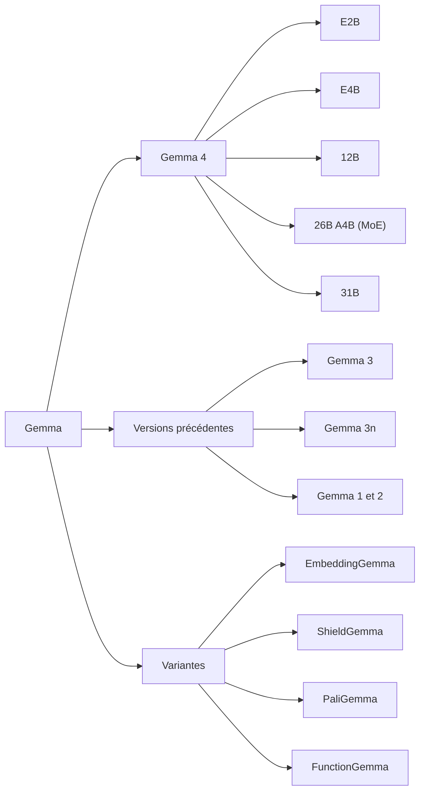

# La famille Gemma

> [!NOTE]
> Dans cette leçon, vous allez vous repérer dans la famille Gemma : les cinq tailles de Gemma 4, ce que signifient « E2B », « A4B » ou « -it », les variantes spécialisées, et comment savoir quels modèles Gemma votre clé d'API peut appeler.

## Gemma 4 en un tableau

D'après la documentation officielle (ai.google.dev, consultée le 2026-10-15), Gemma 4 existe en cinq tailles. Toutes acceptent texte et images ; l'audio est natif sur E2B, E4B et 12B.

| Modèle | Type | Contexte | Usage visé |
| --- | --- | --- | --- |
| Gemma 4 E2B | « effectif » 2 milliards de paramètres | 128K | mobile, navigateur, objets connectés |
| Gemma 4 E4B | « effectif » 4 milliards | 128K | portable, petit serveur |
| Gemma 4 12B | dense | 256K | poste avec GPU grand public |
| Gemma 4 26B A4B | mélange d'experts (MoE) | 256K | serveur, bon rapport qualité/vitesse |
| Gemma 4 31B | dense | 256K | qualité maximale de la famille |

Quelques mots de vocabulaire :

- **Paramètres** : les nombres appris par le modèle ; « 31B » signifie 31 milliards (*billion*). Plus il y en a, plus le modèle est capable en général, et plus il demande de mémoire.
- **E (effective)** : les modèles E2B et E4B sont conçus pour se comporter, en coût de calcul, comme des modèles de 2 et 4 milliards de paramètres actifs.
- **MoE et A4B** : un **mélange d'experts** contient plusieurs sous-réseaux (« experts ») et n'en active qu'une partie pour chaque token. « 26B A4B » : 26 milliards de paramètres au total, environ 4 milliards **actifs** par token. Il faut de la mémoire pour les 26 milliards, mais le calcul ressemble à celui d'un modèle de 4 milliards.
- **Contexte** : la quantité de texte (en tokens) que le modèle peut lire d'un coup ; 128K ≈ 128 000 tokens.



## « -it » ou pas : base et instruction

Chaque taille existe en deux versions :

- **pré-entraînée** (*base*, par exemple `gemma-4-E2B`) : elle complète du texte ; utile comme point de départ pour un affinage (*fine-tuning*) ;
- **instruction-tuned** (`-it`, par exemple `gemma-4-E2B-it`) : affinée pour suivre des consignes et dialoguer. C'est celle qu'on utilise pour un assistant.

```quiz
question: "Que signifie « 26B A4B » ?"
options:
  - "26 Go sur disque, 4 Go de mémoire vive"
  - "Un mélange d'experts de 26 milliards de paramètres au total, dont environ 4 milliards sont activés par token"
  - "La 26e version, révision A4"
answer: 1
explanation: "Toute la mémoire des 26 milliards de paramètres est nécessaire pour charger le modèle, mais le calcul par token ne mobilise qu'environ 4 milliards de paramètres, d'où une vitesse proche d'un petit modèle."
```

## Les variantes spécialisées

| Variante | Rôle |
| --- | --- |
| EmbeddingGemma | produire des **embeddings** (vecteurs) pour la recherche sémantique et le RAG |
| ShieldGemma | classer des contenus selon des politiques de sécurité (garde-fou) |
| PaliGemma | vision et langage (description d'images, lecture de documents) |
| FunctionGemma | appel de fonctions (*function calling*) |
| Gemma 3n | génération précédente optimisée pour les appareils mobiles |

## Gemma raisonne avant de répondre

Les modèles Gemma 4 servis par l'API Gemini **raisonnent** avant de répondre, et le point d'accès compatible OpenAI renvoie ce raisonnement dans le texte, entre balises `<thought>…</thought>`. Lors de nos essais, les paramètres `reasoning_effort` (`none`, `low`) ont été refusés pour Gemma (`Thinking budget is not supported for this model.`). Le client du lab retire donc ces blocs avant de noter la réponse :

```python title="files/client_llm.py (extrait)"
PENSEE = re.compile(r"<(thought|think)>.*?</\1>", re.DOTALL)  # raisonnement renvoyé dans le texte

def nettoyer(texte: str) -> str:
    """Retire les blocs de raisonnement <thought>…</thought> ou <think>…</think>."""
    return PENSEE.sub("", texte or "").strip()
```

> [!WARNING]
> Ce raisonnement prend du temps et des tokens, même s'il est retiré de l'affichage. Prévoyez un `max_tokens` suffisant : avec `max_tokens=50`, notre premier essai s'est arrêté au milieu du raisonnement (`finish_reason: length`), sans réponse.

```quiz
question: "Pourquoi le client retire-t-il les balises <thought> avant la notation ?"
options:
  - "Pour économiser des tokens"
  - "Parce que le raisonnement contient souvent des nombres et des mots qui feraient passer à tort une vérification automatique"
  - "Parce que l'API l'exige"
answer: 1
explanation: "Le raisonnement mentionne des hypothèses intermédiaires. Les noter fausserait le score : seule la réponse finale doit être évaluée."
```

## Exercice : quel Gemma pour quel poste ?

Choisissez une taille de Gemma 4 pour : (a) une extension de navigateur qui reformule des e-mails hors ligne ; (b) un serveur interne avec un GPU de 24 Go qui répond à une centaine de salariés ; (c) une application qui doit lire des documents de 200 pages en une fois.

<details>
<summary>Voir la solution</summary>

- (a) **E2B** : prévu pour le navigateur et le mobile, il tient en environ 3 Go en 4 bits.
- (b) **26B A4B** quantifié en 4 bits (environ 14,4 Go de poids selon la documentation) : il laisse de la place au contexte sur 24 Go et répond vite grâce à ses 4 milliards de paramètres actifs. Un **12B** est une alternative plus légère.
- (c) Un modèle à **256K** de contexte (12B, 26B A4B ou 31B). Attention : la mémoire du contexte (cache KV, voir leçon suivante) s'ajoute à celle des poids.

</details>

## Résultat obtenu

Interrogation le 2026-10-15 de l'API Gemini (SDK `google-genai`, `client.models.list()`) : les deux modèles Gemma hébergés et leurs limites.

```text
models/gemma-4-26b-a4b-it 262144 32768 ['generateContent', 'countTokens']
models/gemma-4-31b-it     262144 32768 ['generateContent', 'countTokens']
```

262 144 tokens en entrée, soit les 256K annoncés ; 32 768 tokens maximum en sortie.

## Je sais faire

- [ ] Citer les cinq tailles de Gemma 4 et leur usage
- [ ] Expliquer « E », « MoE / A4B » et « -it »
- [ ] Choisir une variante spécialisée (embeddings, sécurité, vision)
- [ ] Lister les modèles Gemma accessibles avec ma clé
