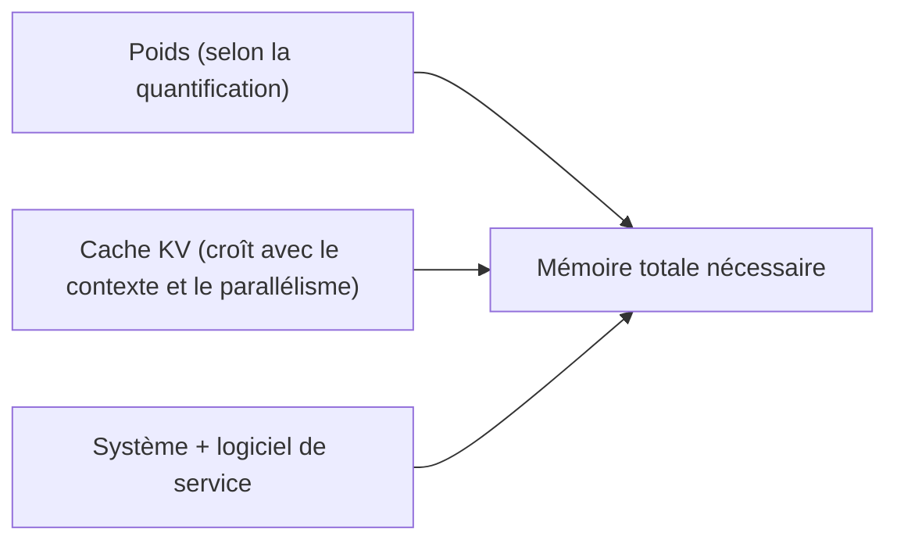

# Quantification et matériel nécessaire

> [!NOTE]
> Dans cette leçon, vous allez comprendre la **quantification** (stocker les poids sur 8 ou 4 bits au lieu de 16), le format de fichier **GGUF**, et estimer en deux minutes la mémoire dont un modèle a besoin sur votre machine.

## Le calcul de base

Un modèle doit tenir **en mémoire** (la VRAM du GPU, ou la RAM pour un calcul sur processeur ou sur un Mac à mémoire unifiée). La taille des poids se calcule simplement :

$$\text{mémoire des poids} \approx \text{nombre de paramètres} \times \text{octets par paramètre}$$

| Précision | Octets par paramètre | Gemma 4 31B (calcul brut) |
| --- | --- | --- |
| BF16 (16 bits) | 2 | 31 × 2 = 62 Go |
| 8 bits | 1 | 31 Go |
| 4 bits | 0,5 | 15,5 Go |

La documentation de Gemma donne des valeurs un peu plus élevées, car elle ajoute **20 %** de marge, mais ne compte toujours **que les poids** :

| Modèle | BF16 | 8 bits (SFP8) | 4 bits (Q4_0) |
| --- | --- | --- | --- |
| Gemma 4 E2B | 11,4 Go | 5,7 Go | 2,9 Go |
| Gemma 4 E4B | 17,9 Go | 8,9 Go | 4,5 Go |
| Gemma 4 12B | 26,7 Go | 13,4 Go | 6,7 Go |
| Gemma 4 26B A4B | 57,7 Go | 28,8 Go | 14,4 Go |
| Gemma 4 31B | 69,9 Go | 34,9 Go | 17,5 Go |

*Source : ai.google.dev/gemma/docs/core, consultée le 2026-10-15.*

## Ce qui s'ajoute : le contexte

Pendant la génération, le modèle garde en mémoire une représentation de chaque token déjà lu : le **cache KV** (*key/value cache*). Sa taille grandit **avec la longueur du contexte** et avec le nombre de requêtes servies en parallèle. Pour quelques milliers de tokens, c'est modeste ; pour 128K tokens, cela peut représenter plusieurs gigaoctets. Ajoutez aussi le système d'exploitation et le logiciel de service.

> [!TIP]
> Règle d'ordre de grandeur : prévoyez **les poids quantifiés + 20 à 50 %** pour un usage courant à contexte court. Pour de longs documents, limitez la taille du contexte au lancement (`-c` dans llama.cpp, `--context-length` dans LM Studio) plutôt que de garder le maximum par défaut.



## La quantification

**Quantifier**, c'est représenter chaque poids avec moins de bits : au lieu d'un nombre à virgule sur 16 bits, on stocke un entier sur 8 ou 4 bits et un facteur d'échelle par petit bloc de poids. On divise la mémoire par 2 ou par 4, et la génération va souvent plus vite (moins de données à lire), au prix d'une **légère perte de qualité**, plus marquée en 4 bits et sur les petits modèles.

Google publie aussi des versions **QAT** (*quantization-aware training*) : le modèle est entraîné en tenant compte de la quantification, ce qui limite la perte en 4 bits. Sur Hugging Face, elles portent `qat` dans leur nom (par exemple `google/gemma-4-E2B-it-qat-q4_0-gguf`).

```quiz
question: "Gemma 4 12B en 4 bits pèse environ 6,7 Go de poids. Votre portable a un GPU de 8 Go. Que faut-il anticiper ?"
options:
  - "Rien, 6,7 Go < 8 Go"
  - "Le cache KV et le logiciel s'ajoutent : il faudra limiter la taille du contexte, ou déborder une partie du calcul sur le processeur, plus lentement"
  - "Que le modèle refusera de démarrer en 4 bits"
answer: 1
explanation: "Les chiffres de la documentation n'incluent ni le cache KV ni le logiciel. Avec seulement 1,3 Go de marge, un contexte court est indispensable ; llama.cpp permet aussi de ne charger qu'une partie des couches sur le GPU (-ngl)."
```

## Le format GGUF

**GGUF** est le format de fichier de **llama.cpp**, repris par Ollama et LM Studio. Un seul fichier contient les poids quantifiés, le tokenizer et les métadonnées (architecture, gabarit de conversation). Le suffixe indique la quantification :

| Suffixe | Bits | Commentaire |
| --- | --- | --- |
| `BF16`, `F16` | 16 | pas de perte, le plus lourd |
| `Q8_0` | 8 | perte quasi imperceptible |
| `Q6_K`, `Q5_K_M` | 6, 5 | compromis |
| `Q4_K_M`, `Q4_0` | 4 | le choix le plus courant en local |

Pour les modèles multimodaux, un second fichier `mmproj-…gguf` contient l'encodeur d'images.

```quiz
question: "Quel fichier choisir pour un premier essai de Gemma 4 E2B sur un portable de 8 Go de RAM sans GPU dédié ?"
options:
  - "gemma-4-E2B-it-BF16.gguf"
  - "gemma-4-E2B-it-Q4_0.gguf"
  - "mmproj-gemma-4-E2B-it-BF16.gguf"
answer: 1
explanation: "La version 4 bits pèse moins de 3 Go et laisse de la marge au système. Le fichier mmproj n'est que l'encodeur d'images, pas le modèle de langage."
```

## Exercice : dimensionner un serveur

Votre équipe veut servir Gemma 4 26B A4B à 10 utilisateurs simultanés, avec des contextes d'environ 8 000 tokens. Vous hésitez entre un GPU de 24 Go et un de 48 Go. Raisonnez en ordre de grandeur.

<details>
<summary>Voir la solution</summary>

- Poids en 4 bits : environ **14,4 Go** (documentation). En 8 bits : 28,8 Go, impossible sur 24 Go.
- Sur **24 Go** en 4 bits, il reste moins de 10 Go pour le cache KV de 10 conversations de 8 000 tokens et le logiciel : c'est possible avec un parallélisme réduit, mais serré.
- Sur **48 Go**, le 4 bits laisse une grande marge, et le 8 bits devient envisageable si la qualité l'exige.

La seule réponse fiable vient d'une **mesure** : lancez le serveur avec la configuration visée, puis observez la mémoire occupée (`nvidia-smi`, ou `ollama ps` qui indique la répartition GPU/CPU) sous une charge réaliste.

</details>

## Résultat obtenu

Fichiers réellement publiés pour Gemma 4 E2B au format GGUF, lus le 2026-10-15 par l'API Hugging Face (`/api/models/ggml-org/gemma-4-E2B-it-GGUF/tree/main`) :

```text
gemma-4-E2B-it-BF16.gguf         9.31 Go
gemma-4-E2B-it-Q8_0.gguf         4.97 Go
gemma-4-E2B-it-Q4_0.gguf         2.84 Go
mmproj-gemma-4-E2B-it-BF16.gguf  0.99 Go
mmproj-gemma-4-E2B-it-Q8_0.gguf  0.56 Go
```

Le rapport BF16 / Q4_0 est d'environ 3,3, et non 4 : les outils de conversion gardent en général certains tenseurs (par exemple la table d'embeddings) en plus haute précision, et chaque bloc 4 bits stocke aussi son facteur d'échelle.

## Je sais faire

- [ ] Calculer la mémoire des poids d'un modèle selon sa précision
- [ ] Expliquer ce qu'est le cache KV et pourquoi il s'ajoute
- [ ] Expliquer la quantification, QAT et lire un suffixe GGUF
- [ ] Dimensionner une machine en ordre de grandeur, puis vérifier par la mesure
