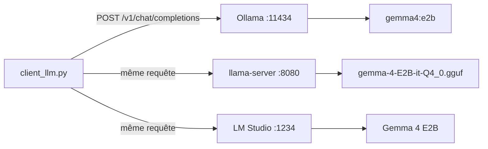

# Ollama, llama.cpp et LM Studio

> [!NOTE]
> Dans cette leçon, vous allez découvrir les trois façons les plus répandues de faire tourner Gemma sur votre machine, avec les commandes exactes de leur documentation officielle (vérifiées le 2026-10-15), et le point commun qui les rend interchangeables : une **API compatible OpenAI**.

## Trois outils, un même principe

Tous trois chargent un modèle (souvent au format GGUF), l'exécutent sur le GPU ou le processeur, et exposent un **serveur HTTP local** qui parle le même dialecte que l'API d'OpenAI : `POST /v1/chat/completions`. Votre code ne change donc pas d'un outil à l'autre, seule l'adresse change.

| | Ollama | llama.cpp | LM Studio |
| --- | --- | --- | --- |
| Pour qui | développeurs, serveurs | contrôle fin, intégration | utilisateurs qui préfèrent une interface graphique |
| Interface | ligne de commande + service | ligne de commande | application de bureau + CLI `lms` |
| Modèles | bibliothèque Ollama (`gemma4:e2b`) | tout GGUF, notamment Hugging Face (`-hf`) | catalogue intégré (GGUF, MLX sur Mac) |
| Adresse compatible OpenAI | `http://localhost:11434/v1` | `http://localhost:<port>/v1` | `http://localhost:1234/v1` (port des exemples de la doc) |



## Ollama

```bash title="terminal"
curl -fsSL https://ollama.com/install.sh | sh   # Linux et macOS
# Windows (PowerShell) : irm https://ollama.com/install.ps1 | iex

ollama pull gemma4:e2b     # télécharge le modèle (4,6 à 7,5 Go selon la variante, d'après la bibliothèque)
ollama run gemma4:e2b      # conversation dans le terminal
ollama ps                  # modèles chargés et répartition GPU/CPU
ollama ls                  # modèles téléchargés
ollama stop gemma4:e2b     # décharge le modèle de la mémoire
ollama rm gemma4:e2b       # supprime le modèle du disque
```

Les étiquettes de Gemma 4 dans la bibliothèque Ollama : `gemma4:e2b`, `gemma4:e4b`, `gemma4:12b`, `gemma4:26b`, `gemma4:31b` (et des variantes `-mlx` pour les Mac). `ollama serve` démarre le service s'il ne tourne pas déjà ; `ollama serve --help` liste les variables d'environnement de configuration.

> [!WARNING]
> L'étiquette `gemma4:31b-cloud` existe aussi : elle fait tourner le modèle **sur les serveurs d'Ollama**, pas chez vous. Si votre motivation est la confidentialité, vérifiez qu'aucune étiquette `-cloud` n'est utilisée.

## llama.cpp

llama.cpp est le moteur d'inférence en C/C++ à l'origine du format GGUF. La documentation actuelle propose un installateur en une ligne, ainsi que des binaires précompilés, une image Docker et la compilation depuis les sources :

```bash title="terminal"
curl -LsSf https://llama.app/install.sh | sh
# Le README de ggml-org/gemma-4-E2B-it-GGUF propose :
llama serve -hf ggml-org/gemma-4-E2B-it-GGUF
# Forme documentée du serveur, avec quantification et port explicites :
llama-server -hf ggml-org/gemma-4-E2B-it-GGUF:Q4_0 --port 8080 -c 8192
```

- `-hf <utilisateur>/<modèle>[:quantification]` télécharge le GGUF depuis Hugging Face ;
- `-c` fixe la taille du contexte (donc la mémoire du cache KV) ;
- `-ngl N` place N couches sur le GPU (le reste tourne sur le processeur).

> [!TIP]
> Passez toujours `--port` explicitement. Le port par défaut a changé selon les versions (la documentation actuelle du serveur indique `127.0.0.1:9931`), et les tutoriels plus anciens utilisent 8080.

## LM Studio

LM Studio est une application de bureau. Elle inclut la CLI `lms` :

```bash title="terminal"
lms get gemma-4                       # recherche et téléchargement interactifs
lms load <modele> --context-length=8192
lms server start --port 1234          # sans --port, reprend le dernier port utilisé
```

`lms get` accepte une quantification après `@` (forme documentée : `lms get llama-3.1-8b@q4_k_m`) et des filtres `--gguf` ou `--mlx`.

```quiz
question: "Que faut-il changer dans le code d'une application pour passer d'Ollama à LM Studio ?"
options:
  - "Réécrire les appels avec le SDK propre à LM Studio"
  - "Seulement l'URL de base (et le nom du modèle) : les deux exposent /v1/chat/completions"
  - "Convertir le modèle au format MLX"
answer: 1
explanation: "Les deux serveurs implémentent l'API compatible OpenAI. Le client du lab ne change que base_url et model."
```

```quiz
question: "Quel réglage de llama-server agit directement sur la mémoire consommée par le contexte ?"
options:
  - "-c (--ctx-size)"
  - "--port"
  - "-hf"
answer: 0
explanation: "La taille du contexte détermine la taille du cache KV. -ngl, lui, répartit les couches entre GPU et processeur."
```

## Exercice : un serveur pour toute l'équipe

Vous voulez rendre votre Ollama accessible aux collègues du réseau local. Quels risques, et quelles précautions ?

<details>
<summary>Voir la solution</summary>

Par défaut, ces serveurs écoutent sur `127.0.0.1` (votre machine seulement) et **n'ont pas d'authentification** : la « clé » demandée par le client OpenAI est ignorée par Ollama. Ouvrir l'écoute sur le réseau donne à n'importe quel poste le droit d'utiliser votre GPU et de lire les réponses.

Précautions : placer le serveur derrière un proxy inverse avec authentification (et HTTPS), limiter l'accès par pare-feu aux postes autorisés, superviser la charge. Pour un vrai service d'équipe, préférez un déploiement géré avec authentification, comme Cloud Run (leçon du module 3).

</details>

## Résultat obtenu

Ollama n'est pas installé sur la machine de test, et la consigne interdisait de télécharger un modèle de plus de 2 Go (le plus petit GGUF de Gemma 4 pèse 2,84 Go). La même requête compatible OpenAI a donc été envoyée, le 2026-10-15, au point d'accès OpenAI de l'API Gemini, qui sert Gemma :

```text
$ curl -s https://generativelanguage.googleapis.com/v1beta/openai/chat/completions \
    -H "Authorization: Bearer $GEMINI_API_KEY" -H "Content-Type: application/json" \
    -d '{"model":"gemma-4-26b-a4b-it","messages":[…"Réponds en un mot : capitale de la France ?"],"max_tokens":1024}'
{"choices":[{"finish_reason":"stop","index":0,"message":{"content":"<thought>*   Question: \"Réponds en un mot :
capitale de la France ?\" … *   \"Paris\"</thought>Paris", …}}],"model":"gemma-4-26b-a4b-it",
"object":"chat.completion","usage":{"completion_tokens":1,"prompt_tokens":26,"total_tokens":101}}
```

Avec Ollama, seule l'URL (`http://localhost:11434/v1/chat/completions`) et le nom du modèle (`gemma4:e2b`) changeraient.

## Je sais faire

- [ ] Installer Ollama et gérer un modèle (`pull`, `run`, `ps`, `stop`, `rm`)
- [ ] Servir un GGUF de Hugging Face avec llama.cpp en fixant port et contexte
- [ ] Démarrer le serveur de LM Studio en ligne de commande
- [ ] Expliquer pourquoi ces serveurs ne doivent pas être exposés sans authentification
