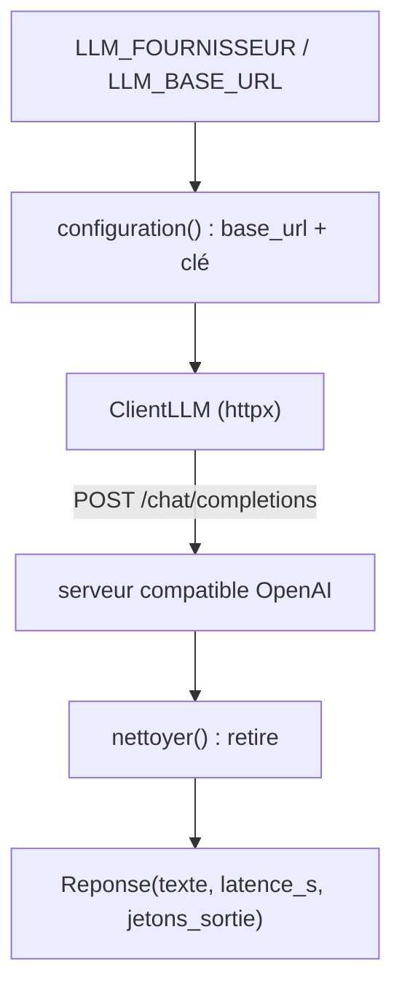

# Un client compatible OpenAI, agnostique du fournisseur

> [!NOTE]
> Dans cette leçon, vous allez écrire `client_llm.py`, un client d'une centaine de lignes qui parle à Ollama, llama.cpp, LM Studio, l'API Gemini (Gemma et Gemini) et Vertex AI **avec le même code**, gère les erreurs 429/503 et se teste sans serveur grâce à `httpx.MockTransport`.

## Pourquoi pas le SDK de chaque fournisseur ?

Chaque fournisseur a son SDK (`google-genai`, `ollama`, `openai`…). Les utiliser tous, c'est écrire autant de variantes du même appel. Or tous exposent aussi l'**API compatible OpenAI**, un format devenu standard de fait : une requête `POST {base_url}/chat/completions` avec un corps `{"model", "messages", …}` et un en-tête `Authorization: Bearer <clé>`. Un seul client HTTP suffit.

| Fournisseur | `base_url` | Clé |
| --- | --- | --- |
| API Gemini | `https://generativelanguage.googleapis.com/v1beta/openai` | clé d'API Gemini |
| Vertex AI | `https://{région}-aiplatform.googleapis.com/v1/projects/{projet}/locations/{région}/endpoints/openapi` | jeton OAuth (identifiants ADC), modèle préfixé `google/` |
| Ollama | `http://localhost:11434/v1` | ignorée (`ollama` ou n'importe quoi) |
| llama.cpp | `http://localhost:8080/v1` (selon `--port`) | ignorée par défaut |
| LM Studio | `http://localhost:1234/v1` | ignorée par défaut |



## Le cœur du client

```python title="files/client_llm.py (extrait)"
def configuration(fournisseur: str | None = None) -> tuple[str, str]:
    """Renvoie (base_url, cle) selon le fournisseur choisi."""
    fournisseur = fournisseur or os.environ.get("LLM_FOURNISSEUR", "gemini")
    if os.environ.get("LLM_BASE_URL"):
        return os.environ["LLM_BASE_URL"].rstrip("/"), os.environ.get("LLM_API_KEY", "local")
    if fournisseur == "gemini":
        return BASES["gemini"], os.environ.get("GEMINI_API_KEY") or os.environ["GOOGLE_API_KEY"]
    if fournisseur == "vertex":
        projet, region = os.environ["GOOGLE_CLOUD_PROJECT"], os.environ.get("GOOGLE_CLOUD_LOCATION", "europe-west1")
        base = f"https://{region}-aiplatform.googleapis.com/v1/projects/{projet}/locations/{region}/endpoints/openapi"
        return base, _jeton_vertex()
    if fournisseur in BASES:
        return BASES[fournisseur], "local"   # les serveurs locaux ignorent la clé
    raise ValueError(f"Fournisseur inconnu : {fournisseur}")
```

```python title="files/client_llm.py (extrait)"
def discuter(self, modele, question, systeme=None, max_tokens=2048) -> Reponse:
    messages = ([{"role": "system", "content": systeme}] if systeme else []) + [{"role": "user", "content": question}]
    corps = {"model": modele, "messages": messages, "max_tokens": max_tokens, "temperature": 0}
    for essai in range(self.essais):
        debut = time.perf_counter()
        r = self.http.post("/chat/completions", json=corps)
        latence = time.perf_counter() - debut
        if r.status_code in (429, 500, 503) and essai < self.essais - 1:
            time.sleep(3 * 2 ** essai)   # 3, 6, 12, 24, 48 s ; la latence mesurée exclut l'attente
            continue
        r.raise_for_status()
        ...
```

Trois choix à noter :

- `temperature: 0` rend les réponses aussi reproductibles que possible, indispensable pour un banc d'essai.
- La latence est mesurée **par tentative** : l'attente due à un 429 n'est pas comptée comme lenteur du modèle.
- L'attente double à chaque essai (**backoff exponentiel**). Lors du test sur Vertex AI, la première version (2, 4, 8, 16 s) a échoué sur un 429 persistant ; avec 3 à 48 s, le banc est passé.

> [!WARNING]
> La clé ne figure jamais dans le code : elle vient de l'environnement ou d'un fichier `.env` (lu par `python-dotenv`). Fournissez un `.env.example` avec des valeurs factices et ajoutez `.env` au `.gitignore`.

```quiz
question: "Sur Vertex AI, quel nom de modèle faut-il passer au point d'accès compatible OpenAI ?"
options:
  - "gemini-2.5-flash"
  - "google/gemini-2.5-flash"
  - "projects/mon-projet/models/gemini-2.5-flash"
answer: 1
explanation: "Le point d'accès OpenAI de Vertex AI attend l'éditeur en préfixe (google/). L'API Gemini, elle, accepte le nom court (gemini-3.5-flash, gemma-4-31b-it)."
```

## Tester sans serveur : `httpx.MockTransport`

`httpx` permet de remplacer la couche réseau par une fonction Python. On simule ainsi un serveur qui répond d'abord 429, puis un texte avec raisonnement :

```python title="files/test_bench.py (extrait)"
def test_client_agnostique_et_reessai(monkeypatch):
    monkeypatch.setattr("client_llm.time.sleep", lambda s: None)
    transport, appels = _faux_serveur([(429, ""), (200, "<thought>…</thought>Paris")])
    client = ClientLLM("http://localhost:11434/v1", "local", transport=transport)
    r = client.discuter("gemma4:e2b", "Capitale ?", "Sois bref.")
    assert r.texte == "Paris" and r.jetons_sortie == 3
    assert len(appels) == 2 and appels[0]["model"] == "gemma4:e2b"
```

```quiz
question: "Pourquoi remplacer time.sleep dans ce test ?"
options:
  - "Pour que le test ne dure pas 3 secondes à cause du réessai après le 429 simulé"
  - "Parce que time.sleep est interdit dans pytest"
  - "Pour mesurer la latence"
answer: 0
explanation: "Le test vérifie la logique de réessai, pas l'attente. Remplacer sleep le rend instantané (les 22 tests passent en 0,04 s)."
```

## Exercice : ajouter vLLM

Votre équipe infra sert Gemma avec **vLLM** (un serveur d'inférence haute performance) à l'adresse `http://gpu-interne:8000/v1`, protégé par un jeton. Comment l'utiliser avec le banc d'essai, sans modifier le code ?

<details>
<summary>Voir la solution</summary>

vLLM expose lui aussi une API compatible OpenAI. Il suffit de deux variables :

```bash title="terminal"
export LLM_BASE_URL=http://gpu-interne:8000/v1
export LLM_API_KEY="$JETON_VLLM"       # lu depuis votre gestionnaire de secrets
python bench.py --modeles google/gemma-4-E4B-it
```

`LLM_BASE_URL` a priorité sur `LLM_FOURNISSEUR`. Le nom du modèle est celui sous lequel vLLM le sert (souvent l'identifiant Hugging Face). Vérifiez-le avec `ClientLLM.depuis_env().modeles()`.

</details>

## Résultat obtenu

`pytest -v` dans `files/`, sans clé ni serveur, le 2026-10-15 (extrait) :

```text
test_bench.py::test_nettoyage_du_raisonnement PASSED                     [ 86%]
test_bench.py::test_configuration_par_fournisseur PASSED                 [ 90%]
test_bench.py::test_client_agnostique_et_reessai PASSED                  [ 95%]
test_bench.py::test_banc_complet_avec_faux_serveur PASSED                [100%]
============================== 22 passed in 0.04s ==============================
```

Puis le même client, réel, sur l'API Gemini et sur Vertex AI : voir la leçon « Gemma contre Gemini ».

## Je sais faire

- [ ] Appeler cinq fournisseurs différents avec un seul client compatible OpenAI
- [ ] Obtenir un jeton Vertex AI à partir des identifiants ADC
- [ ] Réessayer proprement sur 429/503 sans fausser la latence
- [ ] Tester un client HTTP sans réseau avec `httpx.MockTransport`
