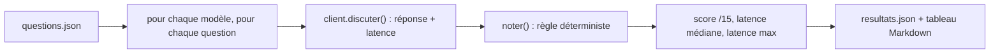

# Construire un banc d'essai qualité + latence

> [!NOTE]
> Dans cette leçon, vous allez construire `bench.py` : un jeu de 15 questions représentatives d'un assistant interne, une **notation automatique sans LLM-juge**, et une mesure de latence. L'objectif : remplacer « Gemma a l'air bien » par un chiffre reproductible.

## Les trois ingrédients d'un banc d'essai

1. **Des questions qui ressemblent à votre usage réel**, pas à un examen générique. Ici : calculs de TVA, dates d'échéance, extraction JSON, tri de tickets, lecture de politiques internes, agrégats de données, SQL.
2. **Une réponse attendue vérifiable**, avec un format imposé (« réponds par le nombre seul ») pour que la vérification soit fiable.
3. **Un protocole fixe** : même message système, `temperature: 0`, requêtes l'une après l'autre (pour que la latence d'une question ne soit pas perturbée par les autres).



## Les questions

```json title="files/questions.json (extrait)"
{"id": "q02", "categorie": "calcul", "question": "Un abonnement coûte 240 € HT par an. Quel est le prix TTC avec une TVA de 20 % ? Réponds par le nombre seul, en euros.", "type": "nombre", "attendu": 288},
{"id": "q06", "categorie": "extraction", "question": "Extrais en JSON avec les clés nom, ville et montant (nombre) : « Commande de Léa Martin, livrée à Nantes, pour un total de 129,90 euros. » Réponds uniquement par le JSON.", "type": "json", "attendu": {"nom": "Léa Martin", "ville": "Nantes", "montant": 129.9}},
{"id": "q10", "categorie": "lecture", "question": "Politique interne : « … Au-delà de 500 €, l'accord du manager est obligatoire. » Une dépense de 650 € faite il y a 10 jours nécessite-t-elle l'accord du manager ? Réponds par OUI ou NON.", "type": "contient", "attendu": ["OUI"]}
```

Les noms et montants sont **fictifs**. Le jeu complet : [questions.json](../files/questions.json).

## La notation sans LLM-juge

Un **LLM-juge** (un modèle qui note les réponses d'un autre) est pratique pour des réponses ouvertes, mais il coûte des appels, peut se tromper et favorise parfois sa propre famille de modèles. Quand on peut imposer un format, une règle déterministe est plus fiable :

| Type | Règle | Exemple accepté |
| --- | --- | --- |
| `contient` | un des mots attendus, comme mot entier, sans tenir compte de la casse | « Négatif » pour `NÉGATIF` |
| `nombre` | un nombre du texte égal à l'attendu (à 0,01 près), formats `1 350` et `288,00` compris | « 1 350 / 15 = 90 » |
| `json` | premier bloc `{…}` décodé, chaque clé comparée | JSON entouré de ```` ```json ```` |
| `regex` | expression régulière | `SELECT COUNT(*) FROM commandes WHERE statut = 'annulee'` |

```python title="files/bench.py (extrait)"
def noter(q: dict, texte: str) -> bool:
    """Note une réponse sans LLM-juge : règles déterministes selon le type de question."""
    if q["type"] == "contient":
        return any(re.search(rf"(?<!\w){re.escape(a)}(?!\w)", texte, re.I) for a in q["attendu"])
    if q["type"] == "nombre":
        return any(abs(n - q["attendu"]) < 0.01 for n in nombres(texte))
    ...
```

> [!WARNING]
> La règle `nombre` accepte une réponse qui **contient** le bon nombre parmi d'autres. Un modèle bavard qui recopie l'énoncé (« 240 € HT + 20 % = 288 € ») passe, ce qui est voulu ; mais un modèle qui énumère plusieurs candidats passerait aussi. C'est pourquoi le format « le nombre seul » est imposé, et qu'il faut **relire** un échantillon des réponses.

```quiz
question: "La question q11 attend NON. Le modèle répond « Non, jamais le lundi. ». La règle contient l'accepte-t-elle ?"
options:
  - "Oui : NON apparaît comme mot entier, la casse est ignorée"
  - "Non : la réponse doit être exactement NON"
  - "Non : la virgule empêche la correspondance"
answer: 0
explanation: "La règle cherche le mot entier sans tenir compte de la casse. Le test test_notation vérifie justement ce cas (q11, « Non, jamais »)."
```

## La latence

On mesure le **temps de réponse complet** côté client (de l'envoi de la requête à la réception de la réponse entière), et on résume par la **médiane** (la valeur du milieu, peu sensible à une réponse exceptionnellement lente) et le **maximum**.

> [!TIP]
> Pour une interface de chat en flux (*streaming*), la métrique qui compte pour l'utilisateur est plutôt le **temps jusqu'au premier token**. Pour un traitement par lots, c'est le **débit** (tokens par seconde ou requêtes par minute). Choisissez la métrique de votre usage.

```quiz
question: "Pourquoi le banc envoie-t-il les questions l'une après l'autre plutôt qu'en parallèle ?"
options:
  - "Parce que l'API compatible OpenAI ne permet pas le parallélisme"
  - "Pour que la latence mesurée reflète une requête isolée, sans file d'attente ni quota partagé entre requêtes simultanées"
  - "Pour économiser des tokens"
answer: 1
explanation: "En parallèle, les requêtes se gênent (quota, file d'attente du serveur local) et la latence mesurée dépend du nombre de requêtes lancées. Mesurer la charge est un autre test, à faire séparément."
```

## Exercice : une question ouverte

Vous voulez ajouter « Résume cette politique de télétravail en une phrase ». Pourquoi ne rentre-t-elle dans aucun type existant, et que proposez-vous ?

<details>
<summary>Voir la solution</summary>

Un résumé n'a pas de réponse unique : aucune règle `contient` ou `regex` ne distingue un bon résumé d'un mauvais. Deux options :

1. **La contraindre** : « Combien de jours de télétravail sont autorisés et quel jour est exclu ? Réponds au format `N;JOUR` », vérifiable par `regex` (`2;lundi`).
2. **Ajouter un type `juge`** : un modèle (de préférence d'une autre famille que celui évalué) note la réponse selon une grille courte (exactitude, concision), avec quelques réponses notées à la main pour vérifier que le juge est fiable. Comptez ses appels dans le budget.

</details>

## Résultat obtenu

Les 22 tests du banc (notation, nettoyage, configuration, client simulé, banc complet à 15/15 sur un faux serveur) passent sans clé le 2026-10-15 :

```text
test_bench.py::test_quinze_questions_bien_formees PASSED                 [  4%]
test_bench.py::test_notation[q02-288,00-True] PASSED                     [ 22%]
test_bench.py::test_notation[q03-1 350 / 15 = 90-True] PASSED            [ 31%]
test_bench.py::test_notation[q06-{"nom": "Léa Martin", "ville": "Nantes", "montant": "129,90"}-False] PASSED [ 50%]
test_bench.py::test_notation[q11-Non, jamais-True] PASSED                [ 68%]
test_bench.py::test_banc_complet_avec_faux_serveur PASSED                [100%]
============================== 22 passed in 0.04s ==============================
```

## Je sais faire

- [ ] Écrire des questions représentatives avec un format de réponse vérifiable
- [ ] Noter automatiquement par règles (`contient`, `nombre`, `json`, `regex`)
- [ ] Choisir la métrique de latence adaptée (complète, premier token, débit)
- [ ] Connaître les limites d'une notation automatique
