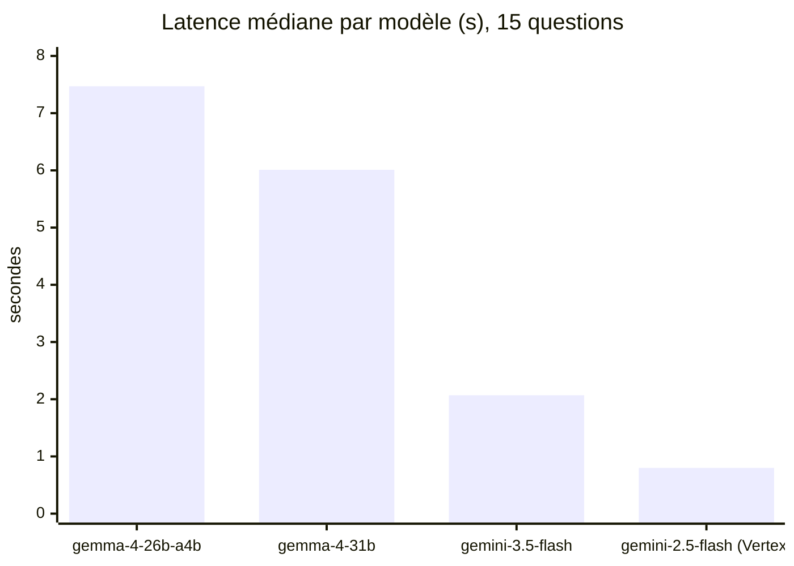

# Gemma contre Gemini : lire les résultats

> [!NOTE]
> Dans cette leçon, vous allez exécuter le banc d'essai pour de vrai sur quatre modèles (Gemma 4 26B A4B, Gemma 4 31B, Gemini 3.5 Flash par l'API Gemini, Gemini 2.5 Flash sur Vertex AI), puis apprendre à **interpréter** les chiffres, y compris ce qu'ils ne disent pas.

## Lancer les mesures

```bash title="terminal"
# API Gemini : Gemma et Gemini avec la même clé
python bench.py --modeles gemma-4-26b-a4b-it,gemma-4-31b-it,gemini-3.5-flash

# Vertex AI : identifiants ADC, région europe-west1
gcloud auth application-default login
GOOGLE_CLOUD_PROJECT=mon-projet GOOGLE_CLOUD_LOCATION=europe-west1 \
  python bench.py --fournisseur vertex --modeles google/gemini-2.5-flash

# En local, avec Ollama (non exécuté ici : voir la note plus bas)
LLM_FOURNISSEUR=ollama python bench.py --modeles gemma4:e2b
```

Coût de la mesure : 15 requêtes courtes par modèle, soit 60 appels pour les quatre modèles.

## Les résultats du 2026-10-15

| Modèle | Accès | Score | Latence médiane | Latence max |
| --- | --- | --- | --- | --- |
| gemma-4-26b-a4b-it | API Gemini | 15/15 | 7,47 s | 11,55 s |
| gemma-4-31b-it | API Gemini | 15/15 | 6,01 s | 8,18 s |
| gemini-3.5-flash | API Gemini | 15/15 | 2,07 s | 3,57 s |
| google/gemini-2.5-flash | Vertex AI, europe-west1 | 15/15 | 0,8 s | 1,86 s |



## Ce que disent les chiffres

**Qualité : égalité parfaite, donc aucune conclusion.** Quand tous les modèles obtiennent 15/15, le banc est trop facile pour les départager : c'est un **effet plafond**. On a seulement appris que les quatre modèles savent traiter ce type de tâche simple dans le format demandé, ce qui est déjà utile (Gemma suffit pour cette classe de tâches).

**Latence : un écart réel, mais à expliquer.** Les modèles Gemma raisonnent avant de répondre (bloc `<thought>` retiré par le client) : la plupart du temps mesuré est consacré à ce raisonnement, alors que la réponse finale ne fait que quelques tokens (1 à 40 tokens de sortie comptés selon les questions). Gemini 2.5 Flash sur Vertex AI répond le plus vite dans cette mesure.

> [!WARNING]
> Ces latences mesurent **un service hébergé, à un instant donné**, depuis une seule machine. Elles dépendent de la charge du service, du réseau et de la région. Gemma servi par l'API Gemini n'a **rien à voir** avec la latence de Gemma sur votre GPU : pour connaître celle-ci, il faut relancer le banc avec `LLM_FOURNISSEUR=ollama` sur le matériel cible.

```quiz
question: "Les quatre modèles obtiennent 15/15. Quelle conclusion est correcte ?"
options:
  - "Gemma 4 26B A4B est aussi bon que Gemini en général"
  - "Le banc est trop facile pour départager les modèles ; il montre seulement qu'ils réussissent tous ce type de tâche"
  - "Le banc est faux, car un modèle doit forcément faire des erreurs"
answer: 1
explanation: "Un score au plafond ne classe rien. Pour comparer, il faut des questions plus difficiles ou plus proches des cas limites de votre usage."
```

```quiz
question: "Pourquoi la latence de Gemma via l'API Gemini ne prédit-elle pas sa latence sur votre serveur ?"
options:
  - "Parce que le modèle hébergé n'est pas le même que les poids publiés"
  - "Parce que la latence dépend du matériel, de la quantification, de la charge et du logiciel de service, tous différents chez vous"
  - "Parce que l'API Gemini ralentit volontairement Gemma"
answer: 1
explanation: "Même modèle, conditions d'exécution différentes : GPU, 4 ou 16 bits, file d'attente, réglages du serveur. Seule une mesure sur la cible fait foi."
```

## Ce qu'il manque pour décider

| Question | Mesure à ajouter |
| --- | --- |
| Lequel est le meilleur sur mes cas difficiles ? | 20 à 50 questions plus dures, tirées de vrais tickets anonymisés |
| Combien ça coûte ? | tokens d'entrée et de sortie (raisonnement compris) × prix, ou coût horaire du GPU |
| Combien d'utilisateurs simultanés ? | test de charge (requêtes en parallèle) sur l'infrastructure cible |
| La qualité tient-elle en 4 bits ? | même banc sur `Q8_0` puis `Q4_0` en local |

## Exercice : casser le plafond

Ajoutez trois questions plus difficiles au jeu (avec leur règle de notation) et prédisez lesquelles séparent les modèles.

<details>
<summary>Voir la solution</summary>

Exemples qui demandent plusieurs étapes ou un piège :

```json title="files/questions.json (ajouts)"
{"id": "q16", "categorie": "dates", "question": "Un contrat signé le 31 janvier 2026 se renouvelle tous les mois, le dernier jour du mois. Quelle est la 3e date de renouvellement ? Réponds au format AAAA-MM-JJ.", "type": "contient", "attendu": ["2026-04-30"]},
{"id": "q17", "categorie": "calcul", "question": "Un prix passe de 100 € à 120 € puis baisse de 20 %. Quel est le prix final ? Réponds par le nombre seul.", "type": "nombre", "attendu": 96},
{"id": "q18", "categorie": "lecture", "question": "Politique : « Les notes de frais doivent être déposées dans les 30 jours. » Une dépense du 1er mars déposée le 2 avril est-elle dans les délais ? Réponds par OUI ou NON.", "type": "contient", "attendu": ["NON"]}
```

(31 janvier → 28 février → 31 mars → 30 avril ; 120 × 0,8 = 96 ; du 1er mars au 2 avril, 32 jours.) Mettez à jour `test_quinze_questions_bien_formees`, qui vérifie qu'il y en a 15, et faites tourner le banc. Les questions à plusieurs étapes et à pièges de calendrier sont typiquement celles où les plus petits modèles décrochent : c'est à vérifier, pas à supposer.

</details>

## Résultat obtenu

Sortie réelle de `bench.py` le 2026-10-15 (extraits) :

```text
  gemma-4-26b-a4b-it     q01 OK  11.55 s  'Na'
  gemma-4-26b-a4b-it     q06 OK   7.47 s  '```json\n{\n  "nom": "Léa Martin",\n  "ville": "Nantes",\n  "mon'
  gemma-4-31b-it         q14 OK   5.79 s  "```sql\nSELECT COUNT(*) FROM commandes WHERE statut = 'annule"
  gemini-3.5-flash       q14 OK   2.29 s  "SELECT COUNT(*) FROM commandes WHERE statut = 'annulee';"

| Modèle | Score | Latence médiane | Latence max |
| --- | --- | --- | --- |
| gemma-4-26b-a4b-it | 15/15 | 7.47 s | 11.55 s |
| gemma-4-31b-it | 15/15 | 6.01 s | 8.18 s |
| gemini-3.5-flash | 15/15 | 2.07 s | 3.57 s |

  google/gemini-2.5-flash q11 OK   1.86 s  'NON.'
| google/gemini-2.5-flash | 15/15 | 0.8 s | 1.86 s |
```

Le détail complet de la première exécution est dans [resultats_exemple.json](../files/resultats_exemple.json). **Non testé ici** : Ollama, llama.cpp et LM Studio (non installés, et téléchargement de modèles de plus de 2 Go exclu sur la machine de test).

## Je sais faire

- [ ] Lancer le même banc sur l'API Gemini, Vertex AI et un serveur local
- [ ] Reconnaître un effet plafond et en tirer la bonne conclusion
- [ ] Expliquer d'où vient l'écart de latence et ce qu'il ne prédit pas
- [ ] Lister les mesures qui manquent pour décider
