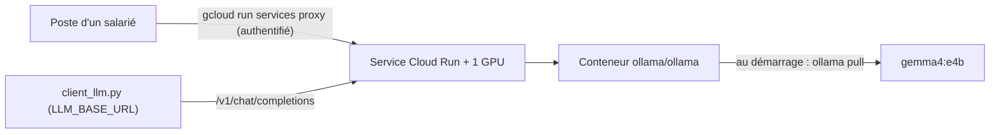

# Déployer Gemma sur Cloud Run avec GPU (explication)

> [!NOTE]
> Dans cette leçon, vous allez comprendre comment servir Gemma pour toute une équipe sur **Cloud Run avec GPU**, en suivant le tutoriel officiel de Google Cloud : image Ollama, options GPU, sonde de démarrage, accès authentifié, test et nettoyage. Cette leçon **explique** le déploiement : il n'a pas été exécuté pour cette formation (les GPU étaient exclus du budget de test).

## Pourquoi Cloud Run ?

**Cloud Run** exécute un conteneur derrière une URL HTTPS, ajoute ou retire des instances selon le trafic et peut **descendre à zéro instance** quand personne ne l'utilise. Avec un GPU attaché, c'est un moyen simple de servir un modèle ouvert sans gérer de machines : vos données restent dans votre projet Google Cloud et dans la région choisie.



## La commande du tutoriel officiel

Reproduite telle quelle depuis la documentation Cloud Run (consultée le 2026-10-15), avec les valeurs à remplacer en majuscules :

```bash title="terminal (non exécuté)"
gcloud beta run deploy SERVICE-NAME \
    --image "ollama/ollama:latest" \
    --project PROJECT_ID \
    --region REGION \
    --no-allow-unauthenticated \
    --cpu 20 \
    --memory 80Gi \
    --gpu 1 \
    --gpu-type nvidia-rtx-pro-6000 \
    --no-gpu-zonal-redundancy \
    --max-instances 1 \
    --concurrency 16 \
    --timeout 600 \
    --set-env-vars=OLLAMA_NUM_PARALLEL=16 \
    --set-env-vars=OLLAMA_HOST=0.0.0.0:8080 \
    --set-env-vars=OLLAMA_DEBUG=false \
    --set-env-vars=OLLAMA_KEEP_ALIVE=-1 \
    --startup-probe tcpSocket.port=8080,initialDelaySeconds=240,failureThreshold=1,timeoutSeconds=240,periodSeconds=240 \
    --command "bash" \
    --args="-c,(sleep 15 && ollama pull MODEL_NAME) & ollama serve"
```

| Option | Rôle |
| --- | --- |
| `--image "ollama/ollama:latest"` | image publique d'Ollama, pas de Dockerfile à écrire |
| `--gpu 1 --gpu-type nvidia-rtx-pro-6000` | un GPU par instance ; le type doit être disponible dans la région (par exemple `us-central1`) |
| `--max-instances 1` | ne pas dépasser le quota GPU du projet (3 000 milliGPU par défaut pour un nouveau projet, d'après le tutoriel) |
| `--concurrency 16` + `OLLAMA_NUM_PARALLEL=16` | 16 requêtes simultanées par instance, réglées de la même façon des deux côtés |
| `OLLAMA_HOST=0.0.0.0:8080` | Ollama écoute sur le port attendu par Cloud Run |
| `OLLAMA_KEEP_ALIVE=-1` | le modèle reste chargé en mémoire GPU |
| `--startup-probe … initialDelaySeconds=240` | laisse 4 minutes au téléchargement du modèle avant de considérer l'instance prête |
| `--no-allow-unauthenticated` | aucun accès anonyme : il faut une identité Google autorisée |

Le tutoriel propose `gemma4:e2b` ou `gemma4:e4b` pour `MODEL_NAME`. Pour 26B et 31B, il renvoie vers une architecture plus avancée (vLLM, accès VPC direct et Run:ai Model Streamer pour charger les poids plus vite).

> [!WARNING]
> Ici, le modèle est **téléchargé à chaque démarrage d'instance** : simple, mais cela allonge le démarrage à froid. En production, on intègre plutôt les poids à l'image ou on les lit depuis Cloud Storage. Vérifiez aussi le coût du GPU avec le simulateur de prix : un GPU allumé coûte nettement plus qu'un CPU, et la fonction de mise à zéro n'aide que si le service est réellement inactif.

```quiz
question: "Pourquoi la sonde de démarrage attend-elle 240 secondes ?"
options:
  - "Parce que Cloud Run limite les conteneurs GPU à 4 minutes"
  - "Parce que le conteneur télécharge le modèle au démarrage : l'instance ne doit pas recevoir de trafic avant la fin"
  - "Pour réduire la facture"
answer: 1
explanation: "La commande de démarrage lance ollama pull en arrière-plan. La sonde laisse le temps au téléchargement et au chargement en mémoire avant de déclarer l'instance prête."
```

## Tester et brancher le banc d'essai

Le service exige une authentification. Le tutoriel utilise le **proxy** de `gcloud`, qui ajoute votre identité à chaque requête :

```bash title="terminal (non exécuté)"
gcloud run services proxy SERVICE-NAME --project PROJECT_ID --region REGION --port=9090
# dans un autre terminal : le banc d'essai, sans modifier une ligne
LLM_BASE_URL=http://localhost:9090/v1 python bench.py --modeles gemma4:e4b
```

C'est la mesure qui compte vraiment : Gemma **sur votre infrastructure cible**, comparé à Gemini sur Vertex AI dans la même région.

```quiz
question: "Quelles affirmations sont vraies pour ce déploiement ?"
options:
  - "Les données des requêtes restent dans le projet et la région choisis"
  - "N'importe qui sur Internet peut appeler le service"
  - "Le banc d'essai du lab fonctionne avec LLM_BASE_URL pointant vers le proxy"
  - "Il faut réécrire le client pour Cloud Run"
answer: [0, 2]
explanation: "--no-allow-unauthenticated bloque l'accès anonyme, et Ollama expose l'API compatible OpenAI : le client agnostique s'y branche tel quel."
```

## Nettoyer

Un service GPU oublié peut coûter cher. Le tutoriel termine par :

```bash title="terminal"
gcloud run services delete SERVICE-NAME --project PROJECT_ID --region REGION
gcloud run services list --project PROJECT_ID --region REGION   # vérifier qu'il a disparu
```

## Exercice : préparer le déploiement pour l'Europe

Votre politique impose que les données restent dans l'Union européenne. Quelles vérifications faites-vous avant de lancer la commande ?

<details>
<summary>Voir la solution</summary>

1. Choisir une **région européenne** où le type de GPU voulu est proposé pour Cloud Run (la liste officielle des régions GPU est liée depuis le tutoriel) ; adapter `--gpu-type` si besoin.
2. Vérifier le **quota GPU** du projet dans cette région et garder `--max-instances` en dessous.
3. Garder `--no-allow-unauthenticated` et donner le rôle d'invocateur Cloud Run aux seuls groupes concernés.
4. Vérifier qu'aucun autre service de la chaîne (journalisation, stockage des poids) n'est configuré hors UE.
5. Estimer le coût mensuel avec le simulateur, et prévoir la commande de suppression.

</details>

## Résultat obtenu

Rien n'a été déployé sur Google Cloud pour cette formation (pas de GPU autorisé dans le budget de test) : il n'y a **aucune ressource à nettoyer**. La partie « sur GCP » a été testée réellement avec Gemini sur Vertex AI, par le point d'accès compatible OpenAI, le 2026-10-15 :

```text
$ GOOGLE_CLOUD_PROJECT=… GOOGLE_CLOUD_LOCATION=europe-west1 python bench.py --fournisseur vertex --modeles google/gemini-2.5-flash
  google/gemini-2.5-flash q01 OK   0.62 s  'Na'
  …
| google/gemini-2.5-flash | 15/15 | 0.8 s | 1.86 s |
```

## Je sais faire

- [ ] Expliquer chaque option du déploiement Ollama sur Cloud Run GPU
- [ ] Appeler un service Cloud Run authentifié via `gcloud run services proxy`
- [ ] Brancher le banc d'essai sur un service déployé
- [ ] Nettoyer et vérifier la suppression d'un service
