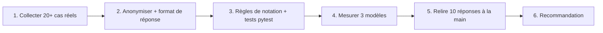

# Projet : un banc d'essai pour votre cas d'usage

> [!NOTE]
> Dans ce projet, vous allez adapter le banc d'essai à **votre** besoin : écrire vos propres questions, mesurer Gemma et Gemini, puis rédiger une recommandation argumentée (modèle, mode d'hébergement, limites) que vous pourriez présenter à votre équipe.

## Cahier des charges

Vous êtes chargé de choisir le modèle d'un **assistant interne** (par exemple : répondre aux questions sur les politiques RH, trier les tickets du support informatique, ou extraire les champs de bons de commande). Livrables :

1. un fichier `questions.json` d'**au moins 20 questions** tirées de votre métier, **anonymisées** (aucun nom, e-mail ou montant réel), avec une règle de notation pour chacune ;
2. les **résultats** du banc sur au moins trois modèles : un Gemma par l'API Gemini, un Gemini, et si possible un Gemma local (Ollama ou llama.cpp) sur votre matériel ;
3. une **note de recommandation** d'une page.



## Étapes

```bash title="terminal"
pip install -r requirements.txt
cp .env.example .env                                  # clé d'API Gemini
pytest -q                                             # 22 passed : le banc fonctionne
# remplacez questions.json par les vôtres, puis :
pytest -q                                             # adaptez test_quinze_questions_bien_formees
python bench.py --modeles gemma-4-26b-a4b-it,gemma-4-31b-it,gemini-3.5-flash --sortie mes_resultats.json
LLM_FOURNISSEUR=ollama python bench.py --modeles gemma4:e4b --sortie local.json   # si Ollama est installé
```

> [!TIP]
> Visez des questions qui **départagent** : si tous les modèles font 100 %, ajoutez des cas limites (dates de fin de mois, montants avec arrondis, consignes contradictoires, documents longs). Un banc utile laisse au moins un modèle sous les 90 %.

## Modèle de note de recommandation

| Rubrique | Contenu attendu |
| --- | --- |
| Besoin | volume estimé, sensibilité des données, latence acceptable |
| Résultats | tableau score / latence médiane / latence max par modèle, date de la mesure |
| Analyse | où chaque modèle échoue (catégories), effet plafond éventuel, limites du protocole |
| Coût | estimation API (tokens × prix du jour) contre infrastructure (GPU ou poste local) |
| Recommandation | modèle + hébergement + conditions de réexamen (nouvelle version, volume ×10…) |

```quiz
question: "Vos données contiennent des noms de clients réels. Que faites-vous avant de lancer le banc sur l'API Gemini ?"
options:
  - "Rien : l'API est sécurisée"
  - "Je les remplace par des valeurs fictives, car le banc envoie les questions à un service externe et le fichier sera partagé"
  - "Je chiffre le fichier questions.json"
answer: 1
explanation: "Le banc envoie chaque question au fournisseur, et le jeu de questions circule dans l'équipe ou dans un dépôt. Des données fictives mais réalistes suffisent pour mesurer."
```

```quiz
question: "Gemma 4 26B A4B via l'API Gemini et Gemini 3.5 Flash ont le même score sur votre banc. Gemma est plus lent. Dans quel cas recommanderiez-vous quand même Gemma ?"
options:
  - "Jamais : à score égal, le plus rapide gagne toujours"
  - "Si les données ne doivent pas quitter votre infrastructure, en l'hébergeant vous-même, après avoir mesuré sa latence sur le matériel cible"
  - "Si vous voulez utiliser l'API Gemini moins cher"
answer: 1
explanation: "La latence mesurée via l'API Gemini ne dit rien de la latence sur votre GPU. L'intérêt de Gemma tient à la confidentialité et à la maîtrise de l'hébergement : la recommandation doit s'appuyer sur une mesure locale."
```

## Exercice : relire avant de conclure

Le banc donne 18/20 à Gemma et 19/20 à Gemini. Avant d'écrire « Gemini est meilleur », que vérifiez-vous ?

<details>
<summary>Voir la solution</summary>

1. **Les échecs** : lisez les réponses notées KO dans le fichier de résultats. Un échec peut venir de la règle de notation (format « 288,0 € » non prévu, JSON valide mais clé en majuscules) plutôt que du modèle.
2. **Les réussites douteuses** : relisez une dizaine de réponses OK, surtout de type `nombre` et `contient`, pour repérer des réussites « par hasard ».
3. **La variabilité** : relancez le banc une ou deux fois. Un écart d'une question sur 20 est souvent dans le bruit ; concluez « équivalents sur ce banc » plutôt que « meilleur ».
4. **La date et les versions** : notez la date, le nom exact des modèles et la quantification, car tout cela change.

</details>

## Résultat obtenu

Le banc de référence (15 questions) exécuté pour de vrai le 2026-10-15 :

```text
| Modèle | Score | Latence médiane | Latence max |
| --- | --- | --- | --- |
| gemma-4-26b-a4b-it | 15/15 | 7.47 s | 11.55 s |
| gemma-4-31b-it | 15/15 | 6.01 s | 8.18 s |
| gemini-3.5-flash | 15/15 | 2.07 s | 3.57 s |
| google/gemini-2.5-flash | 15/15 | 0.8 s | 1.86 s |   ← Vertex AI, europe-west1
```

Exemple de recommandation tirée de ces chiffres : « Sur des tâches simples d'assistant interne, Gemma 4 et Gemini sont équivalents en exactitude ; Gemini sur Vertex AI répond le plus vite. Gemma n'est à privilégier que pour héberger les données soi-même, sous réserve d'une mesure de latence sur le GPU cible et d'un banc plus difficile. »

## Je sais faire

- [ ] Construire un jeu de questions métier anonymisé et vérifiable
- [ ] Mesurer plusieurs modèles avec le même protocole, en local et dans le cloud
- [ ] Relire les résultats avant de conclure
- [ ] Rédiger une recommandation argumentée et datée
