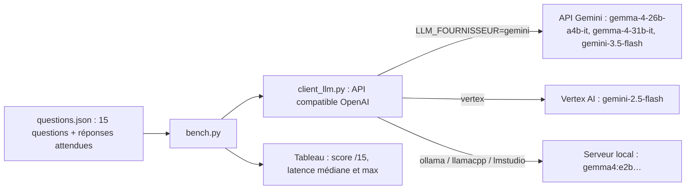

Un **modèle ouvert** (*open weights*) est un modèle dont les poids sont téléchargeables : vous pouvez le faire tourner sur votre portable, votre serveur ou votre projet cloud, sans envoyer vos données à un fournisseur. **Gemma** est la famille de modèles ouverts de Google, construite à partir des mêmes travaux de recherche que Gemini. Cette formation vous apprend à décider **quand** un modèle ouvert est le bon choix, **comment** le faire tourner en local, et à le **prouver** avec des mesures plutôt qu'avec des impressions.

Fil rouge : un **banc d'essai** (*benchmark*) de 15 questions d'assistant interne (calculs, dates, extraction JSON, classification de tickets, lecture de politiques internes, SQL), noté automatiquement, qui mesure qualité et latence. Le même code interroge Gemma et Gemini par l'API Gemini, Gemini sur Vertex AI, et Ollama, llama.cpp ou LM Studio en local.

## Ce que vous construisez

## Pour qui ?

- Développeurs, data analysts ou architectes qui doivent choisir un modèle pour un usage interne, avec des contraintes de confidentialité ou de coût.
- À l'aise avec Python, le terminal et les appels HTTP. Aucune expérience des modèles locaux requise.

## Prérequis

- Python 3.10+, `pip install -r requirements.txt` (`httpx`, `python-dotenv`, `pytest`, `google-auth` pour Vertex AI).
- Une clé d'API Gemini (Google AI Studio) : elle donne accès **à la fois** aux modèles Gemma hébergés et à Gemini, ce qui permet de faire tout le banc d'essai sans GPU.
- Facultatif : Ollama, llama.cpp ou LM Studio installé, et assez de mémoire pour un petit modèle (environ 3 Go pour Gemma 4 E2B quantifié en 4 bits).

| | En local | Sur GCP |
| --- | --- | --- |
| Gemma | Ollama, llama.cpp, LM Studio sur votre machine | API Gemini (hébergé par Google) ; Cloud Run GPU (expliqué, non déployé ici) |
| Gemini | via l'API Gemini avec une clé | Vertex AI, identifiants ADC, région `europe-west1` |
| Données | ne quittent pas votre machine | traitées par Google dans la région choisie |

## Programme

| Module | Leçons | Durée |
| --- | --- | --- |
| 1. Comprendre | Ouvert ou propriétaire : licence, confidentialité, coûts ; la famille Gemma | 1h |
| 2. En local | Quantification et matériel ; Ollama, llama.cpp, LM Studio ; un client compatible OpenAI | 1h45 |
| 3. Comparer et déployer | Construire un banc d'essai ; résultats Gemma vs Gemini ; Gemma sur Cloud Run GPU | 1h45 |
| 4. Projet final | Un banc d'essai pour votre propre cas d'usage | 30 min |

## Le code du lab

Dans [files/](./files/) : [client_llm.py](./files/client_llm.py) (client agnostique), [bench.py](./files/bench.py) (banc d'essai), [questions.json](./files/questions.json), [test_bench.py](./files/test_bench.py) (22 tests sans clé ni serveur), `resultats_exemple.json` (sortie réelle du 2026-10-15), `requirements.txt` et `.env.example`.

## Ce que vous saurez faire

- Expliquer les différences de licence, de confidentialité et de coût entre Gemma et Gemini.
- Estimer la mémoire nécessaire à un modèle selon sa taille et sa quantification.
- Servir Gemma en local et l'appeler par une API compatible OpenAI.
- Mesurer qualité et latence de plusieurs modèles avec un protocole reproductible, et en connaître les limites.
