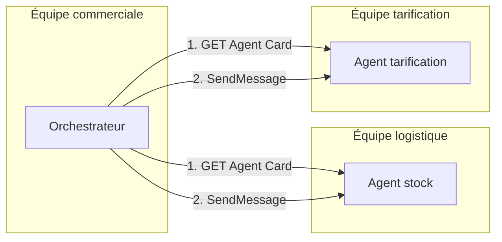

# Pourquoi A2A, et ce que dit une Agent Card

> [!NOTE]
> Dans cette leçon, vous allez comprendre quel problème résout le protocole **Agent2Agent (A2A)**, le distinguer de MCP, et lire une **Agent Card** réelle, la carte d'identité qu'un agent publie pour être découvert.

## Le problème : des agents qui ne vivent pas ensemble

Avec ADK, des `sub_agents` dans un même programme suffisent tant qu'une seule équipe maintient tout. Dès que l'agent stock appartient à la logistique et l'agent tarification au commercial, trois contraintes apparaissent :

- chaque agent est **déployé séparément** (son propre serveur, son propre rythme de mise en production) ;
- l'appelant ne connaît **pas le code** de l'appelé, seulement ce qu'il sait faire ;
- l'appelé est un **agent** : il raisonne, peut prendre du temps, renvoyer un résultat partiel ou demander une précision.

A2A est un protocole ouvert (lancé par Google, aujourd'hui hébergé par la Linux Foundation) qui standardise ce dialogue sur HTTP : **découvrir** un agent, lui **envoyer un message**, **suivre la tâche** qui en résulte.



## A2A et MCP ne font pas la même chose

| | MCP (Model Context Protocol) | A2A (Agent2Agent) |
| --- | --- | --- |
| Relie | un agent à des **outils** et des données | un agent à **un autre agent** |
| L'autre côté | une fonction déterministe | un système autonome qui raisonne |
| Unité d'échange | appel d'outil → résultat | message → **tâche** avec un état (en cours, terminée, échouée…) |
| Exemple du lab | `check_stock("CHAISE-ERGO")` | « Service stock, combien de chaises ergonomiques ? » |

Les deux se combinent : dans ce lab, l'agent stock expose son outil `check_stock` à son propre modèle, et s'expose lui-même aux autres agents en A2A.

```quiz
question: "L'agent tarification est maintenu par une autre équipe, sur un autre serveur. Que choisir pour que l'orchestrateur l'utilise ?"
options:
  - "Copier son code dans l'orchestrateur et l'ajouter en sub_agents"
  - "L'appeler en A2A à partir de son Agent Card"
  - "L'exposer comme un serveur MCP, car c'est la même chose"
answer: 1
explanation: "A2A est fait pour dialoguer avec un agent distant et autonome, sans connaître son code. Copier le code casse l'indépendance des équipes. MCP expose des outils, pas un agent qui raisonne et gère des tâches."
```

## L'Agent Card : la carte d'identité de l'agent

Chaque serveur A2A publie un document JSON à une adresse **bien connue** (*well-known URI*) : `/.well-known/agent-card.json`. Un client n'a besoin que de l'adresse du serveur pour savoir :

- **qui** est l'agent (`name`, `description`, `version`) ;
- **où et comment** l'appeler (`supportedInterfaces` : URL, liaison `JSONRPC`, version du protocole) ;
- **ce qu'il sait faire** (`skills`) et ses **capacités** (`capabilities.streaming`) ;
- quels formats il accepte (`defaultInputModes`, `defaultOutputModes`).

Avec ADK, cette carte est **générée automatiquement** à partir de l'agent : son nom, sa description et la docstring de chaque outil.

> [!TIP]
> La qualité de la `description` de votre agent et des docstrings de vos outils compte double : le modèle de l'agent les lit pour choisir ses outils, et les autres agents les lisent (via la carte) pour décider de vous appeler.

## Résultat obtenu

Carte réellement servie par l'agent stock du lab le 2026-10-15 (`curl -s localhost:8101/.well-known/agent-card.json`, mise en forme) :

```json
{
  "name": "stock_agent",
  "description": "Donne le stock disponible d'un article (par entrepôt) à partir de sa référence.",
  "supportedInterfaces": [
    {"url": "http://localhost:8101", "protocolBinding": "JSONRPC", "protocolVersion": "1.0"}
  ],
  "version": "0.0.1",
  "capabilities": {"streaming": true},
  "defaultInputModes": ["text/plain"],
  "defaultOutputModes": ["text/plain"],
  "skills": [
    {"id": "stock_agent", "name": "model", "description": "Donne le stock disponible…", "tags": ["llm"]},
    {"id": "stock_agent-check_stock", "name": "check_stock",
     "description": "Retourne le stock disponible d'un article, par entrepôt. …", "tags": ["llm", "tools"]}
  ]
}
```

Remarquez `protocolVersion: "1.0"` : le SDK `a2a-sdk` 1.x parle la version 1.0 du protocole. Le chemin `/.well-known/agent-card.json` est celui de cette version ; des versions antérieures du protocole utilisaient un autre nom de fichier.

```quiz
question: "Dans la carte ci-dessus, d'où vient la compétence (skill) nommée check_stock ?"
options:
  - "Elle a été écrite à la main dans un fichier JSON"
  - "ADK l'a générée à partir de l'outil check_stock et de sa docstring"
  - "Le modèle Gemini l'a inventée au démarrage"
answer: 1
explanation: "La fonction to_a2a construit la carte avec AgentCardBuilder : une compétence pour l'agent lui-même, puis une par outil, avec la docstring comme description. Aucun appel au modèle n'est nécessaire."
```

```quiz
question: "Quelles informations un orchestrateur peut-il tirer de la carte sans jamais appeler le modèle de l'agent ? (plusieurs réponses)"
options:
  - "L'URL et la version du protocole à utiliser"
  - "La liste des compétences"
  - "Le stock actuel des chaises"
  - "Si l'agent accepte le streaming"
answer: [0, 1, 3]
explanation: "La carte est statique : identité, interface, compétences, capacités. Le stock est une donnée métier qu'on n'obtient qu'en envoyant un message à l'agent."
```

## Exercice : lire une carte

Lancez l'agent stock (`uvicorn stock_agent:app --port 8101`, voir [stock_agent.py](../files/stock_agent.py)), récupérez sa carte, puis répondez : combien de compétences publie-t-il ? Que change la carte si vous modifiez la docstring de `check_stock` et relancez ?

<details>
<summary>Voir la solution</summary>

```bash
export A2A_TOKEN=$(python -c "import secrets; print(secrets.token_urlsafe(24))")
uvicorn stock_agent:app --port 8101 &
curl -s localhost:8101/.well-known/agent-card.json | python -m json.tool
```

Deux compétences : `model` (l'agent lui-même) et `check_stock` (son outil). La carte est reconstruite au démarrage du serveur : la nouvelle docstring apparaît dans `skills[1].description` après redémarrage. La carte est donc toujours alignée sur le code, ce qui évite qu'une documentation écrite à la main ne dérive.

</details>

> [!WARNING]
> La carte est **publique** dans ce lab (on la sert sans jeton) : n'y mettez rien de confidentiel. Les noms d'outils et leurs descriptions sont visibles par quiconque atteint le serveur.

## Je sais faire

- [ ] Expliquer en deux phrases le problème que résout A2A
- [ ] Distinguer A2A de MCP avec un exemple
- [ ] Récupérer et lire l'Agent Card d'un agent
- [ ] Dire d'où ADK tire le contenu de la carte
