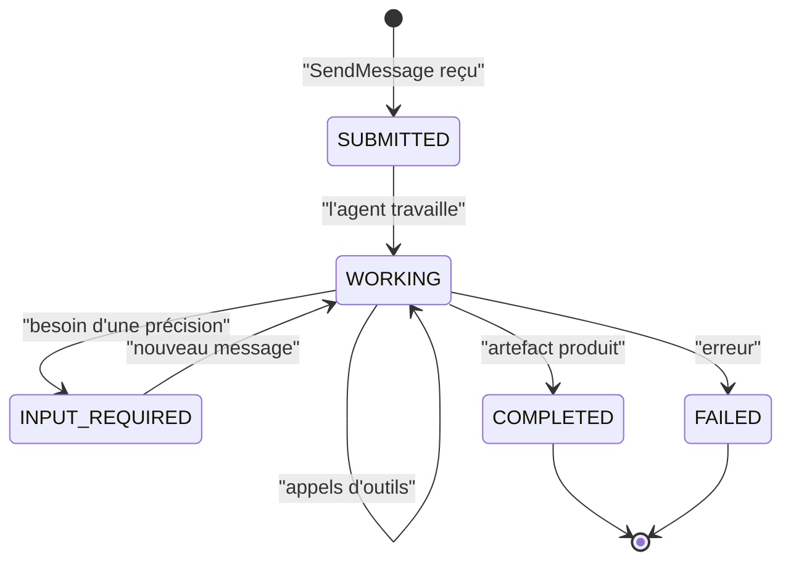

# Tâches, messages et streaming

> [!NOTE]
> Dans cette leçon, vous allez envoyer un message A2A « à la main » en JSON-RPC, lire la **tâche** qui revient (états, artefacts, historique), puis suivre la même demande en **streaming** (flux d'événements SSE).

## Le vocabulaire en une minute

- **Message** : ce qu'envoie un client (rôle `ROLE_USER`) ou un agent (`ROLE_AGENT`), composé de **parts** (texte, données JSON, fichiers).
- **Tâche** (*task*) : l'unité de travail créée par le serveur pour traiter une demande. Elle a un identifiant, un **état** et, à la fin, des **artefacts**.
- **Artefact** : le résultat produit (ici, le texte de la réponse).
- **Contexte** (`contextId`) : relie plusieurs tâches d'une même conversation.



Les états réels portent le préfixe `TASK_STATE_` (`TASK_STATE_COMPLETED`…).

## JSON-RPC : une méthode, des paramètres

Le transport utilisé ici est **JSON-RPC 2.0** sur HTTP : on poste un objet `{"jsonrpc", "id", "method", "params"}` à l'URL de la carte. Les méthodes principales de la version 1.0 :

| Méthode | Rôle |
| --- | --- |
| `SendMessage` | envoie un message, attend la tâche finale |
| `SendStreamingMessage` | envoie un message, reçoit un flux SSE d'événements |
| `GetTask` | relit l'état d'une tâche par son identifiant |
| `CancelTask` | demande l'annulation d'une tâche |

Le client du lab ([client.py](../files/client.py)) construit ce message sans aucune bibliothèque A2A, pour que vous voyiez le protocole à nu :

```python title="files/client.py"
HEADERS = {"A2A-Version": "1.0", "Content-Type": "application/json"}

def _payload(method: str, text: str) -> dict:
    return {"jsonrpc": "2.0", "id": str(uuid.uuid4()), "method": method,
            "params": {"message": {"messageId": str(uuid.uuid4()), "role": "ROLE_USER",
                                   "parts": [{"text": text}]}}}
```

> [!WARNING]
> L'en-tête `A2A-Version: 1.0` est obligatoire avec le serveur `a2a-sdk` 1.x. Sans lui, le serveur suppose un client 0.3 et répond une erreur JSON-RPC `-32009` « A2A version '0.3' is not supported by this handler. Expected version '1.0'. » (nous l'avons rencontrée en écrivant ce lab).

```quiz
question: "Vous postez un SendMessage valide sans l'en-tête A2A-Version. Que se passe-t-il avec le serveur du lab ?"
options:
  - "La réponse arrive normalement"
  - "Une erreur JSON-RPC -32009 : version 0.3 non prise en charge"
  - "Le serveur renvoie une page HTML 404"
answer: 1
explanation: "Le serveur négocie la version du protocole par cet en-tête. Absent, il suppose 0.3 et refuse, avec une erreur JSON-RPC (code HTTP 200, champ error dans le corps)."
```

## Ce que contient la tâche renvoyée

Résultat réel (2026-10-15) d'un `SendMessage` direct à l'agent stock, abrégé :

```json
{"result": {"task": {
  "id": "97a62dbe-…", "contextId": "644d8f9c-…",
  "status": {"state": "TASK_STATE_COMPLETED", "timestamp": "2026-10-15T14:30:50.326891Z"},
  "artifacts": [{"parts": [{"text": "Le stock disponible pour l'article CHAISE-ERGO est de 12 unités au total, réparties avec 0 unité dans l'entrepôt de Lille et 12 unités dans celui de Lyon."}]}],
  "history": [
    {"role": "ROLE_USER", "parts": [{"text": "Stock de CHAISE-ERGO ?"}]},
    {"role": "ROLE_AGENT", "parts": [{"data": {"name": "check_stock", "args": {"sku": "CHAISE-ERGO"}},
                                      "metadata": {"adk_type": "function_call"}}]},
    {"role": "ROLE_AGENT", "parts": [{"data": {"name": "check_stock", "response": {"status": "ok", "total": 12.0}}, "metadata": {"adk_type": "function_response"}}]},
    {"role": "ROLE_AGENT", "parts": [{"text": "Le stock disponible pour l'article CHAISE-ERGO est de 12 unités…"}]}],
  "metadata": {"adk_app_name": "stock_agent", "adk_usage_metadata": {"promptTokenCount": 350.0, "totalTokenCount": 496.0}}}}}
```

Trois observations :

1. L'**historique** expose les appels d'outils internes de l'agent (parts `data` avec `adk_type`). C'est précieux pour déboguer, mais c'est aussi une **fuite d'information** potentielle vers l'appelant (voir le module 3).
2. Les entiers deviennent des flottants (`12.0`) : la conversion passe par des structures protobuf. Ne comparez pas des types stricts côté client.
3. Les métadonnées incluent la consommation de jetons, utile pour refacturer chaque équipe.

## Le streaming : suivre la tâche en direct

Avec `SendStreamingMessage`, la réponse HTTP reste ouverte et le serveur pousse des **événements SSE** (*Server-Sent Events*, des lignes `data: {...}`) : la tâche créée, des mises à jour d'état, puis l'artefact.

```python title="files/client.py"
def stream(url, text, token=None, timeout=120):
    with httpx.stream("POST", url, json=_payload("SendStreamingMessage", text),
                      headers=_auth(token), timeout=timeout) as r:
        r.raise_for_status()
        for line in r.iter_lines():
            if line.startswith("data:"):
                yield json.loads(line[5:])["result"]
```

## Résultat obtenu

`python client.py --stream "Je voudrais un devis pour 12 CHAISE-ERGO"` contre l'orchestrateur, le 2026-10-15 :

```text
[task] TASK_STATE_SUBMITTED
[statusUpdate] TASK_STATE_WORKING
[statusUpdate] TASK_STATE_WORKING
[statusUpdate] TASK_STATE_WORKING
[statusUpdate] TASK_STATE_WORKING
[artifactUpdate]
Voici votre devis pour **12 unités** de la référence **CHAISE-ERGO** :
### 1. Disponibilité en stock
* **Stock total disponible :** 12 unités
  * Entrepôt de Lyon : 12 unités
  * Entrepôt de Lille : 0 unité
### 2. Tarification (HT)
* **Prix unitaire HT :** 189,00 €
* **Remise sur volume appliquée :** 10 %
* **Montant total HT :** **2 041,20 €**
[statusUpdate] TASK_STATE_COMPLETED
```

```quiz
question: "Pourquoi préférer SendStreamingMessage pour une interface utilisateur ?"
options:
  - "Il consomme moins d'appels au modèle"
  - "L'utilisateur voit la progression (WORKING) au lieu d'attendre une réponse muette"
  - "Il est le seul à renvoyer des artefacts"
answer: 1
explanation: "Le nombre d'appels au modèle est le même. Le flux SSE permet d'afficher l'avancement d'une tâche longue (plusieurs agents, plusieurs outils) et de détecter tôt un blocage."
```

## Exercice : relire une tâche

Avec `SendMessage`, récupérez l'`id` de la tâche, puis relisez-la avec `GetTask` (paramètres : `{"id": "<id>"}`). Que renvoie le serveur ?

<details>
<summary>Voir la solution</summary>

```python
import httpx, os, uuid
from client import send, _auth
t = send("http://localhost:8101/", "Stock de BUREAU-120 ?")
r = httpx.post("http://localhost:8101/", headers=_auth(None), json={
    "jsonrpc": "2.0", "id": str(uuid.uuid4()), "method": "GetTask", "params": {"id": t["id"]}})
print(r.json()["result"]["status"]["state"])   # TASK_STATE_COMPLETED
```

Le serveur relit la tâche dans son *task store* (en mémoire dans le lab, donc perdu au redémarrage ; `to_a2a` accepte un `task_store` persistant, par exemple en base de données). C'est ce qui permet à un client déconnecté de reprendre le suivi d'une tâche longue.

</details>

## Je sais faire

- [ ] Nommer les états d'une tâche A2A et leurs transitions
- [ ] Écrire un `SendMessage` JSON-RPC avec les bons en-têtes
- [ ] Lire artefacts, historique et métadonnées d'une tâche
- [ ] Consommer un flux `SendStreamingMessage`
