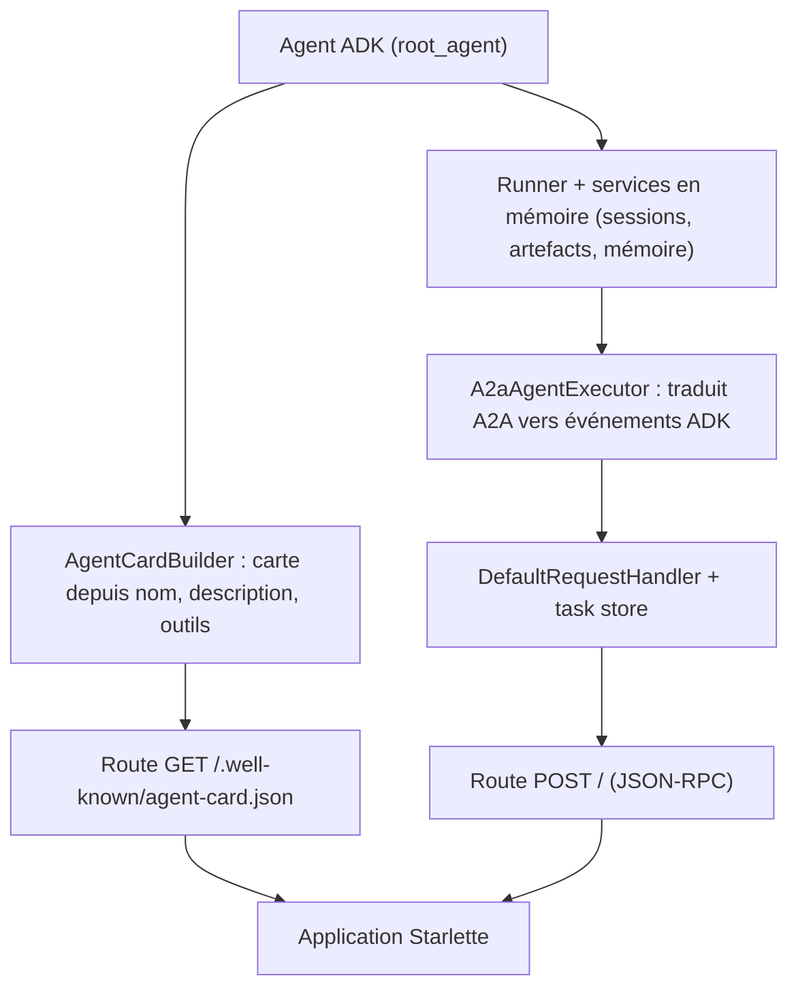

# Exposer un agent ADK en serveur A2A

> [!NOTE]
> Dans cette leçon, vous allez transformer deux agents ADK (stock et tarification) en **serveurs A2A** avec `to_a2a`, comprendre ce que cette fonction assemble, et lancer chaque agent sur son propre port.

## Installer l'extra A2A

Le support A2A d'ADK est une dépendance optionnelle. Dans ADK 2.10, `pip install "google-adk[a2a]==2.10.0"` installe `a2a-sdk[http-server]` (version 1.2.2 au moment du test). Sans cet extra, l'import échoue avec `ModuleNotFoundError: No module named 'a2a'`.

> [!TIP]
> ADK contient une couche de compatibilité (`google/adk/a2a/_compat.py`) qui fonctionne avec `a2a-sdk` 0.3.x **et** 1.x. Épinglez quand même la version dans `requirements.txt` : le format des messages a changé entre ces deux versions (rôles `ROLE_USER`, en-tête `A2A-Version`…).

## Un agent ordinaire d'abord

L'agent stock est un agent ADK classique avec un outil. Rien dans son code ne parle d'A2A :

```python title="files/stock_agent.py"
def check_stock(sku: str) -> dict:
    """Retourne le stock disponible d'un article, par entrepôt.

    Args:
        sku: référence de l'article, par exemple "CHAISE-ERGO".
    """
    item = STOCK.get(sku.strip().upper())
    if item is None:
        return {"status": "error", "message": f"Référence inconnue : {sku}",
                "references_connues": sorted(STOCK)}
    entrepots = {k: v for k, v in item.items() if k != "nom"}
    return {"status": "ok", "sku": sku.upper(), "nom": item["nom"],
            "par_entrepot": entrepots, "total": sum(entrepots.values())}

root_agent = Agent(
    name="stock_agent", model=MODEL,
    description="Donne le stock disponible d'un article (par entrepôt) à partir de sa référence.",
    instruction="Tu es le service stock. Pour toute question de disponibilité, appelle check_stock. ...",
    tools=[check_stock],
)

app = serve(root_agent, port=int(os.environ.get("STOCK_PORT", 8101)))
```

L'outil renvoie une **erreur exploitable** (`references_connues`) plutôt qu'une exception : le modèle peut corriger une référence mal saisie au lieu d'échouer.

## Ce que fait `to_a2a`



`to_a2a(agent, host, port, protocol)` renvoie une application **Starlette** (le micro-framework web sous FastAPI) prête pour `uvicorn`. Les routes sont ajoutées au **démarrage** (*lifespan*) : c'est là que la carte est construite, avec l'URL `protocol://host:port/` qu'elle annoncera.

Le lab enveloppe cet appel dans `serve()` pour ajouter l'authentification (module 3) et l'URL publique (module 4) :

```python title="files/common.py"
def serve(agent, port: int, token: str | None = None):
    """Transforme un agent ADK en application A2A (Starlette) protégée par jeton."""
    # Derrière Cloud Run : A2A_HOST=<service>.run.app, A2A_PROTOCOL=https, A2A_PUBLIC_PORT=443
    app = to_a2a(agent, host=HOST, port=int(os.environ.get("A2A_PUBLIC_PORT", port)),
                 protocol=os.environ.get("A2A_PROTOCOL", "http"))
    app.add_middleware(BearerAuth, token=token or a2a_token())
    return app
```

| Paramètre de `to_a2a` | Rôle | Valeur du lab |
| --- | --- | --- |
| `host`, `port`, `protocol` | URL **annoncée** dans la carte (pas l'adresse d'écoute) | `localhost`, 8101, `http` |
| `rpc_path` | préfixe pour héberger plusieurs agents sur un même serveur | non utilisé |
| `agent_card` | carte fournie à la main (objet ou chemin JSON) | générée |
| `task_store` | où stocker les tâches (mémoire par défaut) | mémoire |
| `runner` | runner ADK personnalisé (sessions persistantes…) | par défaut |

```quiz
question: "Vous lancez uvicorn stock_agent:app --port 9000 sans changer le code. Quelle URL annonce la carte ?"
options:
  - "http://localhost:9000"
  - "http://localhost:8101, car c'est la valeur passée à to_a2a"
  - "Aucune, la carte n'a pas d'URL"
answer: 1
explanation: "La carte annonce l'URL passée à to_a2a, pas le port réel d'écoute d'uvicorn. Si les deux divergent, les clients qui lisent la carte appelleront le mauvais port : gardez-les alignés (ici via STOCK_PORT)."
```

## L'agent tarification, même recette

[pricing_agent.py](../files/pricing_agent.py) calcule un prix avec des paliers de remise. Le calcul est en **Python**, jamais confié au modèle :

```python title="files/pricing_agent.py"
PALIERS = [(20, 0.15), (10, 0.10), (5, 0.05)]

def quote_price(sku: str, quantity: int) -> dict:
    ...
    remise = next((r for seuil, r in PALIERS if quantity >= seuil), 0.0)
    total = round(PRIX_UNITAIRE[sku] * quantity * (1 - remise), 2)
```

Puis on lance chaque agent dans son terminal :

```bash
export A2A_TOKEN=$(python -c "import secrets; print(secrets.token_urlsafe(24))")
uvicorn stock_agent:app --port 8101
uvicorn pricing_agent:app --port 8102
```

```quiz
question: "Pourquoi le calcul de remise est-il dans quote_price plutôt que dans l'instruction de l'agent ?"
options:
  - "Parce que les modèles ne savent pas multiplier"
  - "Pour qu'il soit déterministe, testable sans clé, et identique à chaque appel"
  - "Parce qu'A2A interdit les calculs dans les instructions"
answer: 1
explanation: "Une règle métier dans le code se teste (test_quote_price_paliers vérifie les 4 paliers) et ne varie pas. Dans une instruction, elle dépendrait de l'interprétation du modèle à chaque appel."
```

## Résultat obtenu

Tests sans clé du lab, le 2026-10-15 (`pytest -q` dans `files/`) :

```text
.............                                                            [100%]
13 passed in 0.93s
```

Parmi eux, `test_agent_card_publique` démarre l'application A2A avec le `TestClient` de Starlette (ce qui exécute le *lifespan* et construit la carte) et vérifie le nom, l'URL `http://localhost:8101` et la compétence `check_stock`, sans aucun appel au modèle.

## Exercice : un troisième spécialiste

Écrivez `delivery_agent.py` : un outil `delivery_delay(city: str) -> dict` (délais fictifs : Lyon 2 jours, Lille 3 jours, autres 5 jours) et un serveur A2A sur le port 8103. Vérifiez sa carte.

<details>
<summary>Voir la solution</summary>

```python
import os
from google.adk.agents import Agent
from common import MODEL, serve

DELAIS = {"lyon": 2, "lille": 3}

def delivery_delay(city: str) -> dict:
    """Retourne le délai de livraison estimé, en jours ouvrés, pour une ville.

    Args:
        city: ville de livraison, par exemple "Lyon".
    """
    return {"status": "ok", "ville": city, "jours_ouvres": DELAIS.get(city.strip().lower(), 5)}

root_agent = Agent(name="delivery_agent", model=MODEL,
                   description="Estime le délai de livraison d'une commande selon la ville.",
                   instruction="Tu es le service livraison. Appelle delivery_delay et réponds en une phrase.",
                   tools=[delivery_delay])
app = serve(root_agent, port=int(os.environ.get("DELIVERY_PORT", 8103)))
```

`uvicorn delivery_agent:app --port 8103`, puis `curl -s localhost:8103/.well-known/agent-card.json` : la compétence `delivery_delay` apparaît. Vous l'ajouterez au registre dans la leçon 3.

</details>

## Je sais faire

- [ ] Installer l'extra A2A d'ADK et épingler les versions
- [ ] Exposer un agent avec `to_a2a` et le lancer avec `uvicorn`
- [ ] Expliquer la différence entre URL annoncée et port d'écoute
- [ ] Garder les règles métier dans des outils testables
