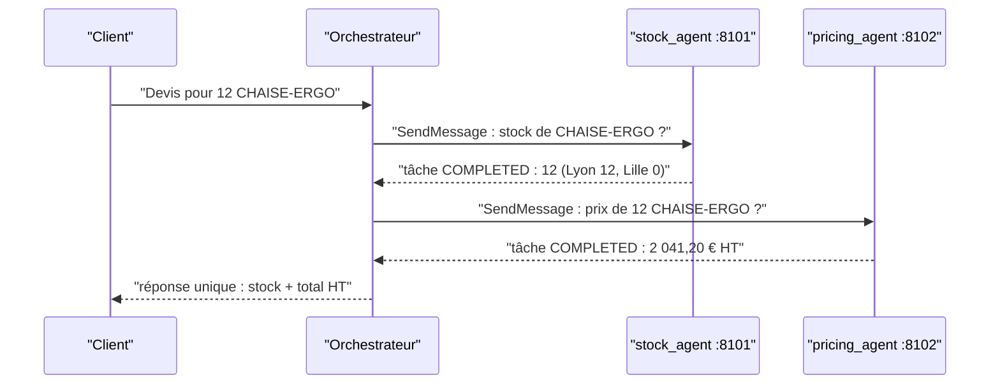

# Consommer un agent distant avec RemoteA2aAgent

> [!NOTE]
> Dans cette leçon, vous allez brancher l'orchestrateur sur les agents stock et tarification avec `RemoteA2aAgent`, choisir entre **délégation** (`sub_agents`) et **agent comme outil** (`AgentTool`), et suivre un devis complet à travers les trois agents.

## Un agent distant qui ressemble à un agent local

`RemoteA2aAgent` (module `google.adk.agents.remote_a2a_agent`) est un agent ADK dont le « cerveau » est ailleurs : quand on l'exécute, il lit la carte distante, convertit la conversation en message A2A, appelle le serveur, puis reconvertit la tâche reçue en événements ADK.

Ses paramètres utiles dans ADK 2.10 (vérifiés dans le code installé) :

| Paramètre | Rôle |
| --- | --- |
| `name` | identifiant local (doit être un identifiant Python valide) |
| `agent_card` | URL de la carte, chemin d'un fichier JSON ou objet `AgentCard` |
| `description` | lue par le modèle de l'orchestrateur pour choisir ; reprise de la carte si vide |
| `timeout` | délai HTTP en secondes (600 par défaut, beaucoup trop pour un devis) |
| `auth_scheme`, `auth_credential` | authentification ajoutée à la lecture de la carte **et** aux messages |

## Délégation ou outil ?



Un devis a besoin des **deux** réponses dans un seul message. Avec `sub_agents`, l'orchestrateur transférerait la conversation au premier spécialiste, qui répondrait seul. On enveloppe donc chaque agent distant dans un `AgentTool` : l'orchestrateur l'appelle comme une fonction et **garde la main**.

| | `sub_agents=[remote]` | `tools=[AgentTool(agent=remote)]` |
| --- | --- | --- |
| Qui répond au client | le spécialiste | l'orchestrateur |
| Combiner deux résultats | non | oui |
| Ce que voit le spécialiste | l'historique de la conversation | une demande autonome rédigée par l'orchestrateur |

> [!NOTE]
> La docstring d'`AgentTool` dans ADK 2.10 recommande, pour les sous-agents **locaux**, `mode="single_turn"` dans `sub_agents` plutôt qu'`AgentTool`. Pour un agent distant, `AgentTool(agent=RemoteA2aAgent(...))` fonctionne et a été testé de bout en bout dans ce lab.

## Le code de l'orchestrateur

```python title="files/orchestrator.py"
def build_orchestrator(found: list[dict], missing: list[str], token: str) -> Agent:
    scheme, cred = bearer_auth(token)
    remotes = [RemoteA2aAgent(name=a["name"], description=a["description"], agent_card=a["card_url"],
                              timeout=CALL_TIMEOUT, auth_scheme=scheme, auth_credential=cred)
               for a in found]
    catalogue = "\n".join(f"- {a['name']} : {a['description']}" for a in found) or "- (aucun)"
    absent = ", ".join(missing) or "aucun"
    return Agent(
        name="orchestrator", model=MODEL,
        description="Répond aux demandes de devis en combinant stock et tarification.",
        instruction=(
            "Tu es l'orchestrateur des devis. Agents disponibles :\n" + catalogue +
            f"\nAgents indisponibles en ce moment : {absent}.\n"
            "Pour une demande de devis : interroge le stock ET le prix (outils séparés), puis rédige "
            "une réponse unique en français avec la disponibilité et le total HT. "
            "Transmets à chaque agent une demande autonome et précise (référence, quantité). "
            "Si un agent est indisponible ou renvoie une erreur, dis-le clairement et donne "
            "uniquement l'information obtenue. N'invente jamais un stock ni un prix."),
        tools=[AgentTool(agent=r) for r in remotes],
    )
```

L'orchestrateur est lui-même exposé en A2A sur le port 8100 : un autre système peut l'appeler exactement comme il appelle ses spécialistes. C'est ce qui rend l'architecture **composable**.

```quiz
question: "Pourquoi l'instruction demande-t-elle de transmettre « une demande autonome et précise » à chaque agent ?"
options:
  - "Pour réduire le coût de l'orchestrateur"
  - "Parce qu'avec AgentTool, le spécialiste ne reçoit que la requête rédigée par l'orchestrateur, pas toute la conversation"
  - "Parce qu'A2A limite la taille des messages à une phrase"
answer: 1
explanation: "AgentTool passe au spécialiste une requête rédigée par l'orchestrateur. Si elle omet la quantité, l'agent tarification ne peut pas calculer le total : le contrat de l'appel doit être explicite."
```

```quiz
question: "Quel timeout donner à RemoteA2aAgent pour un devis interactif ?"
options:
  - "Laisser la valeur par défaut de 600 secondes"
  - "Une valeur proche du temps de réponse attendu de l'agent, par exemple 30 secondes, réglable par variable d'environnement"
  - "0, pour désactiver le délai"
answer: 1
explanation: "600 s par défaut bloquerait l'utilisateur dix minutes sur une panne réseau. Le lab lit A2A_TIMEOUT (30 s par défaut) ; la leçon sur les pannes montre l'effet d'un délai trop court."
```

## Résultat obtenu

Scénario 1 de [e2e_a2a.py](../files/e2e_a2a.py), le 2026-10-15 : trois serveurs `uvicorn` réels, vrai modèle.

```text
1) Devis complet en streaming
   états : TASK_STATE_SUBMITTED > TASK_STATE_WORKING > artifactUpdate > TASK_STATE_COMPLETED
   réponse : Voici votre devis pour **12 unités** de la référence **CHAISE-ERGO** :  * **Disponibilité en stock :** 12 unités disponibles au total (12 unités à l'entrepôt de Lyon, 0 à Lille). * **Tarification :**   * Prix unitaire HT : 189,00 €   * Remise sur volume : 10 %   * **Total HT : 2 041,20 €**
```

Le total est juste (12 × 189 € × 0,90 = 2 041,20 €) et le test le vérifie automatiquement : `assert "204120" in digits(answer)`. Les journaux des deux spécialistes montrent chacun un `POST / HTTP/1.1 200 OK` authentifié.

## Exercice : brancher l'agent livraison

Ajoutez l'agent livraison de la leçon précédente à l'orchestrateur **sans modifier** `build_orchestrator`, puis demandez « devis et délai pour 6 BUREAU-120 livrés à Lille ».

<details>
<summary>Voir la solution</summary>

Il suffit que l'agent apparaisse dans `found`, ce que fera la découverte (leçon suivante). Pour un test immédiat :

```python
from orchestrator import build_orchestrator, discover
found, missing = discover()
found.append({"name": "delivery_agent", "description": "Estime le délai de livraison selon la ville.",
              "skills": [], "card_url": "http://localhost:8103/.well-known/agent-card.json"})
agent = build_orchestrator(found, missing, token)
```

Adaptez aussi l'instruction : « pour un délai, interroge delivery_agent ». La réponse attendue combine stock (8 unités), prix (6 × 329 € × 0,95 = 1 875,30 € HT) et délai (3 jours ouvrés).

</details>

> [!WARNING]
> Chaque agent distant ajouté est un appel réseau et au moins un appel au modèle de plus. Un devis du lab demande déjà de l'ordre de cinq à sept appels au modèle (orchestrateur et spécialistes) : surveillez la latence et le coût avant d'ajouter des agents.

## Je sais faire

- [ ] Déclarer un `RemoteA2aAgent` avec carte, timeout et authentification
- [ ] Choisir entre `sub_agents` et `AgentTool` selon qui doit répondre
- [ ] Écrire une instruction d'orchestrateur qui interdit d'inventer
- [ ] Vérifier un résultat combiné par un test automatique
