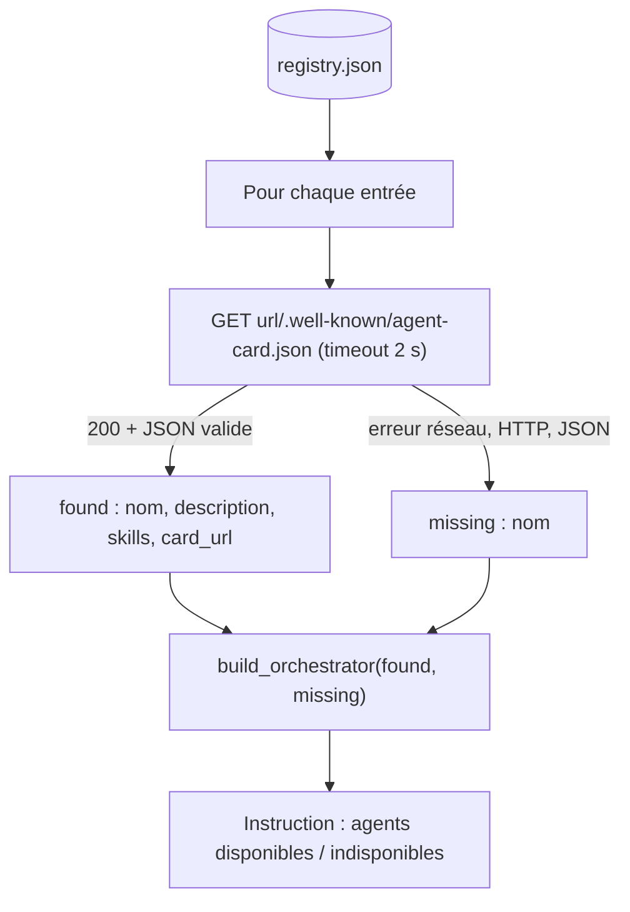

# Registre et découverte d'agents

> [!NOTE]
> Dans cette leçon, vous allez remplacer des adresses codées en dur par un **registre** d'agents, écrire la fonction `discover()` qui lit les Agent Cards au démarrage, et faire en sorte que l'orchestrateur démarre même quand un agent manque.

## Trois façons de trouver un agent

| Méthode | Principe | Quand l'utiliser |
| --- | --- | --- |
| URL en dur | l'adresse est dans le code | prototype, un seul agent |
| **Registre** (fichier, base, service) | une liste d'agents autorisés, maintenue à part | entreprise : catalogue contrôlé d'agents |
| Well-known seul | on connaît un domaine, on lit `/.well-known/agent-card.json` | agents publics d'un partenaire |

La spécification A2A décrit la carte et son adresse bien connue, mais laisse le **registre** à votre charge. Dans ce lab, c'est un fichier JSON : simple, versionné avec le code, relu en revue de code.

```json title="files/registry.json"
{
  "agents": [
    {"name": "stock_agent", "url": "http://localhost:8101"},
    {"name": "pricing_agent", "url": "http://localhost:8102"}
  ]
}
```

> [!TIP]
> Un registre est aussi une **liste blanche** : l'orchestrateur n'appelle que les agents qui y figurent. Ne laissez jamais un modèle choisir lui-même une URL d'agent à appeler à partir d'un texte reçu.

## La découverte au démarrage



```python title="files/orchestrator.py"
def discover(registry_path: Path = REGISTRY, timeout: float = 2.0) -> tuple[list[dict], list[str]]:
    """Lit le registre et récupère l'Agent Card de chaque agent joignable.

    Retourne (agents_disponibles, noms_indisponibles). Un agent qui ne répond pas
    en `timeout` secondes est écarté : l'orchestrateur démarre quand même.
    """
    found, missing = [], []
    for entry in json.loads(registry_path.read_text(encoding="utf-8"))["agents"]:
        url = entry["url"].rstrip("/") + CARD_PATH
        try:
            card = httpx.get(url, timeout=timeout).raise_for_status().json()
            found.append({"name": card["name"], "description": card.get("description", ""),
                          "skills": [s.get("name") for s in card.get("skills", [])], "card_url": url})
        except (httpx.HTTPError, ValueError, KeyError):
            missing.append(entry["name"])
    return found, missing
```

Deux choix de conception :

1. **Le nom et la description viennent de la carte**, pas du registre : c'est l'équipe propriétaire de l'agent qui décrit ce qu'il fait, et l'orchestrateur s'adapte à chaque redémarrage.
2. **Un agent absent n'empêche pas le démarrage.** Il est listé dans l'instruction comme indisponible, pour que le modèle l'annonce au lieu de chercher un outil qui n'existe pas.

```quiz
question: "L'agent tarification est arrêté quand l'orchestrateur démarre. Que contient l'orchestrateur construit ?"
options:
  - "Rien : le démarrage échoue avec une exception"
  - "Un seul outil (stock_agent) et la mention « Agents indisponibles en ce moment : pricing_agent »"
  - "Deux outils, dont un qui échouera"
answer: 1
explanation: "discover() range pricing_agent dans missing ; build_orchestrator ne crée un AgentTool que pour les agents trouvés, et l'instruction annonce l'absent. test_orchestrateur_construit_un_outil_par_agent vérifie exactement cela, sans clé."
```

## Tester la découverte sans réseau

Le test pointe un registre temporaire vers le port 9 (réservé, jamais ouvert) : la connexion échoue immédiatement.

```python title="files/test_lab.py"
def test_decouverte_ecarte_les_agents_injoignables(tmp_path):
    reg = tmp_path / "registry.json"
    reg.write_text(json.dumps({"agents": [{"name": "fantome", "url": "http://127.0.0.1:9"}]}))
    found, missing = orchestrator.discover(reg, timeout=0.5)
    assert found == [] and missing == ["fantome"]
```

## Résultat obtenu

Scénario 4 de `e2e_a2a.py` (2026-10-15), après l'arrêt réel du serveur tarification :

```text
4) Découverte avec un agent absent du réseau
   disponibles : ['stock_agent'] | absents : ['pricing_agent']
```

## Limites de la découverte « au démarrage »

| Limite | Conséquence | Amélioration |
| --- | --- | --- |
| La liste est figée au démarrage | un agent revenu en ligne n'est pas vu | redécouvrir périodiquement, ou à chaque requête avec un cache court |
| Un agent peut tomber **après** la découverte | l'outil existe mais échoue | gestion d'erreurs à l'exécution (leçon suivante) |
| La carte n'est pas signée | un serveur usurpé pourrait publier une fausse carte | HTTPS, registre contrôlé, et cartes signées si votre version du protocole le permet |

```quiz
question: "Pourquoi garder le registre sous forme de fichier versionné plutôt que laisser chaque agent s'inscrire tout seul ?"
options:
  - "Parce qu'A2A interdit l'inscription automatique"
  - "Pour qu'ajouter un agent à l'orchestrateur passe par une revue humaine : c'est une décision de sécurité"
  - "Parce qu'un fichier est plus rapide qu'une base de données"
answer: 1
explanation: "Ajouter un agent, c'est donner à l'orchestrateur un nouvel interlocuteur dont il relaiera les réponses. Une inscription libre permettrait à n'importe quel service de s'insérer dans la chaîne. Un registre en revue de code garde ce contrôle."
```

## Exercice : redécouverte paresseuse

Modifiez l'orchestrateur pour qu'un agent absent au démarrage soit retenté au plus une fois par minute. Esquissez le code.

<details>
<summary>Voir la solution</summary>

L'agent ADK est construit une fois ; le plus simple est de reconstruire l'orchestrateur quand la liste change :

```python
import time
_state = {"at": 0.0, "agent": None, "names": None}

def current_orchestrator(token, ttl=60):
    if time.monotonic() - _state["at"] > ttl:
        found, missing = discover()
        names = tuple(a["name"] for a in found)
        if names != _state["names"]:
            _state["agent"] = build_orchestrator(found, missing, token)
            _state["names"] = names
        _state["at"] = time.monotonic()
    return _state["agent"]
```

Il faut ensuite un `runner` qui utilise cet agent à chaque requête (par exemple un `agent_executor_factory` personnalisé passé à `to_a2a`). C'est plus de code à maintenir : dans beaucoup de cas, un redémarrage de l'orchestrateur après un déploiement suffit.

</details>

## Je sais faire

- [ ] Décrire les trois façons de trouver un agent
- [ ] Écrire une découverte qui tolère les agents absents
- [ ] Tester la découverte sans réseau
- [ ] Expliquer pourquoi le registre est une décision de sécurité
