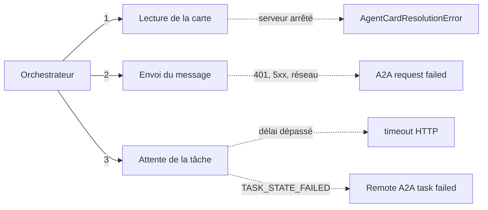

# Pannes, délais et dégradation propre

> [!NOTE]
> Dans cette leçon, vous allez provoquer de vraies pannes (un agent arrêté, un délai trop court), lire ce que `RemoteA2aAgent` renvoie dans ces cas, et vérifier par test que l'orchestrateur **n'invente jamais** l'information manquante.

## Ce qui peut casser dans un système distribué



Dans ADK 2.10, `RemoteA2aAgent` **ne lève pas** ces erreurs vers l'orchestrateur : il les attrape et produit un événement ADK portant un `error_message` (par exemple « Failed to resolve remote A2A agent… » ou « A2A request failed: … »). Vu de l'orchestrateur, l'`AgentTool` renvoie ce message comme résultat d'outil. Le modèle de l'orchestrateur le lit et doit en tirer la bonne conclusion : c'est le rôle de l'instruction « Si un agent est indisponible ou renvoie une erreur, dis-le clairement et donne uniquement l'information obtenue ».

| Panne | Où elle apparaît | Ce que doit faire l'orchestrateur |
| --- | --- | --- |
| Agent absent au démarrage | `discover()` → `missing` | ne pas créer l'outil, l'annoncer dans l'instruction |
| Agent tombé après le démarrage | message d'erreur de l'outil | annoncer l'indisponibilité, répondre avec le reste |
| Agent trop lent | timeout HTTP du `RemoteA2aAgent` | idem, et ne pas attendre indéfiniment |
| Agent qui répond une erreur métier (référence inconnue) | texte de la réponse | relayer l'erreur, proposer une correction |

```quiz
question: "Dans ADK 2.10, que reçoit l'orchestrateur quand l'agent tarification est arrêté au moment de l'appel ?"
options:
  - "Une exception Python qui interrompt l'invocation"
  - "Un résultat d'outil contenant un message d'erreur, que son modèle doit interpréter"
  - "Une réponse vide, sans indication"
answer: 1
explanation: "RemoteA2aAgent capture les erreurs réseau et de résolution de carte et les transforme en événement avec error_message. La conversation continue : c'est l'instruction qui garantit une réponse honnête."
```

## Tester qu'il n'invente pas

Un test de panne utile ne vérifie pas seulement « pas de plantage » : il vérifie qu'une **valeur impossible à connaître n'apparaît pas**. Avec l'agent tarification arrêté, le prix de 6 bureaux (6 × 329 € × 0,95 = 1 875,30 €) ne doit pas figurer dans la réponse :

```python title="files/e2e_a2a.py"
print("3) Panne de l'agent tarification pendant le service")
procs.pop("pricing_agent").kill()
t = send(ORCH, "Devis pour 6 BUREAU-120")
assert t["status"]["state"] == "TASK_STATE_COMPLETED"
assert "18753" not in digits(task_text(t))  # le prix (6*329*0,95) ne peut pas être connu
```

Le délai est testé en relançant l'orchestrateur avec `A2A_TIMEOUT=1` : une seconde ne suffit pas à un agent qui appelle un modèle puis un outil.

```python title="files/e2e_a2a.py"
procs["orchestrator"] = start("orchestrator", A2A_TIMEOUT="1")
t = send(ORCH, "Devis pour 3 BUREAU-120")
assert "987" not in digits(task_text(t))  # 3*329 = 987 : ne doit pas apparaître
```

## Résultat obtenu

Scénarios 3 et 5 de `e2e_a2a.py`, le 2026-10-15 (vrai modèle, vrais processus arrêtés) :

```text
3) Panne de l'agent tarification pendant le service
   réponse : Voici les informations concernant votre demande de devis pour **6 unités de BUREAU-120** :  * **Disponibilité en stock :**   * Stock total disponible : **8 unités** (suffisant pour honorer votre demande de 6 unités).   * Répartition par entrepôt : **5 à Lille** et **3 à Lyon**.  * **Prix HT :**   *
5) Délai dépassé (A2A_TIMEOUT=1 s)
   réponse : Bonjour,  Les services de vérification des stocks (`stock_agent`) et de calcul des prix (`pricing_agent`) sont actuellement indisponibles (délai d'attente dépassé).   Par conséquent, il est impossible de vérifier la disponibilité et de calculer le montant total HT pour les 3 exemplaires de la référe
OK : 5 scénarios passés
```

Lors d'un essai manuel du même cas 3, la fin de la réponse était : « L'agent de tarification (`pricing_agent`) a rencontré une erreur et n'a pas pu calculer le prix. » Et le journal de l'orchestrateur contenait :

```text
Failed to resolve remote A2A agent pricing_agent: Failed to resolve AgentCard from URL http://localhost:8102/.well-known/agent-card.json: Network communication error fetching agent card from http://localhost:8102/.well-known/agent-card.json: All connection attempts failed
```

> [!WARNING]
> Un délai dépassé côté orchestrateur **n'arrête pas** le travail côté spécialiste : l'agent distant termine sa tâche (et consomme ses appels au modèle) pour rien. Pour une opération qui a des effets (réserver du stock), un délai dépassé ne veut pas dire « rien ne s'est passé » : prévoyez `GetTask` pour vérifier, ou des opérations idempotentes (rejouables sans double effet).

## Réessayer ou pas ?

| Situation | Réessayer ? |
| --- | --- |
| Erreur réseau transitoire, HTTP 503 | oui, une ou deux fois avec attente croissante |
| HTTP 401 / 403 | non : c'est une configuration à corriger |
| Délai dépassé sur une opération avec effet | pas aveuglément : vérifiez l'état de la tâche d'abord |
| Erreur métier (référence inconnue) | non : relayer au client |

```quiz
question: "Lequel de ces cas NE doit PAS être réessayé automatiquement ?"
options:
  - "HTTP 503 renvoyé une fois par le serveur stock"
  - "HTTP 401 renvoyé par l'agent tarification"
  - "Coupure réseau d'une demi-seconde"
answer: 1
explanation: "Un 401 signifie que le jeton est absent ou invalide : réessayer ne changera rien et peut déclencher des alertes de sécurité. Les erreurs transitoires (503, réseau) justifient un ou deux essais avec attente."
```

## Exercice : un disjoncteur

Quand un agent échoue trois fois de suite, l'orchestrateur devrait cesser de l'appeler pendant 30 secondes (motif du **disjoncteur**, *circuit breaker*). Où placer cette logique dans ADK ?

<details>
<summary>Voir la solution</summary>

Dans un `before_tool_callback` de l'orchestrateur : il voit passer chaque appel d'`AgentTool` et peut répondre à sa place, sans réseau.

```python
import time
FAILS, OPEN_UNTIL = {}, {}

def breaker_before(tool, args, tool_context):
    if OPEN_UNTIL.get(tool.name, 0) > time.monotonic():
        return {"error": f"{tool.name} indisponible (disjoncteur ouvert)"}

def breaker_after(tool, args, tool_context, tool_response):
    failed = "error" in str(tool_response).lower()
    FAILS[tool.name] = FAILS.get(tool.name, 0) + 1 if failed else 0
    if FAILS[tool.name] >= 3:
        OPEN_UNTIL[tool.name], FAILS[tool.name] = time.monotonic() + 30, 0
```

Puis `Agent(..., before_tool_callback=breaker_before, after_tool_callback=breaker_after)`. La détection « contient error » est grossière ; en production, marquez explicitement les échecs.

</details>

## Je sais faire

- [ ] Lister les quatre types de panne d'un appel A2A
- [ ] Écrire un test qui prouve qu'une valeur inconnue n'est pas inventée
- [ ] Régler un timeout adapté et en mesurer l'effet
- [ ] Décider quand réessayer et quand s'abstenir
