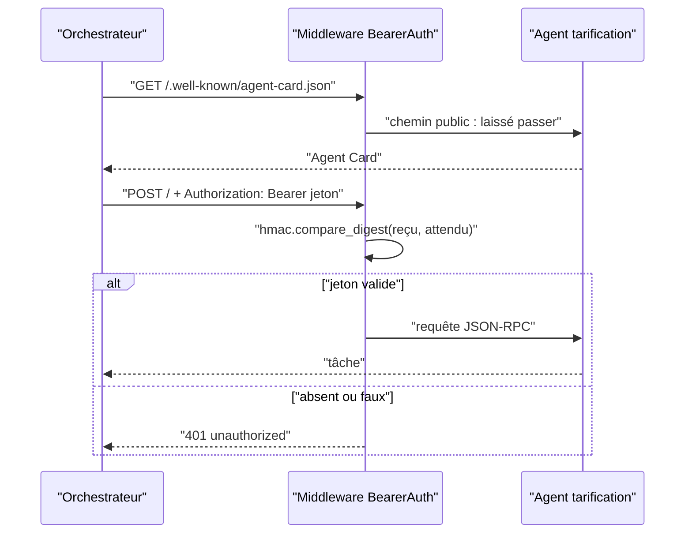

# Sécurité entre agents : authentification et confiance

> [!NOTE]
> Dans cette leçon, vous allez protéger les serveurs A2A par un **jeton** vérifié dans un middleware, faire envoyer ce jeton par `RemoteA2aAgent`, puis voir comment passer, en production, à des identités Google (IAM) et au principe du **moindre privilège**.

## Qui a le droit d'appeler qui ?

Sans protection, n'importe quel programme qui atteint le port 8102 peut demander des prix, et n'importe qui atteignant 8100 peut consommer vos appels au modèle. On distingue :

- **authentification** : prouver *qui* appelle (un jeton, une identité de service) ;
- **autorisation** : décider *ce que* cet appelant a le droit de faire ;
- **confiance dans les réponses** : ce qu'un agent distant renvoie reste une donnée à vérifier, pas un ordre.



## Côté serveur : un middleware ASGI de quinze lignes

```python title="files/common.py"
class BearerAuth:
    """Middleware ASGI : l'Agent Card reste publique, l'appel JSON-RPC exige le jeton."""

    def __init__(self, app, token: str):
        self.app, self.expected = app, f"Bearer {token}".encode()

    async def __call__(self, scope, receive, send):
        if scope["type"] == "http" and not scope["path"].endswith(CARD_PATH):
            got = dict(scope["headers"]).get(b"authorization", b"")
            if not hmac.compare_digest(got, self.expected):  # comparaison à temps constant
                await send({"type": "http.response.start", "status": 401,
                            "headers": [(b"content-type", b"application/json")]})
                await send({"type": "http.response.body", "body": b'{"error":"unauthorized"}'})
                return
        await self.app(scope, receive, send)
```

Trois détails comptent :

1. `hmac.compare_digest` compare en **temps constant** : un `==` ordinaire s'arrête au premier caractère différent, ce qui peut, en théorie, laisser deviner le jeton en mesurant les temps de réponse.
2. Le jeton est refusé s'il fait moins de 16 caractères (`a2a_token()` lève une erreur) : un jeton faible ne doit pas démarrer en silence.
3. La carte reste publique pour la découverte. Si elle doit être privée, le `RemoteA2aAgent` d'ADK 2.10 envoie aussi le jeton lors de la lecture de la carte.

## Côté client : `auth_scheme` et `auth_credential`

```python title="files/orchestrator.py"
def bearer_auth(token: str):
    """Schéma + identifiant : ADK ajoute « Authorization: Bearer … » à chaque appel A2A."""
    cred = AuthCredential(auth_type=AuthCredentialTypes.HTTP,
                          http=HttpAuth(scheme="bearer", credentials=HttpCredentials(token=token)))
    return HTTPBearer(), cred
```

ADK résout l'identifiant une fois par invocation et l'ajoute à la lecture de la carte **et** aux messages. Le code installé dérive aussi une clé de cache **par agent distant**, pour que le jeton d'un agent ne soit jamais envoyé à un autre hôte. Au lancement, ADK affiche des avertissements `[EXPERIMENTAL]` (PLUGGABLE_AUTH, CredentialManager) : la fonctionnalité marche, mais son API peut changer.

```quiz
question: "Pourquoi utiliser hmac.compare_digest plutôt que == pour comparer le jeton ?"
options:
  - "C'est plus rapide"
  - "La comparaison prend le même temps quel que soit le préfixe correct, ce qui évite de deviner le jeton par mesure de temps"
  - "== ne fonctionne pas sur des bytes"
answer: 1
explanation: "== s'arrête au premier octet différent. compare_digest parcourt toujours toute la chaîne : le temps de réponse ne révèle rien sur la partie correcte du jeton."
```

## Résultat obtenu

Le 2026-10-15, scénario 2 de `e2e_a2a.py`, et journal du serveur stock pendant les essais :

```text
2) Appel sans jeton
   HTTP 401
```

```text
INFO:     127.0.0.1:35282 - "POST / HTTP/1.1" 401 Unauthorized
INFO:     127.0.0.1:35284 - "POST / HTTP/1.1" 200 OK
```

Les tests sans clé couvrent les trois cas : sans jeton (401), mauvais jeton (401), bon jeton (le middleware laisse passer et c'est le protocole qui répond).

## En production : des identités, pas un secret partagé

Un jeton partagé a deux défauts : tous les appelants se ressemblent (impossible de savoir qui a appelé), et une fuite oblige à changer le secret partout. Sur Google Cloud :

| | Jeton partagé (lab) | IAM Cloud Run (production) |
| --- | --- | --- |
| Identité de l'appelant | inconnue | compte de service de l'orchestrateur |
| Autorisation | tout ou rien | rôle `roles/run.invoker` accordé service par service |
| Rotation | manuelle | jetons d'identité Google de courte durée (environ une heure) |
| Révocation | changer le secret partout | retirer un rôle |

Avec Cloud Run déployé en `--no-allow-unauthenticated`, c'est Cloud Run qui vérifie le jeton d'identité avant votre code : le middleware du lab devient inutile (il entrerait même en conflit, puisque les deux utilisent l'en-tête `Authorization`). L'orchestrateur obtient un jeton d'identité dont l'*audience* est l'URL du service appelé, par exemple avec `google.oauth2.id_token.fetch_id_token(requête, url_du_service)`, et l'envoie à chaque appel. Ce jeton expire : il faut le renouveler, ce qu'un identifiant statique passé à `auth_credential` ne fait pas.

> [!WARNING]
> Cette variante IAM est expliquée ici mais **n'a pas été testée** dans ce lab (pas de déploiement Cloud Run). Testez-la dans votre projet avant de vous y fier.

## La confiance dans les réponses

Être authentifié ne rend pas une réponse fiable. L'orchestrateur relaie à son modèle le texte des spécialistes : si un spécialiste est compromis ou bogué, son texte peut contenir n'importe quoi. Règles de base :

- n'accordez à l'orchestrateur **aucun outil à effet** (paiement, suppression) qu'un texte d'agent distant pourrait déclencher sans contrôle en code ;
- traitez les réponses comme des données : validez les nombres côté code quand c'est possible ;
- limitez ce que les spécialistes renvoient : l'historique des tâches expose leurs appels d'outils internes (leçon 2 du module 1).

```quiz
question: "L'orchestrateur et ses spécialistes tournent sur Cloud Run. Quelles mesures relèvent du moindre privilège ? (plusieurs réponses)"
options:
  - "Accorder roles/run.invoker sur l'agent tarification au seul compte de service de l'orchestrateur"
  - "Déployer tous les agents en --allow-unauthenticated pour simplifier"
  - "Un compte de service distinct par agent"
  - "Donner le rôle Éditeur du projet à l'orchestrateur"
answer: [0, 2]
explanation: "Le moindre privilège donne à chaque identité exactement ce dont elle a besoin : un compte par agent, et le droit d'invocation accordé service par service. Ouvrir les services ou donner un rôle large au projet fait l'inverse."
```

## Exercice : un jeton par appelant

Faites évoluer `BearerAuth` pour accepter plusieurs jetons, chacun associé au nom d'un appelant, et journaliser qui appelle.

<details>
<summary>Voir la solution</summary>

```python
class BearerAuth:
    def __init__(self, app, tokens: dict[str, str]):   # {"orchestrator": "…", "batch": "…"}
        self.app = app
        self.expected = {f"Bearer {t}".encode(): name for name, t in tokens.items()}

    async def __call__(self, scope, receive, send):
        if scope["type"] == "http" and not scope["path"].endswith(CARD_PATH):
            got = dict(scope["headers"]).get(b"authorization", b"")
            caller = next((n for tok, n in self.expected.items() if hmac.compare_digest(got, tok)), None)
            if caller is None:
                ...  # même réponse 401 qu'avant
                return
            scope.setdefault("state", {})["caller"] = caller
            logging.info("appel A2A de %s", caller)
        await self.app(scope, receive, send)
```

On compare avec **tous** les jetons (pas d'arrêt anticipé révélateur), puis on peut révoquer un appelant sans toucher aux autres. C'est un pas vers l'identité par service qu'apporte IAM.

</details>

## Je sais faire

- [ ] Protéger un serveur A2A par un middleware à comparaison en temps constant
- [ ] Configurer `auth_scheme` et `auth_credential` sur un `RemoteA2aAgent`
- [ ] Expliquer pourquoi passer à IAM en production
- [ ] Traiter la réponse d'un agent distant comme une donnée, pas comme un ordre
