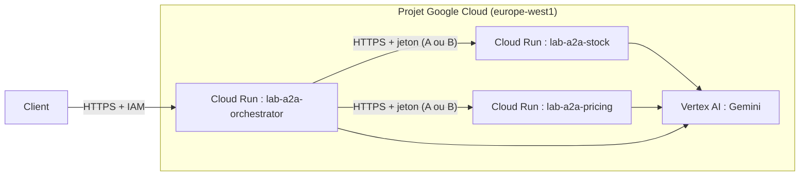

# Déployer chaque agent : Cloud Run ou Agent Engine

> [!NOTE]
> Dans cette leçon, vous allez préparer le déploiement des trois agents sur **Cloud Run** (une image, trois services), comprendre ce qu'apporte **Agent Engine**, et savoir tout supprimer à la fin. Cette leçon est **expliquée, pas exécutée** : aucun service n'a été créé pendant la rédaction.

## Cible de déploiement



## Cloud Run : une image, trois services

**Cloud Run** exécute un conteneur HTTP et facture à l'usage (il peut descendre à zéro instance). Le lab fournit un seul [Dockerfile](../files/Dockerfile) ; la variable `AGENT` choisit le module lancé :

```dockerfile title="files/Dockerfile"
FROM python:3.12-slim
WORKDIR /app
COPY requirements.txt .
RUN pip install --no-cache-dir -r requirements.txt
COPY *.py registry.json ./
ENV AGENT=stock_agent
# Cloud Run fournit la variable PORT (8080 par défaut)
CMD exec uvicorn ${AGENT}:app --host 0.0.0.0 --port ${PORT:-8080}
```

Deux réglages sont propres à A2A :

1. **L'URL annoncée dans la carte** doit être l'URL publique HTTPS, pas `localhost:8080`. `serve()` la lit dans `A2A_HOST`, `A2A_PROTOCOL=https` et `A2A_PUBLIC_PORT=443`.
2. **Le registre** de l'orchestrateur doit contenir les URL `https://…run.app` des spécialistes.

Deux variantes d'authentification :

- **Variante A, le code du lab tel quel** : le service est joignable (`--allow-unauthenticated`) mais le middleware exige le jeton partagé, stocké dans **Secret Manager** et injecté dans `A2A_TOKEN`.
- **Variante B, recommandée en production** : `--no-allow-unauthenticated` et IAM (leçon précédente). Elle demande de retirer le middleware et d'envoyer des jetons d'identité Google depuis l'orchestrateur : c'est une évolution du code, non testée ici.

Commandes de principe pour la variante A (remplacez `PROJET` ; l'URL exacte d'un service s'obtient après son premier déploiement) :

```bash
REGION=europe-west1
python -c "import secrets; print(secrets.token_urlsafe(32), end='')" | \
  gcloud secrets create lab-a2a-token --data-file=- --project PROJET --labels formation-lab=a2a
# le compte de service d'exécution doit avoir roles/secretmanager.secretAccessor sur ce secret
gcloud run deploy lab-a2a-stock --source . --project PROJET --region $REGION \
  --allow-unauthenticated --labels formation-lab=a2a --set-secrets A2A_TOKEN=lab-a2a-token:latest \
  --set-env-vars AGENT=stock_agent,GOOGLE_GENAI_USE_VERTEXAI=TRUE,GOOGLE_CLOUD_PROJECT=PROJET,GOOGLE_CLOUD_LOCATION=$REGION,MODEL=gemini-2.5-flash,A2A_PROTOCOL=https,A2A_PUBLIC_PORT=443
# puis : récupérer l'URL et la déclarer comme A2A_HOST
URL=$(gcloud run services describe lab-a2a-stock --project PROJET --region $REGION --format 'value(status.url)')
gcloud run services update lab-a2a-stock --project PROJET --region $REGION \
  --update-env-vars A2A_HOST=${URL#https://}
```

Même chose pour `lab-a2a-pricing`, puis pour `lab-a2a-orchestrator` après avoir mis les deux URL dans `registry.json`. En variante B, on ajouterait le rôle `roles/run.invoker` sur les deux spécialistes au seul compte de service de l'orchestrateur.

> [!TIP]
> ADK propose aussi `adk deploy cloud_run` avec une option `--a2a` (vérifiée dans `adk deploy cloud_run --help` de la version 2.10). Elle convient à un dossier d'agent standard ; le `Dockerfile` du lab reste utile pour garder exactement le même `common.py` (authentification, URL) en local et dans le cloud.

```quiz
question: "Après déploiement, l'orchestrateur lit la carte de lab-a2a-stock et y trouve http://localhost:8080. Que s'est-il passé ?"
options:
  - "Cloud Run a modifié la carte"
  - "A2A_HOST, A2A_PROTOCOL et A2A_PUBLIC_PORT n'ont pas été définis : la carte annonce l'adresse locale"
  - "Le registre est mal rempli"
answer: 1
explanation: "La carte annonce l'URL passée à to_a2a. Sans les variables d'URL publique, elle annonce localhost, et les clients qui suivent la carte échoueront. Le registre, lui, ne sert qu'à trouver la carte."
```

## Agent Engine : l'hébergement géré pour agents

**Agent Engine** (Vertex AI Agent Engine, dont la documentation est désormais rangée sous *Gemini Enterprise Agent Platform*) est un environnement géré dédié aux agents : vous déployez un agent ADK avec `adk deploy agent_engine`, et la plateforme fournit l'exécution, les sessions gérées, la mise à l'échelle et l'observabilité.

| | Cloud Run | Agent Engine |
| --- | --- | --- |
| Ce que vous livrez | un conteneur HTTP (vous gérez serveur, routes, A2A) | un agent ADK (la plateforme gère le serveur) |
| Protocole d'accès | celui que vous exposez (ici A2A JSON-RPC) | l'API de la plateforme, avec authentification Google |
| Sessions, mémoire | à brancher vous-même | services gérés intégrés |
| Contrôle fin (middleware, URL de la carte) | total | limité à ce que la plateforme expose |
| Bon choix pour | agents A2A interopérables, multi-frameworks | agents ADK en production sans gérer d'infrastructure |

Pour un système A2A, un montage courant est mixte : les spécialistes internes sur Agent Engine, et une façade A2A légère sur Cloud Run. Vérifiez dans la documentation de votre version si l'exposition A2A directe depuis Agent Engine est disponible pour votre cas, ce que ce lab n'a pas testé.

```quiz
question: "Vous devez exposer l'agent tarification à un partenaire qui utilise un autre framework que ADK. Quel choix est le plus direct ?"
options:
  - "Cloud Run avec le serveur A2A du lab, car le partenaire n'a besoin que du protocole A2A"
  - "Agent Engine, car c'est plus récent"
  - "Envoyer le code source au partenaire"
answer: 0
explanation: "A2A existe pour l'interopérabilité : un serveur A2A standard sur Cloud Run est appelable par n'importe quel client A2A. Agent Engine reste possible, mais son accès natif passe par l'API de la plateforme."
```

## Nettoyer : tout supprimer

Un service Cloud Run inactif coûte peu, mais l'image stockée dans Artifact Registry et les services oubliés s'accumulent. Supprimez tout ce que vous avez créé :

```bash
for s in lab-a2a-orchestrator lab-a2a-stock lab-a2a-pricing; do
  gcloud run services delete $s --project PROJET --region europe-west1 --quiet
done
gcloud run services list --project PROJET --region europe-west1 --filter "metadata.labels.formation-lab=a2a"  # doit être vide
gcloud secrets delete lab-a2a-token --project PROJET --quiet
# --source crée un dépôt Artifact Registry « cloud-run-source-deploy » : supprimez les images du lab
gcloud artifacts docker images list europe-west1-docker.pkg.dev/PROJET/cloud-run-source-deploy --project PROJET
```

Pour Agent Engine : supprimez l'instance depuis la console ou avec le SDK Vertex AI, puis vérifiez qu'elle n'apparaît plus dans la liste.

## Résultat obtenu

Rien n'a été déployé pour cette formation (choix délibéré : le brief demandait d'expliquer le déploiement). Ce qui a été vérifié le 2026-10-15 :

```text
$ adk deploy cloud_run --help | grep a2a
  --a2a                           Optional. Whether to enable A2A endpoint.
$ pytest -q        # dont test_agent_card_publique : URL annoncée = http://localhost:8101
13 passed in 0.93s
```

## Exercice : préparer le registre de production

Écrivez `registry.prod.json` pour les deux spécialistes déployés, et la commande qui lance l'orchestrateur avec ce registre.

<details>
<summary>Voir la solution</summary>

```json
{"agents": [
  {"name": "stock_agent", "url": "https://lab-a2a-stock-XXXXXXXX.europe-west1.run.app"},
  {"name": "pricing_agent", "url": "https://lab-a2a-pricing-XXXXXXXX.europe-west1.run.app"}
]}
```

`orchestrator.py` lit `A2A_REGISTRY` : ajoutez `A2A_REGISTRY=registry.prod.json` aux variables du service (et copiez ce fichier dans l'image). En variante A, le même secret `lab-a2a-token` est monté dans les trois services. En variante B, remplacez-le par des jetons d'identité Google (leçon précédente) : avec `--no-allow-unauthenticated`, Cloud Run refuse tout appel sans jeton d'identité valide.

</details>

## Je sais faire

- [ ] Construire une image unique pour plusieurs agents
- [ ] Régler l'URL publique annoncée par la carte derrière Cloud Run
- [ ] Choisir entre Cloud Run et Agent Engine pour un agent A2A
- [ ] Supprimer et vérifier la suppression de tout ce que j'ai créé
