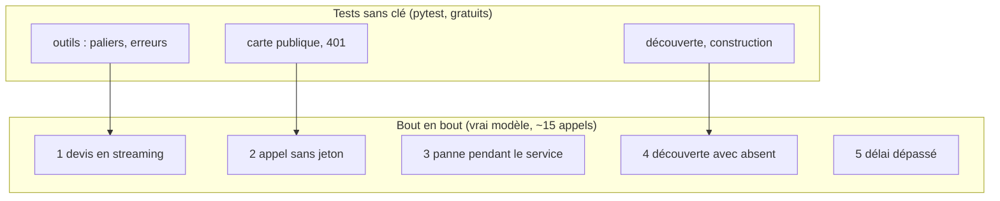

# Projet final : le système de devis de bout en bout

> [!NOTE]
> Dans ce projet, vous allez lancer les trois agents, exécuter la batterie de tests sans clé puis le test de bout en bout avec le vrai modèle, et étendre le système avec un quatrième agent en respectant les mêmes garanties (découverte, pannes, authentification).

## Le cahier des charges

Le système de devis doit :

1. répondre à « devis pour N articles » avec stock et total HT **justes** ;
2. refuser tout appel non authentifié à un agent ;
3. démarrer même si un spécialiste manque, et le dire ;
4. ne **jamais** inventer une valeur qu'un agent en panne aurait dû fournir ;
5. ne pas bloquer plus de `A2A_TIMEOUT` secondes sur un agent lent.



| Exigence | Vérifiée par |
| --- | --- |
| 1. Total juste | `e2e_a2a.py` scénario 1 (`204120`), `test_quote_price_paliers` |
| 2. Authentification | scénario 2, `test_rpc_refuse_sans_jeton_ou_mauvais_jeton` |
| 3. Démarrage dégradé | scénario 4, `test_orchestrateur_construit_un_outil_par_agent` |
| 4. Pas d'invention | scénarios 3 et 5 (valeurs interdites absentes) |
| 5. Délai borné | scénario 5 (`A2A_TIMEOUT=1`) |

## Étape 1 : installer et configurer

```bash
cd files
python -m venv .venv && . .venv/bin/activate
pip install -r requirements.txt
cp .env.example .env          # mettez votre clé et un A2A_TOKEN long et aléatoire
pytest -q                     # 13 tests, aucune clé nécessaire
```

## Étape 2 : lancer à la main (trois terminaux)

```bash
uvicorn stock_agent:app --port 8101
uvicorn pricing_agent:app --port 8102
uvicorn orchestrator:app --port 8100     # après les deux autres : il les découvre au démarrage
python client.py --stream "Je voudrais un devis pour 12 CHAISE-ERGO"
```

```quiz
question: "Vous lancez l'orchestrateur AVANT les deux spécialistes. Que se passe-t-il quand vous demandez un devis ?"
options:
  - "Tout fonctionne, la découverte attend les agents"
  - "L'orchestrateur n'a aucun outil et annonce que stock et tarification sont indisponibles"
  - "L'orchestrateur plante au démarrage"
answer: 1
explanation: "La découverte a lieu une fois, au démarrage, avec un délai de 2 s par agent. Les deux sont rangés dans missing : l'orchestrateur démarre sans outil et le dit. Relancez-le après les spécialistes (ou ajoutez une redécouverte, voir le module 2)."
```

## Étape 3 : le test de bout en bout

[e2e_a2a.py](../files/e2e_a2a.py) démarre lui-même les trois serveurs en sous-processus, attend que chaque carte réponde, enchaîne les 5 scénarios, puis arrête tout (bloc `finally`).

```python title="files/e2e_a2a.py"
def start(name: str, **env) -> subprocess.Popen:
    p = subprocess.Popen([sys.executable, "-m", "uvicorn", f"{name}:app", "--port", str(PORTS[name])],
                         cwd=HERE, env={**os.environ, **env},
                         stdout=subprocess.DEVNULL, stderr=subprocess.DEVNULL)
    card = f"http://localhost:{PORTS[name]}/.well-known/agent-card.json"
    for _ in range(60):  # attend que l'Agent Card réponde
        try:
            httpx.get(card, timeout=1).raise_for_status()
            return p
        except httpx.HTTPError:
            time.sleep(0.5)
    p.kill()
    raise RuntimeError(f"{name} n'a pas démarré")
```

> [!TIP]
> Attendre que la **carte** réponde est un bon test de disponibilité (*readiness*) : la carte n'est servie qu'après le *lifespan*, donc une fois les routes A2A montées.

## Résultat obtenu

Sortie complète de `python e2e_a2a.py`, le 2026-10-15, avec `gemini-3.5-flash` (une quinzaine d'appels au modèle) :

```text
1) Devis complet en streaming
   états : TASK_STATE_SUBMITTED > TASK_STATE_WORKING > artifactUpdate > TASK_STATE_COMPLETED
   réponse : Voici votre devis pour **12 unités** de la référence **CHAISE-ERGO** :  * **Disponibilité en stock :** 12 unités disponibles au total (12 unités à l'entrepôt de Lyon, 0 à Lille). * **Tarification :**   * Prix unitaire HT : 189,00 €   * Remise sur volume : 10 %   * **Total HT : 2 041,20 €**
2) Appel sans jeton
   HTTP 401
3) Panne de l'agent tarification pendant le service
   réponse : Voici les informations concernant votre demande de devis pour **6 unités de BUREAU-120** :  * **Disponibilité en stock :**   * Stock total disponible : **8 unités** (suffisant pour honorer votre demande de 6 unités).   * Répartition par entrepôt : **5 à Lille** et **3 à Lyon**.  * **Prix HT :**   *
4) Découverte avec un agent absent du réseau
   disponibles : ['stock_agent'] | absents : ['pricing_agent']
5) Délai dépassé (A2A_TIMEOUT=1 s)
   réponse : Bonjour,  Les services de vérification des stocks (`stock_agent`) et de calcul des prix (`pricing_agent`) sont actuellement indisponibles (délai d'attente dépassé).   Par conséquent, il est impossible de vérifier la disponibilité et de calculer le montant total HT pour les 3 exemplaires de la référe
OK : 5 scénarios passés
```

(Les réponses sont tronquées à 300 caractères par le script.)

```quiz
question: "Le scénario 3 vérifie que « 18753 » n'apparaît pas dans la réponse. Pourquoi ce test est-il plus fort qu'un simple « la tâche est COMPLETED » ?"
options:
  - "Il est plus rapide"
  - "Il prouve que l'orchestrateur n'a pas inventé le prix qu'il ne pouvait pas connaître, alors qu'une tâche terminée peut contenir une réponse fausse"
  - "Il vérifie que l'agent tarification a bien été arrêté"
answer: 1
explanation: "Une tâche COMPLETED dit seulement que l'orchestrateur a répondu. Chercher la valeur impossible (6 × 329 × 0,95 = 1 875,30) détecte une hallucination. C'est une assertion sur le contenu, pas sur la forme."
```

## Étape 4 : votre extension

Ajoutez l'agent **livraison** (port 8103) écrit au module 2 :

1. ajoutez-le à `registry.json` ;
2. adaptez l'instruction de l'orchestrateur (devis + délai) ;
3. ajoutez un test sans clé pour `delivery_delay` et un scénario e2e « devis et délai pour 6 BUREAU-120 à Lille » ;
4. ajoutez un scénario de panne : livraison arrêtée, le délai ne doit pas apparaître (« 3 jours » absent).

<details>
<summary>Voir la solution</summary>

```json title="registry.json"
{"agents": [
  {"name": "stock_agent", "url": "http://localhost:8101"},
  {"name": "pricing_agent", "url": "http://localhost:8102"},
  {"name": "delivery_agent", "url": "http://localhost:8103"}
]}
```

```python title="test_lab.py (ajout)"
import delivery_agent
def test_delivery_delay():
    assert delivery_agent.delivery_delay("Lille")["jours_ouvres"] == 3
    assert delivery_agent.delivery_delay("Brest")["jours_ouvres"] == 5
```

```python title="e2e_a2a.py (ajouts)"
PORTS["delivery_agent"] = 8103
# démarrer delivery_agent avec les autres, puis :
t = send(ORCH, "Devis et délai pour 6 BUREAU-120 livrés à Lille")
assert "187530" in digits(task_text(t)) and "3" in task_text(t)
procs.pop("delivery_agent").kill()
t = send(ORCH, "Délai pour 2 LAMPE-LED à Lille")
assert "3 jours" not in task_text(t)
```

Le test `test_orchestrateur_construit_un_outil_par_agent` continue de passer sans modification : `build_orchestrator` ne dépend que de ce que la découverte renvoie.

</details>

> [!WARNING]
> Le test de bout en bout coûte de vrais appels au modèle. Gardez-le hors de chaque commit : lancez `pytest` à chaque modification, et `e2e_a2a.py` avant une mise en production ou une fois par jour.

## Je sais faire

- [ ] Lancer un système de trois agents A2A et l'interroger en streaming
- [ ] Relier chaque exigence à un test qui la prouve
- [ ] Écrire un test de panne qui détecte une valeur inventée
- [ ] Ajouter un agent au système sans casser les garanties existantes
