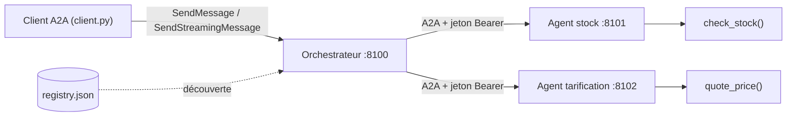

Un agent qui sait tout faire finit par tout mal faire. Les grandes organisations découpent donc leurs agents par métier : l'équipe logistique maintient l'agent **stock**, la direction commerciale l'agent **tarification**, et un **orchestrateur** compose leurs réponses. Ces agents vivent sur des serveurs différents, sont déployés à des rythmes différents, et parfois écrits avec des frameworks différents. Pour qu'ils se parlent, il faut un protocole commun : **A2A** (Agent2Agent).

Dans cette formation, vous construisez ce système pour de vrai, avec Google ADK 2.10 et le SDK `a2a-sdk` 1.2 : trois agents, trois ports, un registre, des pannes simulées et un jeton d'authentification entre agents.

## Pour qui ?

- Développeurs Python qui ont déjà écrit un agent ADK avec des outils (voir [Construire un agent IA de A à Z](../../../01-ia-generative/07-construire-un-agent-ia/index.md)).
- À l'aise avec HTTP, JSON et `uvicorn`. Aucune connaissance préalable d'A2A n'est nécessaire.

## Ce que vous construisez

Une demande « devis pour 12 chaises » arrive à l'orchestrateur, qui interroge le stock **et** la tarification en A2A, puis rédige une réponse unique. Si un agent tombe ou répond trop lentement, l'orchestrateur le dit au lieu d'inventer.

## Prérequis techniques

- Python 3.10 ou plus récent, `pip install -r requirements.txt` (installe `google-adk[a2a]==2.10.0`).
- Une clé Gemini (Google AI Studio) **ou** un projet Google Cloud avec Vertex AI.
- Pour le module 4 seulement : un projet Google Cloud avec facturation.

## Programme

| Module | Leçons | Durée indicative |
| --- | --- | --- |
| 1. Le protocole A2A | Agent Card et découverte ; tâches, messages et streaming | 1h |
| 2. Agents A2A avec ADK | Exposer un agent ; consommer un agent distant ; registre et découverte | 1h30 |
| 3. Robustesse et sécurité | Pannes et délais ; authentification entre agents | 1h15 |
| 4. Déploiement et projet final | Cloud Run et Agent Engine ; projet final de bout en bout | 1h15 |

Tout le code est dans [files/](./files/) : [stock_agent.py](./files/stock_agent.py), [pricing_agent.py](./files/pricing_agent.py), [orchestrator.py](./files/orchestrator.py), [common.py](./files/common.py), [client.py](./files/client.py), les tests [test_lab.py](./files/test_lab.py) (sans clé) et [e2e_a2a.py](./files/e2e_a2a.py) (vrai modèle).

## En local ou sur GCP ?

| | En local (modules 1 à 3) | Sur GCP (module 4) |
| --- | --- | --- |
| Modèle | clé Gemini (`GOOGLE_API_KEY`) ou Vertex AI | Vertex AI, identité du service |
| Agents | 3 processus `uvicorn` sur 8100 à 8102 | 3 services Cloud Run, ou Agent Engine |
| Authentification | jeton partagé `A2A_TOKEN` | IAM : jeton d'identité Google par appel |
| Coût | quelques appels au modèle | Cloud Run facture à l'usage ; supprimez tout à la fin |

> [!NOTE]
> Tout le lab a été exécuté le 2026-10-15 avec `gemini-3.5-flash` : 13 tests sans clé verts, et 5 scénarios de bout en bout réussis (une quinzaine d'appels au modèle). Les sorties réelles sont reproduites dans les sections « Résultat obtenu ».
