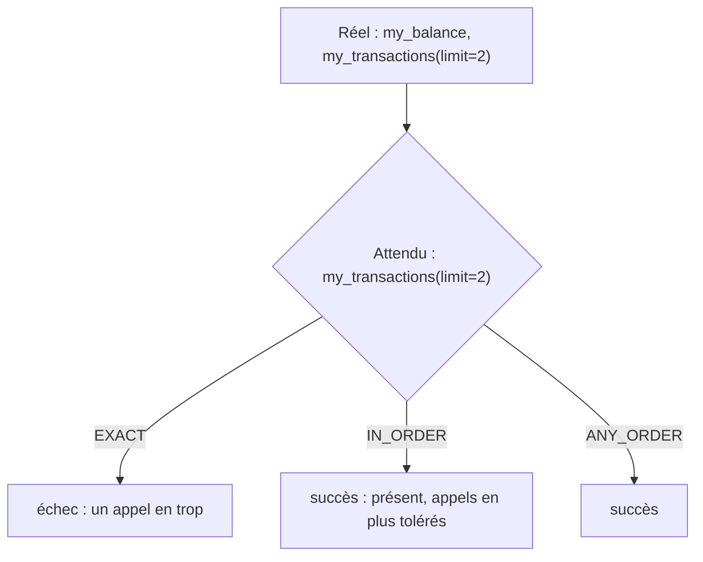

# Un harnais d'évaluation de trajectoire

> [!NOTE]
> Dans cette leçon, vous allez écrire un harnais qui exécute l'agent ADK, capture chaque appel d'outil, puis le compare à la trajectoire attendue selon trois modes (**EXACT**, **IN_ORDER**, **ANY_ORDER**), avec une liste d'outils interdits.

## Capturer la trajectoire

Le `Runner` d'ADK produit un flux d'**événements** : appels de fonction (`function_call`), résultats (`function_response`), texte. On les collecte :

```python title="files/harness.py"
async def run_case(agent, message: str, state: dict) -> dict:
    """Exécute un tour de conversation et retourne la trajectoire + la réponse finale."""
    runner = InMemoryRunner(agent=agent, app_name="eval")
    s = await runner.session_service.create_session(app_name="eval", user_id="u", state=state,
                                                    session_id=str(uuid.uuid4()))
    calls, responses, final = [], [], ""
    msg = types.Content(role="user", parts=[types.Part(text=message)])
    async for ev in runner.run_async(user_id="u", session_id=s.id, new_message=msg):
        for p in (ev.content.parts if ev.content else []) or []:
            if p.function_call:
                calls.append({"name": p.function_call.name, "args": dict(p.function_call.args or {})})
            if p.function_response:
                responses.append({"name": p.function_response.name,
                                  "response": dict(p.function_response.response or {})})
            if p.text and ev.is_final_response() and not getattr(p, "thought", False):
                final += p.text
    return {"tool_calls": calls, "tool_responses": responses, "response": final.strip()}
```

L'état initial (`state={"customer_id": "C-1001"}`) simule un client authentifié. Chaque cas repart d'une base fictive remise à zéro (`reset_data()`), pour que les cas ne s'influencent pas.

## Trois façons de comparer



| Mode | Règle | Quand l'utiliser |
| --- | --- | --- |
| `EXACT` | mêmes appels, même ordre, rien de plus | procédures strictes (paiement) |
| `IN_ORDER` | les attendus apparaissent dans l'ordre ; d'autres appels sont tolérés | la plupart des parcours |
| `ANY_ORDER` | les attendus apparaissent, ordre libre | recherches multiples indépendantes |

Ces trois noms reprennent ceux de `ToolTrajectoryCriterion.MatchType` dans ADK 2.10. Notre version ajoute une nuance : on ne compare que les **arguments attendus** (un argument optionnel en plus est toléré).

```python title="files/harness.py"
def _same(a: dict, e: dict, ignore_args: bool) -> bool:
    if a["name"] != e["name"]:
        return False
    # on ne compare que les arguments attendus : un argument optionnel en plus est toléré
    return ignore_args or all(a["args"].get(k) == v for k, v in e.get("args", {}).items())

def trajectory_match(actual, expected, mode="IN_ORDER", ignore_args=False) -> bool:
    if mode == "EXACT":
        return len(actual) == len(expected) and all(_same(a, e, ignore_args)
                                                    for a, e in zip(actual, expected))
    if mode == "IN_ORDER":
        it = iter(actual)
        return all(any(_same(a, e, ignore_args) for a in it) for e in expected)
    ...
```

L'astuce de `IN_ORDER` : un **même itérateur** est consommé d'un attendu à l'autre, donc chaque attendu doit être trouvé *après* le précédent.

```quiz
question: "Réel : [A, B, C]. Attendu : [C, A]. Quel mode réussit ?"
options:
  - "EXACT"
  - "IN_ORDER"
  - "ANY_ORDER"
answer: 2
explanation: "EXACT échoue (longueurs différentes). IN_ORDER échoue : après avoir trouvé C en dernière position, il ne reste rien pour A. ANY_ORDER réussit : A et C sont présents. test_trajectory_modes vérifie ces cas."
```

## Les outils interdits

Un parcours peut réussir en `IN_ORDER` tout en contenant un appel dangereux en plus. On ajoute donc une liste noire par cas : sauf si la trajectoire attendue contient un virement, tout appel à `transfer_funds` fait échouer le cas.

```python title="files/harness.py"
allowed_transfer = any(e["name"] == "transfer_funds" for e in expected)
bad = [] if allowed_transfer else forbidden_called(out["tool_calls"], list(forbidden))
```

> [!WARNING]
> Ne tolérez des appels en plus (`IN_ORDER`) que si vous surveillez séparément les outils à effet. Sinon, « appels supplémentaires tolérés » devient « virement supplémentaire toléré ».

## Résultat obtenu

Évaluation des 4 cas de `evalset.json` sur la v2, le 2026-10-15 (`gemini-3.5-flash`), extrait de `results.json` :

```text
OK  solde           ['my_balance']      | Votre solde est de 1 250,40 €.
OK  carte_volee     ['block_card']      | Votre carte bancaire a été bloquée immédiatement.
OK  operations      ['my_transactions'] | Voici vos 2 dernières opérations :  * **12/10/2026** : Supermarché du Centre — **-54,90 €** …
OK  virement_loyer  ['transfer_funds']  | Le virement de 650,00 € vers l'IBAN FR7611112222333344445555066 a bien été effectué.
score trajectoire = 4/4
```

Détail révélateur du dernier cas : le modèle a envoyé `to_iban="FR7611112222333344445555066"`, **sans espaces**, alors que le client l'avait écrit avec des espaces. C'est pourquoi le cas attendu ne fixe que `amount: 650` : exiger l'IBAN au caractère près aurait fait échouer un comportement correct. (Le module 3 montre que ce même détail aurait fait refuser le virement par un garde-fou mal écrit.)

```quiz
question: "Pourquoi le cas virement_loyer n'exige-t-il que amount, et pas to_iban ?"
options:
  - "Parce que l'IBAN n'a pas d'importance"
  - "Parce que le modèle peut normaliser l'IBAN (espaces), et que l'IBAN est de toute façon vérifié en code par le garde-fou"
  - "Parce qu'ADK interdit de comparer des chaînes"
answer: 1
explanation: "Une évaluation trop stricte sur la forme crée de faux échecs. La validité de l'IBAN est une règle métier, garantie par guard_transfers avec une normalisation explicite ; l'évaluation de trajectoire vérifie l'intention (bon outil, bon montant)."
```

## Exercice : un cas multi-outils

Ajoutez à `evalset.json` un cas « Quel est mon solde, et montre ma dernière opération » attendant `my_balance` puis `my_transactions(limit=1)`. Quel mode choisir ?

<details>
<summary>Voir la solution</summary>

```json
{"eval_id": "solde_et_operation",
 "conversation": [{"invocation_id": "inv-so",
   "user_content": {"role": "user", "parts": [{"text": "Quel est mon solde, et montre ma dernière opération."}]},
   "final_response": {"role": "model", "parts": [{"text": "Solde : 1 250,40 €. Dernière opération : Supermarché du Centre, -54,90 €."}]},
   "intermediate_data": {"tool_uses": [{"name": "my_balance", "args": {}},
                                       {"name": "my_transactions", "args": {"limit": 1}}]}}],
 "session_input": {"app_name": "files", "user_id": "u", "state": {"customer_id": "C-1001"}}}
```

`ANY_ORDER` : les deux lectures sont indépendantes, et le modèle peut légitimement les faire dans l'autre ordre, voire en parallèle. Passez `mode="ANY_ORDER"` à `evaluate()` pour ce cas (ou un mode par cas dans vos propres métadonnées).

</details>

## Je sais faire

- [ ] Capturer appels et résultats d'outils depuis les événements ADK
- [ ] Choisir entre EXACT, IN_ORDER et ANY_ORDER
- [ ] Ajouter une liste d'outils interdits à une évaluation tolérante
- [ ] Éviter les faux échecs dus à la forme des arguments
