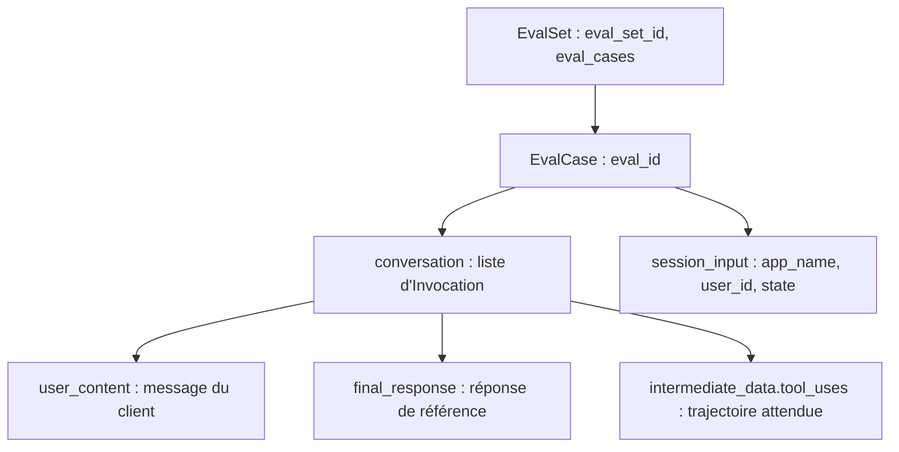

# Le format d'évaluation d'ADK et la commande adk eval

> [!NOTE]
> Dans cette leçon, vous allez écrire un **jeu d'évaluation** au format d'ADK 2.10 (`EvalSet`), le valider sans clé, le lancer avec `adk eval`, et comprendre une limite importante : la comparaison **exacte** des arguments.

## Le format `EvalSet`

Un fichier d'évaluation ADK est du JSON validé par les modèles Pydantic de `google.adk.evaluation` (`EvalSet`, `EvalCase`, `Invocation`). Les clés acceptent le `snake_case` ou le `camelCase`.



```json title="files/evalset.json (extrait)"
{
  "eval_set_id": "banque_atelier_support",
  "eval_cases": [{
    "eval_id": "solde",
    "conversation": [{
      "invocation_id": "inv-solde",
      "user_content": {"role": "user", "parts": [{"text": "Bonjour, quel est le solde de mon compte ?"}]},
      "final_response": {"role": "model", "parts": [{"text": "Le solde de votre compte est de 1 250,40 €."}]},
      "intermediate_data": {"tool_uses": [{"name": "my_balance", "args": {}}]}
    }],
    "session_input": {"app_name": "files", "user_id": "u", "state": {"customer_id": "C-1001"}}
  }]
}
```

`session_input.state` injecte l'identité du client avant le premier tour : c'est indispensable pour un agent dont les outils lisent `tool_context.state`.

> [!TIP]
> Le même fichier sert à deux outils : `adk eval` et notre harnais (`harness.load_evalset()` le charge avec `EvalSet.model_validate_json`). Une seule source de vérité pour les cas.

## Les critères : `test_config.json`

```json title="files/test_config.json"
{
  "criteria": {
    "tool_trajectory_avg_score": {"threshold": 1.0, "match_type": "IN_ORDER"},
    "response_match_score": 0.3
  }
}
```

| Critère | Ce qu'il mesure | Appel au modèle ? |
| --- | --- | --- |
| `tool_trajectory_avg_score` | trajectoire réelle contre `tool_uses` (modes EXACT, IN_ORDER, ANY_ORDER) | non |
| `response_match_score` | recouvrement de mots (ROUGE-1) avec `final_response` | non |
| `final_response_match_v2`, critères à grille (*rubric*) | jugement par un LLM | oui |

## Lancer `adk eval`

`adk eval` attend un **dossier d'agent** contenant un `__init__.py` qui expose `root_agent`. Le dossier `files/` du lab en contient un minimal :

```python title="files/__init__.py"
# Point d'entrée de `adk eval .` : ADK importe ce fichier et y cherche `root_agent`.
import os
import sys

sys.path.insert(0, os.path.dirname(os.path.abspath(__file__)))
from bank_agent import root_agent  # noqa: E402,F401
```

```bash
cd files
adk eval . evalset.json:solde,carte_volee --config_file_path test_config.json
```

La syntaxe `fichier:cas1,cas2` ne lance que les cas cités.

## Résultat obtenu

Exécution réelle le 2026-10-15 (4 appels au modèle) :

```text
Using evaluation criteria: criteria={'tool_trajectory_avg_score': BaseCriterion(threshold=1.0, include_intermediate_responses_in_final=False, match_type='IN_ORDER'), 'response_match_score': 0.3} …
*********************************************************************
Eval Run Summary
banque_atelier_support:
  Tests passed: 2
  Tests failed: 0
```

Le fichier de résultats écrit dans `files/.adk/eval_history/` donnait, par cas :

```text
carte_volee  tool_trajectory_avg_score=1.0  response_match_score=0.545  inference_call_count_v1=2  token_usage_v1=1247
solde        tool_trajectory_avg_score=1.0  response_match_score=0.952  inference_call_count_v1=2  token_usage_v1=1254
```

> [!WARNING]
> `adk eval` charge un `.env` en remontant les dossiers depuis celui de l'agent. Pendant notre essai, il a trouvé un `.env` d'un dossier parent et l'a signalé (« Both GOOGLE_API_KEY and GEMINI_API_KEY are set »). Vérifiez quelle clé et quel projet sont réellement utilisés, surtout en CI.

## La limite des arguments

Pourquoi n'avoir lancé que `solde` et `carte_volee` ? Dans ADK 2.10, `TrajectoryEvaluator` compare les arguments par **égalité stricte** du dictionnaire complet (`actual.args == expected.args`), sauf si l'on passe `ignore_args: true`. Pour `virement_loyer`, l'attendu `{"amount": 650}` ne sera jamais égal au réel `{"to_iban": "FR76…", "amount": 650}`.

| Besoin | `adk eval` (2.10) | Harnais du lab |
| --- | --- | --- |
| Arguments sans importance | `ignore_args: true` | `ignore_args=True` |
| Tous les arguments exacts | oui (par défaut) | oui, en les listant tous |
| **Seulement certains** arguments | non (critère personnalisé à écrire) | oui (`_same` ne compare que les clés attendues) |
| Outils interdits | non natif | `forbidden_called` |

```quiz
question: "Avec adk eval 2.10, l'attendu est transfer_funds avec args {\"amount\": 650} et l'agent appelle transfer_funds(to_iban=\"FR76…\", amount=650). Résultat ?"
options:
  - "Succès : le montant est bon"
  - "Échec : la comparaison des arguments est une égalité stricte de tout le dictionnaire"
  - "Erreur de format du fichier"
answer: 1
explanation: "Le code de TrajectoryEvaluator compare actual.args == expected.args. Il faut soit lister tous les arguments (et leur forme exacte), soit ignore_args, soit un critère personnalisé, comme le fait notre harnais."
```

```quiz
question: "Lequel de ces critères consomme des appels au modèle en plus de l'agent évalué ?"
options:
  - "tool_trajectory_avg_score"
  - "response_match_score"
  - "final_response_match_v2"
answer: 2
explanation: "Les deux premiers sont calculés en Python (comparaison de trajectoire, ROUGE). final_response_match_v2 utilise un LLM comme juge, donc des appels et un coût supplémentaires."
```

## Exercice : valider sans clé

Écrivez un test `pytest` qui échoue si `evalset.json` ou `test_config.json` ne respectent plus le format d'ADK.

<details>
<summary>Voir la solution</summary>

```python
import json
from google.adk.evaluation.eval_config import EvalConfig
from harness import load_evalset

def test_fichiers_adk_valides():
    es = load_evalset()                                   # EvalSet.model_validate_json
    assert all(c.session_input.state.get("customer_id") for c in es.eval_cases)
    EvalConfig.model_validate(json.load(open("test_config.json")))
```

Le lab contient déjà `test_evalset_au_format_adk`. Comme `EvalCase` refuse les champs inconnus (`extra="forbid"`), une faute de frappe dans une clé fait échouer le test immédiatement, sans appel au modèle.

</details>

## Je sais faire

- [ ] Écrire un `EvalSet` avec trajectoire attendue et état de session
- [ ] Configurer des critères dans `test_config.json`
- [ ] Lancer `adk eval` sur une sélection de cas
- [ ] Expliquer la limite de comparaison des arguments et la contourner
