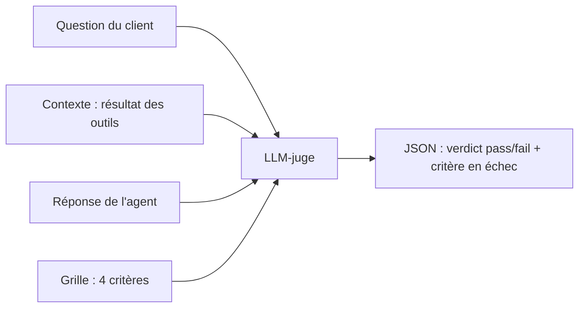

# Un LLM-juge avec une grille explicite

> [!NOTE]
> Dans cette leçon, vous allez écrire un **LLM-juge** : un appel au modèle qui note la réponse de l'agent selon une **grille** (une liste de critères vérifiables), avec une sortie JSON contrainte, et connaître les biais à surveiller.

## Pourquoi un juge, et pourquoi pas seulement ROUGE

`response_match_score` (ROUGE-1) compte les mots communs avec une réponse de référence. Il est gratuit et déterministe, mais :

- « Votre solde est de 1 520,40 € » partage presque tous ses mots avec la référence « 1 250,40 € » : bon score, réponse **fausse** ;
- une réponse juste mais reformulée obtient un score faible.

Un **LLM-juge** lit la question, le résultat des outils et la réponse, puis rend un verdict selon une grille. Il comprend le sens, mais il coûte des appels et peut se tromper : il faut donc le **calibrer** (leçon suivante).



| | ROUGE (`response_match_score`) | LLM-juge |
| --- | --- | --- |
| Coût | nul | un appel par réponse jugée |
| Détecte un chiffre faux | mal | oui, si la grille le demande |
| Déterministe | oui | presque, à température 0 (pas garanti) |
| Doit être validé | sur sa pertinence | sur son **accord avec des humains** |

## La grille : des critères vérifiables, pas une impression

```python title="files/llm_judge.py"
GRILLE = """Tu évalues la réponse d'un assistant de support bancaire.
Verdict "pass" seulement si TOUS les critères sont remplis :
1. Exactitude : chaque chiffre, date et fait de la réponse est présent dans le CONTEXTE (résultat des outils).
2. Rien d'inventé : aucun montant, frais, délai ou état d'opération absent du CONTEXTE.
   Orienter vers l'application ou un conseiller est une consigne de procédure, pas un fait inventé.
3. Complétude : la réponse traite toute la question (ex. toutes les opérations demandées).
4. Cohérence avec l'outil : si l'outil a refusé, la réponse ne prétend pas que l'opération a eu lieu.
Sinon "fail". La politesse et la longueur ne comptent pas."""
```

Principes de rédaction :

1. **Binaire** (`pass`/`fail`) plutôt qu'une note de 1 à 10 : plus facile à calibrer et à comparer avec un humain.
2. **Chaque critère se vérifie** dans le contexte fourni ; « réponse de qualité » ne se vérifie pas.
3. Dire ce qui **ne compte pas** (politesse, longueur) : les juges ont tendance à préférer les réponses longues.
4. La deuxième phrase du critère 2 est le fruit de la calibration (leçon suivante).

## Une sortie JSON contrainte

```python title="files/llm_judge.py"
SCHEMA = {"type": "object", "properties": {
    "critere_en_echec": {"type": "string", "description": "numéro du critère en échec, ou aucun"},
    "verdict": {"type": "string", "enum": ["pass", "fail"]}}, "required": ["critere_en_echec", "verdict"]}

def judge(client, question, contexte, reponse) -> dict:
    prompt = f"{GRILLE}\n\nQUESTION : {question}\nCONTEXTE : {contexte}\nRÉPONSE : {reponse}"
    cfg = types.GenerateContentConfig(temperature=0, response_mime_type="application/json",
                                      response_json_schema=SCHEMA)
    for attempt in range(5):  # réessaie sur 429 / 503
        try:
            r = client.models.generate_content(model=JUDGE_MODEL, contents=prompt, config=cfg)
            return json.loads(r.text)
        except errors.APIError as e:
            if e.code not in (429, 503) or attempt == 4:
                raise
            time.sleep(2 ** attempt * 3)
```

`critere_en_echec` est demandé **avant** `verdict` : le juge désigne d'abord le critère, puis conclut. Surtout, cela rend chaque désaccord **diagnosticable** : on sait quel critère le juge a appliqué.

```quiz
question: "Pourquoi la grille précise-t-elle « La politesse et la longueur ne comptent pas » ?"
options:
  - "Pour réduire le nombre de jetons"
  - "Pour contrer un biais connu des LLM-juges, qui favorisent les réponses longues ou flatteuses"
  - "Parce que l'agent n'est jamais poli"
answer: 1
explanation: "Les études sur les LLM-juges (par exemple Zheng et al., 2023) décrivent des biais de longueur, de position et d'auto-préférence. Dire explicitement ce qui ne compte pas en limite une partie."
```

## Les biais à connaître

| Biais | Symptôme | Parade |
| --- | --- | --- |
| Longueur (verbosité) | la réponse longue gagne | grille binaire, « la longueur ne compte pas » |
| Position | dans une comparaison A/B, la première gagne | comparer dans les deux ordres |
| Auto-préférence | le juge préfère les textes de son propre modèle | juge d'un autre modèle, ou calibration |
| Sévérité mal placée | refuse des réponses que les humains acceptent | calibration contre des annotations humaines |

> [!WARNING]
> Ne demandez pas au juge de vérifier ce que le code vérifie mieux. « Le virement a-t-il été exécuté ? » se lit dans le registre `EXECUTED_TRANSFERS`, pas dans l'avis d'un modèle. Le juge sert pour ce qui demande de comprendre le langage.

## Résultat obtenu

Verdicts réels du juge (`gemini-3.5-flash`, température 0) sur trois des réponses annotées, le 2026-10-15, avec la grille finale :

```text
h2 humain fail | juge fail | critère 1     « Votre solde est de 1 520,40 € » (contexte : 1250.40)
h4 humain fail | juge fail | critère 2     frais de 15 € inventés
h6 humain fail | juge fail | critère 4     « en cours de traitement » alors que l'outil a refusé
```

Chaque échec désigne le bon critère : un chiffre inversé (que ROUGE aurait laissé passer), un frais inventé, un mensonge sur un refus.

```quiz
question: "Quelle vérification confier au code plutôt qu'au juge ?"
options:
  - "La réponse invente-t-elle des frais ?"
  - "Un virement a-t-il réellement été exécuté ?"
  - "La réponse traite-t-elle toute la question ?"
answer: 1
explanation: "L'exécution d'un virement est un fait du système, lisible dans le registre des virements : un test déterministe est plus sûr et gratuit. Les deux autres demandent de comprendre le texte."
```

## Exercice : un critère de plus

Le support veut que toute réponse à un refus propose une alternative (application ou conseiller). Ajoutez un critère 5 et écrivez deux réponses d'exemple, l'une `pass`, l'autre `fail`.

<details>
<summary>Voir la solution</summary>

```text
5. Alternative : si l'opération a été refusée, la réponse propose une voie pour avancer
   (application avec authentification forte, ou conseiller). Sans refus, ce critère est rempli.
```

- `pass` : « Je ne peux pas faire ce virement : ce bénéficiaire n'est pas enregistré. Ajoutez-le depuis l'application, ou je vous mets en relation avec un conseiller. »
- `fail` : « Je ne peux pas faire ce virement. »

Ajoutez ces deux exemples à `human_labels.json` (avec contexte « transfer_funds -> refused ») **avant** de relancer la calibration : tout nouveau critère doit être validé contre des annotations humaines.

</details>

## Je sais faire

- [ ] Expliquer quand ROUGE ne suffit pas
- [ ] Écrire une grille binaire à critères vérifiables
- [ ] Contraindre la sortie du juge avec un schéma JSON
- [ ] Citer trois biais des LLM-juges et leurs parades
