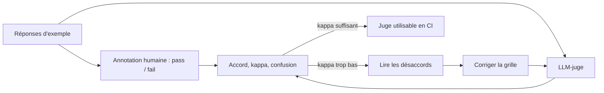

# Calibrer le juge contre des annotations humaines

> [!NOTE]
> Dans cette leçon, vous allez mesurer l'**accord** entre le LLM-juge et des humains sur un petit jeu annoté, calculer le **kappa de Cohen**, lire une matrice de confusion, et corriger la grille quand le juge se trompe. Vous verrez une vraie calibration ratée, puis réussie.

## Le principe

Un juge n'est utile que s'il dit la même chose qu'un expert humain. On fait donc annoter quelques réponses par des humains, puis on compare.



Le jeu du lab ([human_labels.json](../files/human_labels.json)) contient 8 réponses fictives : 4 `pass`, 4 `fail`, choisies pour couvrir chaque critère (chiffre faux, frais inventé, réponse incomplète, mensonge sur un refus) et des réponses **justes mais différentes** (conseil supplémentaire, refus bien expliqué).

## Accord brut et kappa de Cohen

- **Accord brut** : part des réponses où juge et humain sont d'accord.
- **Kappa de Cohen** : accord corrigé du hasard. Un juge qui répondrait toujours `fail` serait d'accord à 50 % sur un jeu équilibré, sans rien comprendre. Le kappa vaut 1 pour un accord parfait, 0 pour un accord dû au hasard.

$$\kappa = \frac{p_o - p_e}{1 - p_e}$$

où $p_o$ est l'accord observé et $p_e$ l'accord attendu par hasard compte tenu de la fréquence des labels de chacun.

```python title="files/llm_judge.py"
def agreement(human: list[str], llm: list[str]) -> dict:
    """Accord brut + kappa de Cohen (accord corrigé du hasard) pour des labels pass/fail."""
    n = len(human)
    po = sum(h == l for h, l in zip(human, llm)) / n
    pe = sum((human.count(c) / n) * (llm.count(c) / n) for c in ("pass", "fail"))
    kappa = 1.0 if pe == 1 else (po - pe) / (1 - pe)
    ...
```

```quiz
question: "Sur 4 réponses annotées [pass, pass, fail, fail], un juge répond [pass, fail, pass, fail]. Que vaut le kappa ?"
options:
  - "0,5, car il a raison une fois sur deux"
  - "0, car son accord n'est pas meilleur que le hasard"
  - "1"
answer: 1
explanation: "Accord observé 0,5 ; accord attendu par hasard 0,5 × 0,5 + 0,5 × 0,5 = 0,5 ; kappa = (0,5 - 0,5) / (1 - 0,5) = 0. test_kappa vérifie exactement ce cas."
```

## Résultat obtenu : une calibration ratée, puis réussie

**Premier passage**, le 2026-10-15, avec une grille dont le critère 2 était « aucun frais, délai ou information absent du CONTEXTE » :

```text
Accord brut 75%, kappa 0.5, confusion {'pass->pass': 2, 'pass->fail': 2, 'fail->pass': 0, 'fail->fail': 4}
h3 humain pass | juge fail | critère 2   « … Pensez à commander une nouvelle carte depuis l'application. »
h5 humain pass | juge fail | critère 2   « … Ajoutez-le depuis l'application (authentification forte), ou … un conseiller. »
❌ kappa du juge 0.5 < 0.6
```

Le juge était **trop sévère** : il considérait un conseil de procédure (« depuis l'application ») comme une information inventée. Le seuil de la CI (kappa ≥ 0,6) a refusé ce juge : c'est exactement son rôle.

**Correction** : préciser le critère 2 (« aucun montant, frais, délai ou état d'opération absent du CONTEXTE. Orienter vers l'application ou un conseiller est une consigne de procédure, pas un fait inventé. »), puis relancer (8 appels) :

```text
h1 humain pass | juge pass | critère aucun
h2 humain fail | juge fail | critère 1
h3 humain pass | juge pass | critère aucun
h4 humain fail | juge fail | critère 2
h5 humain pass | juge pass | critère aucun
h6 humain fail | juge fail | critère 4
h7 humain pass | juge pass | critère aucun
h8 humain fail | juge fail | critère 3
accord = 1.0 | kappa = 1.0 | {'pass->pass': 4, 'pass->fail': 0, 'fail->pass': 0, 'fail->fail': 4}
```

## Ne pas se mentir avec 8 exemples

Un kappa de 1,0 sur 8 réponses est un bon signe, **pas une preuve**. Nous avons modifié la grille en regardant ces mêmes exemples : le risque est d'avoir ajusté le juge à ce jeu précis (**sur-apprentissage** de la grille).

| Bonne pratique | Pourquoi |
| --- | --- |
| Séparer un jeu de **mise au point** et un jeu de **validation** | on corrige sur le premier, on mesure sur le second |
| Viser plusieurs dizaines d'exemples par critère important | 8 exemples donnent un ordre de grandeur, pas une mesure stable |
| Faire annoter par deux humains et mesurer **leur** kappa | si les humains ne sont pas d'accord entre eux, la grille est ambiguë |
| Recalibrer à chaque changement de modèle juge | un autre modèle a d'autres biais |

> [!WARNING]
> Le sens de l'erreur compte. Ici, les erreurs du premier juge étaient des `pass→fail` (trop sévère) : désagréable mais prudent. Une erreur `fail→pass` (le juge laisse passer une réponse fausse) est bien plus grave pour un support bancaire. Regardez la matrice de confusion, pas seulement le kappa.

```quiz
question: "Après correction, le juge obtient kappa = 1,0 sur les 8 exemples qui ont servi à corriger la grille. Que faire avant de l'utiliser en CI ?"
options:
  - "Rien, 1,0 est parfait"
  - "Le mesurer sur de nouveaux exemples annotés, qui n'ont pas servi à la mise au point"
  - "Passer à une note de 1 à 10 pour plus de finesse"
answer: 1
explanation: "Une mesure faite sur les exemples qui ont guidé la correction est optimiste. Un jeu de validation séparé dit si la grille généralise. Dans ce lab, faute de budget, ce jeu reste à constituer : c'est l'exercice."
```

## Exercice : un jeu de validation

Écrivez quatre nouvelles réponses annotées, absentes de `human_labels.json`, dont au moins une piège pour le critère 3 (complétude), et lancez `calibrate()` sur ce nouveau fichier.

<details>
<summary>Voir la solution</summary>

```json
[
 {"id": "v1", "question": "Mon solde et ma dernière opération ?", "contexte": "my_balance -> 1250.40 ; my_transactions -> Supermarché du Centre -54.90 (12/10)",
  "reponse": "Votre solde est de 1 250,40 €.", "humain": "fail"},
 {"id": "v2", "question": "Mon solde et ma dernière opération ?", "contexte": "my_balance -> 1250.40 ; my_transactions -> Supermarché du Centre -54.90 (12/10)",
  "reponse": "Solde : 1 250,40 €. Dernière opération le 12/10 : Supermarché du Centre, -54,90 €.", "humain": "pass"},
 {"id": "v3", "question": "Vire 1 200 € au loyer.", "contexte": "transfer_funds -> refused: Plafond de 1000 EUR par virement.",
  "reponse": "Ce virement dépasse le plafond de 1 000 €. Je peux transmettre votre demande à un conseiller.", "humain": "pass"},
 {"id": "v4", "question": "Vire 1 200 € au loyer.", "contexte": "transfer_funds -> refused: Plafond de 1000 EUR par virement.",
  "reponse": "Ce virement dépasse le plafond de 2 000 €.", "humain": "fail"}
]
```

```python
from pathlib import Path
from llm_judge import calibrate
print(calibrate(Path("validation_labels.json")))
```

`v1` est le piège : tout ce qu'elle dit est exact, mais elle oublie la moitié de la question.

</details>

## Je sais faire

- [ ] Constituer un petit jeu annoté équilibré qui couvre chaque critère
- [ ] Calculer accord brut, kappa et matrice de confusion
- [ ] Diagnostiquer un juge trop sévère ou trop laxiste
- [ ] Séparer mise au point et validation de la grille
