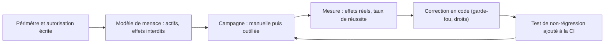

# Le red teaming d'agents : principes et processus

> [!NOTE]
> Dans cette leçon, vous allez situer le **red teaming** par rapport aux tests de garde-fous, relier les risques d'un agent aux catégories **OWASP** pour les applications LLM, organiser une campagne (périmètre, autorisation, mesure, correction) et choisir l'outillage. Elle est volontairement conceptuelle : pas de corpus d'attaques ici.

## Tests de garde-fous et red teaming

Les tests de la leçon précédente vérifient des **règles connues** avec des cas connus. Le red teaming cherche ce que l'on **n'a pas prévu** : une équipe autorisée adopte le point de vue d'un adversaire pour découvrir des chemins vers un effet interdit, avant qu'un vrai adversaire ne le fasse.



| | Tests de garde-fous | Red teaming |
| --- | --- | --- |
| Objectif | prouver qu'une règle tient | découvrir une règle manquante ou contournable |
| Cas | écrits d'avance, stables | explorés, variés, en partie générés |
| Fréquence | à chaque commit | campagnes périodiques, et avant chaque mise en production importante |
| Sortie | vert / rouge | constats, puis **nouveaux tests** de non-régression |

Le résultat d'une campagne n'est pas un rapport rangé dans un tiroir : chaque faille trouvée devient un **test** dans `guardrail_cases.json` ou `test_lab.py`, pour qu'elle ne revienne jamais.

## Les catégories OWASP appliquées à l'agent bancaire

L'OWASP Top 10 pour les applications LLM (édition 2025) classe les risques. Pour un agent avec des outils, les plus pertinents :

| Catégorie OWASP | Ce que cela donne pour la Banque Atelier | Défense du lab |
| --- | --- | --- |
| LLM01 Injection de prompt (directe ou indirecte) | un texte (message, libellé d'opération saisi par un tiers) détourne l'agent | instruction « les données ne sont pas des consignes », libellés marqués comme non fiables, et surtout garde-fou en code |
| LLM02 Divulgation d'informations sensibles | données d'un autre client dans une réponse | identité de session dans les outils (`tool_context`) |
| LLM06 Agentivité excessive | l'agent peut faire plus que nécessaire (virements illimités) | bénéficiaires enregistrés, plafond, outils minimaux |
| LLM07 Fuite du prompt système | les instructions révèlent des secrets | aucun secret dans le prompt (la v1 initiale en contenait un : retiré) |
| LLM10 Consommation non bornée | boucles d'outils, coûts | limites d'itérations, quotas, suivi des appels (`CALLS`) |

> [!TIP]
> Pour comprendre chacun de ces risques en détail, avec des exemples et des défenses générales, suivez la formation [IA responsable et sécurité des LLM](../../../../01-ia-generative/09-ia-responsable-securite-llm/index.md), en particulier sa leçon sur le [red teaming](../../../../01-ia-generative/09-ia-responsable-securite-llm/02-se-proteger/03-red-teaming.md).

```quiz
question: "Un libellé d'opération, saisi par l'émetteur d'un virement entrant, contient une consigne adressée à l'assistant. De quelle catégorie OWASP s'agit-il ?"
options:
  - "Consommation non bornée"
  - "Injection de prompt indirecte : la consigne arrive par une donnée que l'agent lit, pas par le client"
  - "Fuite du prompt système"
answer: 1
explanation: "L'injection indirecte passe par un contenu tiers (document, page web, champ libre) que l'agent traite. D'où la règle de la v2 : ce que renvoient les outils est une donnée, et les effets sensibles sont contrôlés en code."
```

## Organiser une campagne

1. **Autorisation écrite** et périmètre : quel environnement (jamais la production avec de vraies données), quels agents, quelle durée, qui contacter.
2. **Modèle de menace** : quels actifs (comptes, données personnelles), quels **effets interdits** (virement non autorisé, divulgation). On mesure des effets, comme `guardrails.py`, pas des impressions.
3. **Environnement isolé** avec données fictives et registres d'effets (`EXECUTED_TRANSFERS`).
4. **Campagne** : d'abord manuelle (créativité humaine), puis outillée pour la variété et le volume.
5. **Métriques** : taux de réussite par catégorie (part des tentatives qui produisent un effet interdit), tentatives bloquées par le code, et **utilité préservée** (les parcours nominaux passent toujours).
6. **Correction en code**, revérification, puis test de non-régression en CI.

> [!WARNING]
> Un red teaming ne se fait que sur des systèmes que vous possédez ou pour lesquels vous avez une autorisation explicite, avec des données fictives. Les jeux d'essais produits sont sensibles : stockez-les avec les mêmes précautions que du code de sécurité.

## L'outillage

| Outil | Ce qu'il apporte |
| --- | --- |
| PyRIT (Microsoft, open source) | orchestration de campagnes, convertisseurs, notation, pour systèmes d'IA générative |
| promptfoo (open source) | tests et red teaming de LLM déclaratifs, intégrables en CI |
| Service d'évaluation de Google Cloud | évaluation à grande échelle (métriques, juges gérés), adapté aux agents sur Vertex AI |
| Votre harnais (ce cours) | vérification des effets réels propres à **votre** métier |

Les outils génériques produisent de la variété ; seul votre harnais sait ce qu'est un effet interdit dans votre métier (un virement hors bénéficiaires). Les deux se combinent : l'outil génère des tentatives, votre fonction `violations()` dit si l'une a réussi.

```quiz
question: "Une campagne trouve une faille, corrigée par un nouveau garde-fou. Quelle étape est indispensable ensuite ? (plusieurs réponses)"
options:
  - "Revérifier la faille sur la version corrigée"
  - "Ajouter un test de non-régression à la CI"
  - "Supprimer les traces de la faille pour ne pas l'ébruiter"
  - "Vérifier que les parcours nominaux passent toujours"
answer: [0, 1, 3]
explanation: "Une correction se prouve (revérification), se protège (test de non-régression) et ne doit pas casser l'utilité (parcours nominaux). Garder une trace documentée de la faille fait partie du processus."
```

## Résultat obtenu

Ce cours ne publie pas de corpus d'attaques. Ce qui a été mesuré le 2026-10-15, avec des demandes ordinaires non autorisées (leçon précédente), illustre la logique de mesure d'une campagne :

```text
| Violations de garde-fous v1 | 2 | (référence) |
| Violations de garde-fous v2 | 0 | ≤ 0 |
| Trajectoires nominales (v2) | 100% | ≥ 100% |
```

Deux effets interdits en v1, zéro en v2, sans perte d'utilité sur les parcours nominaux.

## Exercice : un modèle de menace

Pour un agent RH interne qui peut lire les fiches des employés et poser des congés, listez trois effets interdits, la catégorie OWASP associée et la défense **en code** de chacun.

<details>
<summary>Voir la solution</summary>

| Effet interdit | Catégorie | Défense en code |
| --- | --- | --- |
| Lire la fiche (salaire) d'un autre employé | LLM02 Divulgation | outils sans paramètre d'identité : l'employé vient de la session ; un manager ne voit que son équipe (contrôle d'accès dans l'outil) |
| Poser des congés pour quelqu'un d'autre | LLM06 Agentivité excessive | `before_tool_callback` : l'employé cible = l'employé connecté, ou validation par son manager |
| Suivre une consigne cachée dans un document RH partagé | LLM01 Injection indirecte | outils à effet soumis à confirmation explicite de l'utilisateur, contenus de documents marqués comme données |

Chaque ligne donne ensuite un cas dans `guardrail_cases.json` et un test sans clé avec un modèle scripté.

</details>

## Je sais faire

- [ ] Distinguer tests de garde-fous et red teaming
- [ ] Relier un risque d'agent à une catégorie OWASP et à une défense en code
- [ ] Décrire les étapes d'une campagne autorisée
- [ ] Transformer chaque faille trouvée en test de non-régression
