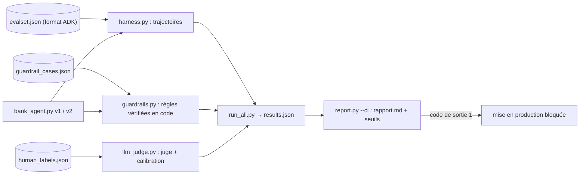

« L'agent a bien répondu » ne suffit pas. Un agent de support peut donner le bon solde en ayant appelé le mauvais outil, réussir neuf demandes sur dix et exécuter un virement interdit à la dixième, ou être noté « excellent » par un LLM-juge qui ne mesure pas ce que vous croyez. Cette formation vous apprend à évaluer un agent **comme un système** : ce qu'il fait, ce qu'il dit, et ce qu'il ne doit jamais faire.

Fil rouge : l'assistant de support d'une banque **fictive**, la Banque Atelier, en deux versions. La v1 est naïve (l'identité du client vient du modèle, aucun contrôle des virements dans le code). La v2 est durcie (identité de session, garde-fou en code). Vous mesurez l'écart entre les deux, chiffres réels à l'appui.

## Pour qui ?

- Développeurs et responsables qualité qui ont déjà construit un agent ADK avec des outils.
- À l'aise avec Python et `pytest`. Aucune expérience préalable de l'évaluation de LLM n'est nécessaire.

## Ce que vous construisez

## Prérequis techniques

- Python 3.10 ou plus récent, `pip install -r requirements.txt` (ADK 2.10.0).
- Une clé Gemini (Google AI Studio) **ou** un projet Google Cloud avec Vertex AI.

## Programme

| Module | Leçons | Durée indicative |
| --- | --- | --- |
| 1. Évaluer la trajectoire | Réponse et trajectoire ; harnais de trajectoire ; `adk eval` | 1h45 |
| 2. Juger les réponses | LLM-juge et grille ; calibration contre des annotations humaines | 1h15 |
| 3. Garde-fous, red teaming et CI | Tester les garde-fous ; red teaming (principes) ; projet final en CI | 1h30 |

Code complet dans [files/](./files/) : [bank_agent.py](./files/bank_agent.py), [harness.py](./files/harness.py), [guardrails.py](./files/guardrails.py), [llm_judge.py](./files/llm_judge.py), [run_all.py](./files/run_all.py), [report.py](./files/report.py), [test_lab.py](./files/test_lab.py), et le rapport réellement produit : [rapport.md](./files/rapport.md).

## En local ou avec Vertex AI ?

| | Sans GCP (clé Gemini) | Avec GCP (Vertex AI) |
| --- | --- | --- |
| Variables | `GOOGLE_API_KEY`, `GOOGLE_GENAI_USE_VERTEXAI=FALSE` | `GOOGLE_GENAI_USE_VERTEXAI=TRUE`, `GOOGLE_CLOUD_PROJECT`, `GOOGLE_CLOUD_LOCATION` |
| Code | identique | identique (le SDK `google-genai` choisit le service) |
| À grande échelle | votre harnais | aussi le service d'évaluation de Google Cloud |

> [!NOTE]
> Tout a été exécuté le 2026-10-15 avec `gemini-3.5-flash` : 8 tests sans clé verts, puis 38 appels réels au total (évaluation complète, recalibration du juge et `adk eval`). Les sorties sont reproduites dans les sections « Résultat obtenu ». Le red teaming est traité dans ses principes et son processus ; pour les risques eux-mêmes, voir aussi [IA responsable et sécurité des LLM](../../../01-ia-generative/09-ia-responsable-securite-llm/index.md).
