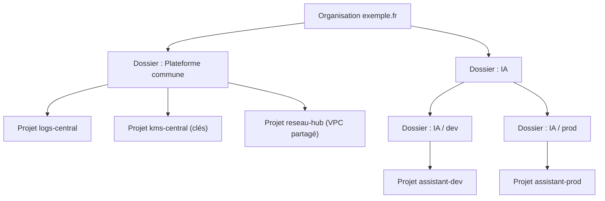

# Une landing zone pour l'IA

> [!NOTE]
> Dans cette leçon, vous allez découper votre organisation Google Cloud en dossiers et projets adaptés à l'IA, fixer la résidence des données dans l'UE, et prendre en main le module Terraform du lab.

## Pourquoi un socle avant le premier prompt ?

Une **landing zone** (zone d'atterrissage) est l'ensemble des fondations communes d'un environnement cloud : hiérarchie des ressources, identités, réseau, sécurité, journalisation, facturation. Une équipe qui arrive y « atterrit » et trouve déjà les règles en place.

Pour l'IA, ce socle répond à des questions que tout comité de sécurité pose :

| Question du comité | Réponse de la landing zone | Leçon |
| --- | --- | --- |
| Qui peut appeler le modèle ? | IAM au moindre privilège, comptes de service dédiés | 1.2 |
| Les données sortent-elles par internet ? | VPC privé + Private Service Connect | 2.1 |
| Un identifiant volé permet-il d'exfiltrer ? | VPC Service Controls | 2.2 |
| Qui détient la clé de chiffrement ? | CMEK dans Cloud KMS | 2.3 |
| Les données restent-elles dans l'UE ? | région unique + contrainte d'organisation | 2.3 |
| Qui peut ouvrir l'assistant ? | Cloud Run privé derrière IAP | 3.1 |
| Que fait-on d'un prompt malveillant ? | Model Armor | 3.2 |
| Peut-on prouver qui a fait quoi ? | journaux d'audit, rétention | 3.2 |
| Combien ça coûte, au pire ? | quotas, plafond d'instances, budgets | 3.3 |

## Organiser les projets

Dans Google Cloud, tout vit dans une hiérarchie : **organisation** (votre domaine) → **dossiers** → **projets** → ressources. Les droits et les règles (contraintes d'organisation) se **héritent** de haut en bas.



Principes retenus :

1. **Un projet par application et par environnement** (`assistant-dev`, `assistant-prod`) : les quotas, budgets, droits et journaux sont isolés. Une erreur en dev ne touche pas la prod.
2. **Les clés à part** : un projet dédié à Cloud KMS, administré par l'équipe sécurité, sépare « qui gère les données » de « qui gère les clés » (séparation des tâches).
3. **Les règles en haut** : la contrainte « ressources dans l'UE uniquement » se pose sur le dossier IA, pas projet par projet.

> [!TIP]
> Le module du lab vise **un** projet (celui de l'application), pour rester déployable sans droits d'organisation. En entreprise, vous l'instanciez une fois par projet (`dev`, `prod`) et les clés vivent dans le projet KMS central : seule la variable de la clé change.

```quiz
question: "Pourquoi séparer les projets dev et prod de l'assistant plutôt que d'utiliser des labels dans un seul projet ?"
options:
  - "Parce que les labels ne sont pas supportés par Vertex AI"
  - "Parce que les droits IAM, les quotas, les budgets et les périmètres VPC-SC s'appliquent au niveau projet : un seul projet mélangerait les deux environnements"
  - "Parce que Google facture moins cher deux petits projets qu'un gros"
answer: 1
explanation: "Le projet est la frontière d'isolation : IAM, quotas, budgets et périmètres s'y attachent. Les labels servent à ventiler les coûts, pas à isoler. Le prix ne dépend pas du nombre de projets."
```

## Résidence des données UE

Trois couches, de la plus souple à la plus stricte :

| Couche | Ce qu'elle garantit | Dans le module |
| --- | --- | --- |
| Variable `region` validée | le code refuse toute région hors `europe-` | `validation` dans `variables.tf` |
| Ressources régionales | bucket, clé KMS, logs, Cloud Run, Model Armor dans `europe-west1` | partout `var.region` |
| Contrainte `gcp.resourceLocations` | Google refuse de créer une ressource hors UE, même à la main | `google_org_policy_policy.eu_only` |

```hcl title="files/variables.tf (extrait)"
variable "region" {
  type    = string
  default = "europe-west1"

  validation {
    condition     = startswith(var.region, "europe-")
    error_message = "Résidence des données UE : la région doit commencer par europe-."
  }
}
```

> [!WARNING]
> La région d'un appel Gemini compte aussi : un client Vertex AI configuré sur `global` ou `us-central1` traite la requête ailleurs. L'application lit `GOOGLE_CLOUD_LOCATION=europe-west1`, injecté par Terraform dans Cloud Run.

```quiz
question: "Un développeur crée à la main, dans la console, un bucket en us-central1 dans le projet assistant-prod. Quelle couche l'en empêche ?"
options:
  - "La validation de la variable region dans Terraform"
  - "La contrainte d'organisation gcp.resourceLocations (in:eu-locations)"
  - "Le périmètre VPC Service Controls"
answer: 1
explanation: "La validation Terraform ne voit que ce qui passe par Terraform. Le périmètre VPC-SC contrôle les flux d'accès, pas la localisation. Seule la contrainte d'organisation est appliquée par Google à toute création, quel que soit l'outil."
```

## Le module Terraform du lab

**Terraform** décrit l'infrastructure dans des fichiers `.tf` ; `plan` calcule ce qu'il faudrait créer, `apply` le crée. Le module est découpé par couche :

| Fichier | Couche |
| --- | --- |
| [versions.tf](../files/versions.tf) | versions de Terraform et du provider, labels par défaut |
| [variables.tf](../files/variables.tf) | paramètres (projet, région, domaine, options d'organisation) |
| [apis_iam.tf](../files/apis_iam.tf) | API activées, compte de service, rôles |
| [network.tf](../files/network.tf) | VPC, sous-réseau, PSC, DNS privé, pare-feu |
| [data_protection.tf](../files/data_protection.tf) | KMS, bucket CMEK, audit, bucket de logs |
| [perimeter.tf](../files/perimeter.tf) | VPC Service Controls |
| [app.tf](../files/app.tf) | Cloud Run, load balancer, IAP |
| [guardrails.tf](../files/guardrails.tf) | Model Armor, contrainte UE, budget |
| [outputs.tf](../files/outputs.tf) | valeurs utiles après déploiement |

```hcl title="files/versions.tf (extrait)"
required_providers {
  google = {
    source  = "hashicorp/google"
    version = "~> 6.0"
  }
}

provider "google" {
  project        = var.project_id
  region         = var.region
  default_labels = var.labels # formation-lab = architecture-ia sur tout ce qui accepte un label
}
```

## Exercice

Vous avez trois applications IA (assistant RH, résumé de contrats, chatbot client) en dev et en prod. Proposez une hiérarchie de dossiers et projets, et dites où vous posez la contrainte de localisation UE.

<details>
<summary>Voir la solution</summary>

```text
Organisation
├── Plateforme commune/  logs-central, kms-central, reseau-hub
└── IA/                     ← contrainte gcp.resourceLocations = in:eu-locations
    ├── dev/   rh-dev, contrats-dev, chatbot-dev
    └── prod/  rh-prod, contrats-prod, chatbot-prod
```

Six projets applicatifs (un par application et par environnement), plus les projets communs. La contrainte est posée **une fois** sur le dossier `IA` et héritée par les six projets. Le chatbot client, exposé à l'extérieur, peut avoir son propre périmètre VPC-SC, distinct des outils internes.

</details>

## Résultat obtenu

Validation locale du module, le 2026-10-15 (Terraform 1.16.0, provider google 6.50.0) :

```text
$ terraform init -backend=false
- Installing hashicorp/google v6.50.0...
- Installed hashicorp/google v6.50.0 (signed by HashiCorp)
Terraform has been successfully initialized!
$ terraform validate
Success! The configuration is valid.
$ terraform fmt -check && echo FMT_OK
FMT_OK
```

## Je sais faire

- [ ] Expliquer ce qu'est une landing zone et ce qu'elle apporte à un projet IA
- [ ] Proposer une hiérarchie organisation / dossiers / projets par application et environnement
- [ ] Combiner les trois couches de résidence UE
- [ ] Initialiser et valider le module Terraform sans backend
