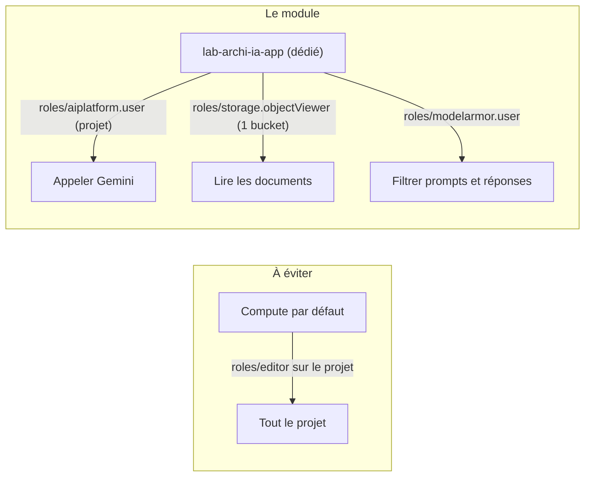

# IAM au moindre privilège et comptes de service

> [!NOTE]
> Dans cette leçon, vous allez donner à l'assistant une identité propre avec quatre rôles minimaux, comprendre pourquoi les clés de comptes de service sont à bannir, et lancer un contrôle de posture IAM en lecture seule sur un projet réel.

## Les trois mots de l'IAM

**IAM** (Identity and Access Management) répond à « qui peut faire quoi sur quelle ressource ». Une **liaison** (binding) associe :

- un **membre** : `user:`, `group:`, `serviceAccount:` (identité d'un programme) ;
- un **rôle** : un paquet de permissions, par exemple `roles/aiplatform.user` qui permet d'appeler les modèles Vertex AI ;
- une **ressource** : projet, bucket, clé KMS, service Cloud Run…

Le **moindre privilège** consiste à donner le plus petit rôle, sur la plus petite ressource, au plus petit groupe.



| Rôle | Pourquoi l'assistant en a besoin | Ce qu'il ne permet pas |
| --- | --- | --- |
| `roles/aiplatform.user` | appeler Gemini sur Vertex AI | supprimer des ressources Vertex, gérer IAM |
| `roles/storage.objectViewer` **sur le bucket** | lire les documents de connaissances | lire les autres buckets, écrire |
| `roles/modelarmor.user` | appeler Model Armor | modifier les modèles Model Armor |
| `roles/logging.logWriter`, `roles/monitoring.metricWriter` | écrire ses journaux et métriques | lire les journaux des autres |

```hcl title="files/apis_iam.tf (extrait)"
resource "google_service_account" "app" {
  account_id   = "${var.prefix}-app"
  display_name = "Assistant interne (Cloud Run)"
}

resource "google_project_iam_member" "app_roles" {
  for_each = toset([
    "roles/aiplatform.user",
    "roles/logging.logWriter",
    "roles/monitoring.metricWriter",
    "roles/modelarmor.user",
  ])
  project = var.project_id
  role    = each.value
  member  = google_service_account.app.member
}

# Lecture du seul bucket de connaissances, pas de tous les buckets du projet.
resource "google_storage_bucket_iam_member" "app_reads_kb" {
  bucket = google_storage_bucket.kb.name
  role   = "roles/storage.objectViewer"
  member = google_service_account.app.member
}
```

> [!TIP]
> On utilise `google_project_iam_member` (ajoute **une** liaison) et non `google_project_iam_policy` ou `_binding` (qui **remplacent** la politique ou la liste des membres d'un rôle) : un module applicatif ne doit jamais effacer les droits posés par d'autres.

## Pas de clés de comptes de service

Une **clé de compte de service** est un fichier JSON qui permet à n'importe qui le possédant d'agir comme ce compte, sans expiration par défaut. C'est la première cause de fuite d'identifiants cloud. Les alternatives :

| Où tourne le code | Identité sans clé |
| --- | --- |
| Cloud Run, Cloud Functions, GKE | le compte de service attaché (ici `template.service_account`) |
| Poste d'un développeur | `gcloud auth application-default login` (ses propres droits) |
| CI GitHub / GitLab | Workload Identity Federation (jeton OIDC échangé contre un jeton Google) |

La contrainte d'organisation `iam.disableServiceAccountKeyCreation` interdit d'en créer.

```quiz
question: "Le compte Compute par défaut (PROJECT_NUMBER-compute@developer.gserviceaccount.com) a souvent roles/editor. Pourquoi est-ce dangereux pour une plateforme IA ?"
options:
  - "Parce qu'il ne peut pas appeler Vertex AI"
  - "Parce que tout service qui l'utilise par défaut (Cloud Run, VM) hérite d'un droit d'écriture sur presque tout le projet : une injection de prompt qui fait exécuter du code devient une prise de contrôle du projet"
  - "Parce qu'il coûte plus cher qu'un compte dédié"
answer: 1
explanation: "roles/editor donne l'écriture sur la quasi-totalité des ressources. Tout service lancé sans compte explicite l'utilise. Un compte dédié à rôles minimaux limite les dégâts d'une compromission. Les comptes de service ne sont pas facturés."
```

## Contrôler la posture en lecture seule

Le script [check_posture.py](../files/check_posture.py) appelle trois API **en lecture** (Service Usage, Resource Manager `getIamPolicy`, IAM) puis passe le tout à une fonction pure, `evaluate`, testable sans réseau.

```python title="files/check_posture.py (extrait)"
for b in bindings:
    for m in b.get("members", []):
        if m in PUBLIC:                       # allUsers, allAuthenticatedUsers
            public.append(f"{m} -> {b['role']}")
        if m == default_sa:
            default_sa_roles.append(b["role"])
        if b["role"] in PRIMITIVE:            # roles/owner, roles/editor
            (sa_primitive if m.startswith("serviceAccount:") else humans_primitive).append(m)
```

Le rapport **masque les adresses** (`user:al***@exemple.fr`) : un rapport circule, il ne doit pas devenir une fuite de données personnelles.
```bash
pip install -r requirements.txt
pytest -q                                    # 4 tests, sans réseau
gcloud auth application-default login
python check_posture.py --project mon-projet # code de sortie 1 s'il y a un FAIL
```

> [!WARNING]
> Le script n'a besoin que de rôles de lecture : `roles/iam.securityReviewer` et `roles/serviceusage.serviceUsageViewer`. Ne le lancez pas avec un compte owner « parce que c'est plus simple » : un outil d'audit doit lui-même respecter le moindre privilège.

```quiz
question: "Quelle ressource Terraform utiliser pour ajouter roles/aiplatform.user à un groupe sans risquer d'effacer les autres membres de ce rôle ?"
options:
  - "google_project_iam_policy"
  - "google_project_iam_binding"
  - "google_project_iam_member"
answer: 2
explanation: "_member ajoute une seule liaison membre-rôle. _binding fait autorité sur la liste complète des membres d'un rôle, et _policy sur toute la politique du projet : les deux peuvent retirer des accès posés ailleurs."
```

## Exercice

Ajoutez au script un contrôle : « aucun **utilisateur** individuel (`user:`) ne doit avoir `roles/aiplatform.admin` ; seuls des groupes le peuvent ». Écrivez aussi le test correspondant.

<details>
<summary>Voir la solution</summary>

Dans `evaluate`, après la boucle :

```python
admins = [m for b in bindings if b["role"] == "roles/aiplatform.admin"
          for m in b.get("members", []) if m.startswith("user:")]
out.append(("WARN" if admins else "OK", "Admins Vertex AI nominatifs",
            ", ".join(mask(m) for m in admins) or "aucun (groupes uniquement)"))
```

Et dans `test_check_posture.py` :

```python
def test_admin_vertex_nominatif():
    policy = {"bindings": [{"role": "roles/aiplatform.admin", "members": ["user:bob@exemple.fr"]}]}
    r = levels(evaluate(N, set(EXPECTED_APIS), policy, {}))
    assert r["Admins Vertex AI nominatifs"] == "WARN"
```

</details>

## Résultat obtenu

Exécution réelle le 2026-10-15 sur un projet de test (identifiant masqué), en lecture seule :

```text
$ pytest -q
....                                                                     [100%]
4 passed in 0.01s
$ python check_posture.py --project <projet-de-test>
[WARN] API attendues                        manquantes : cloudkms.googleapis.com, iap.googleapis.com, modelarmor.googleapis.com, accesscontextmanager.googleapis.com
[OK  ] Accès public (allUsers)              aucun
[FAIL] Compte Compute par défaut            a roles/editor
[OK  ] Comptes de service owner/editor      aucun
[OK  ] Humains owner/editor                 1 (cible : 3 au plus, idéalement via un groupe)
[OK  ] Clés de comptes de service           aucune clé utilisateur
[WARN] Audit accès aux données Vertex AI    manque DATA_READ, DATA_WRITE

7 contrôles : 1 FAIL, 2 WARN
```

Lecture : le projet de test a le défaut classique (compte Compute par défaut en `roles/editor`), et les journaux d'accès aux données de Vertex AI ne sont pas activés. Le module Terraform corrige le second point (leçon 3.2) ; le premier se corrige en retirant le rôle après avoir donné un compte dédié à chaque service.

## Je sais faire

- [ ] Choisir des rôles prédéfinis minimaux et les poser à la bonne granularité (projet ou ressource)
- [ ] Expliquer pourquoi `_member` plutôt que `_binding` ou `_policy`
- [ ] Remplacer une clé de compte de service par une identité sans clé
- [ ] Lancer un contrôle de posture IAM en lecture seule et interpréter le rapport
