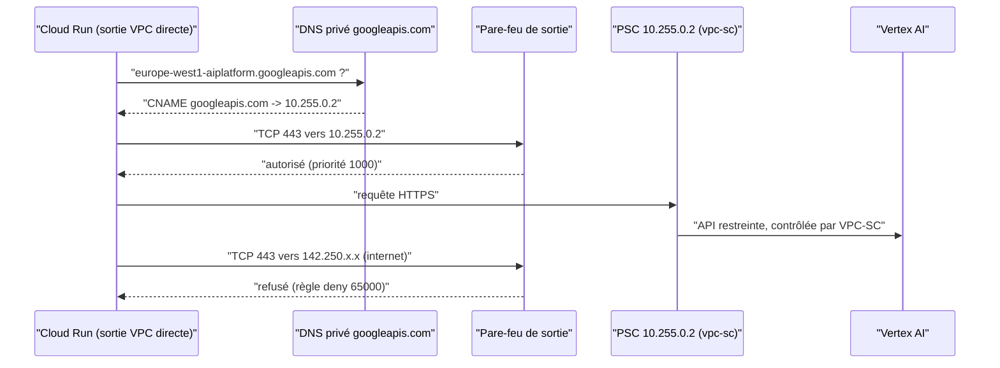

# VPC privé et Private Service Connect

> [!NOTE]
> Dans cette leçon, vous allez construire un réseau sans sortie internet dans lequel l'assistant atteint quand même Vertex AI, grâce à un point d'accès Private Service Connect et à une zone DNS privée.

## Le problème

Par défaut, un service qui appelle `europe-west1-aiplatform.googleapis.com` passe par les adresses publiques de Google. Le trafic reste sur le réseau de Google, mais il est **indistinguable** d'un appel vers n'importe quelle autre API publique, y compris un bucket d'un autre client vers lequel on exfiltrerait des données. On veut :

1. aucune sortie vers internet depuis l'application ;
2. un chemin privé, identifiable, vers les seules API Google compatibles avec VPC Service Controls.

## Les briques

| Brique | Rôle | Ressource Terraform |
| --- | --- | --- |
| **VPC** (Virtual Private Cloud) en mode personnalisé | réseau privé, sous-réseaux créés explicitement | `google_compute_network`, `google_compute_subnetwork` |
| **Private Google Access** | les machines sans IP publique peuvent joindre les API Google | `private_ip_google_access = true` |
| **Point d'accès PSC pour les API Google** | une IP interne (ici `10.255.0.2`) qui « représente » les API Google | `google_compute_global_address` + `google_compute_global_forwarding_rule` |
| **Zone DNS privée** `googleapis.com` | fait résoudre `*.googleapis.com` vers l'IP PSC, dans ce VPC seulement | `google_dns_managed_zone` + 2 enregistrements |
| **Pare-feu de sortie** | refuse tout, sauf HTTPS vers l'IP PSC | 2 × `google_compute_firewall` |

**Private Service Connect** (PSC) est le mécanisme qui expose un service (ici les API Google) derrière une adresse IP interne de votre VPC.



## Le code

```hcl title="files/network.tf (extrait)"
resource "google_compute_global_address" "psc" {
  name         = "${replace(var.prefix, "-", "")}psc"
  purpose      = "PRIVATE_SERVICE_CONNECT"
  address_type = "INTERNAL"
  address      = var.psc_ip
  network      = google_compute_network.vpc.id
}

resource "google_compute_global_forwarding_rule" "psc" {
  name                  = "${replace(var.prefix, "-", "")}psc" # lettres et chiffres uniquement
  target                = "vpc-sc"   # ou "all-apis"
  network               = google_compute_network.vpc.id
  ip_address            = google_compute_global_address.psc.id
  load_balancing_scheme = ""
}
```

Deux cibles possibles :

| `target` | API joignables | Quand |
| --- | --- | --- |
| `all-apis` | presque toutes les API Google | pas de VPC Service Controls |
| `vpc-sc` | seulement les API compatibles VPC-SC (équivalent de `restricted.googleapis.com`) | avec un périmètre (leçon suivante) |

> [!WARNING]
> Le nom d'un point d'accès PSC pour les API Google est limité à des lettres minuscules et des chiffres (1 à 20 caractères) : pas de tiret. D'où le `replace(var.prefix, "-", "")`. L'IP choisie doit être **hors** de tout sous-réseau du VPC.

```hcl title="files/network.tf (pare-feu)"
resource "google_compute_firewall" "deny_egress" {
  name               = "${var.prefix}-deny-all-egress"
  network            = google_compute_network.vpc.id
  direction          = "EGRESS"
  priority           = 65000            # plus le nombre est grand, plus la règle est faible
  destination_ranges = ["0.0.0.0/0"]
  deny { protocol = "all" }
}
```

```quiz
question: "Une règle deny de priorité 65000 vers 0.0.0.0/0 et une règle allow de priorité 1000 vers 10.255.0.2/32 port 443 coexistent. Que se passe-t-il pour une connexion vers 10.255.0.2:443 ?"
options:
  - "Elle est refusée : un deny l'emporte toujours"
  - "Elle est autorisée : la règle de priorité 1000 (numéro plus petit = plus prioritaire) est évaluée d'abord"
  - "Le résultat dépend de l'ordre de création des règles"
answer: 1
explanation: "Le pare-feu VPC applique la règle correspondante de plus haute priorité, c'est-à-dire de plus petit numéro. À priorité égale, deny gagne ; ici les priorités diffèrent, l'allow à 1000 s'applique."
```

## Et Cloud Run ?

Cloud Run n'est pas « dans » le VPC. La **sortie VPC directe** (Direct VPC egress) lui attache une interface dans le sous-réseau ; avec `egress = "ALL_TRAFFIC"`, même le trafic vers des IP publiques passe par le VPC, et donc par le pare-feu.

```hcl title="files/app.tf (extrait)"
vpc_access {
  egress = "ALL_TRAFFIC"
  network_interfaces {
    network    = google_compute_network.vpc.id
    subnetwork = google_compute_subnetwork.app.id
  }
}
```

> [!TIP]
> Si l'assistant doit appeler une API tierce (un CRM SaaS par exemple), n'ouvrez pas `0.0.0.0/0` : ajoutez Cloud NAT et une règle `allow` vers les seules plages du fournisseur, ou mieux, passez par un proxy sortant (Secure Web Proxy) qui filtre par nom de domaine. La formation [Sécuriser Gemini Enterprise](../../../../04-agents-google-cloud/03-securite-gemini-enterprise/index.md) montre un Secure Web Proxy en Terraform.

```quiz
question: "Pourquoi faut-il une zone DNS privée en plus du point d'accès PSC ?"
options:
  - "Pour que les noms *.googleapis.com, utilisés tels quels par les SDK, résolvent vers l'IP PSC au lieu des IP publiques"
  - "Parce que PSC ne fonctionne qu'avec des noms en .internal"
  - "Pour chiffrer le trafic entre Cloud Run et Vertex AI"
answer: 0
explanation: "Les bibliothèques clientes appellent les noms publics standards. La zone privée, visible seulement depuis ce VPC, les redirige vers l'IP PSC sans changer le code. Le chiffrement est assuré par TLS dans tous les cas."
```

## Exercice

Votre équipe veut utiliser `all-apis` « pour ne rien casser » alors qu'un périmètre VPC-SC est prévu. Quel est le risque, et comment vérifier depuis Cloud Run que le DNS privé fonctionne ?

<details>
<summary>Voir la solution</summary>

Avec `all-apis`, le VPC peut joindre des API **non** couvertes par VPC Service Controls ; un code compromis pourrait exfiltrer par l'une d'elles. Avec `vpc-sc`, seules les API restreintes sont joignables, et le paramètre `vpc_accessible_services = RESTRICTED-SERVICES` du périmètre ferme la boucle.

Vérification : déployez temporairement une image de diagnostic, ou ajoutez un point de santé à l'application qui fait :

```python
import socket
print(socket.gethostbyname("europe-west1-aiplatform.googleapis.com"))  # attendu : 10.255.0.2
```

Une IP publique signifie que la zone privée n'est pas attachée au bon VPC.

</details>

## Résultat obtenu

`terraform plan` réel le 2026-10-15 (extrait de la couche réseau, aucune ressource créée) :

```text
  # google_compute_firewall.allow_psc will be created
  # google_compute_firewall.deny_egress will be created
  # google_compute_global_address.psc will be created
  # google_compute_global_forwarding_rule.psc will be created
  # google_compute_network.vpc will be created
  # google_compute_subnetwork.app will be created
  # google_dns_managed_zone.googleapis will be created
  # google_dns_record_set.googleapis_a will be created
  # google_dns_record_set.googleapis_wildcard will be created
...
Plan: 46 to add, 0 to change, 0 to destroy.
```

## Je sais faire

- [ ] Créer un VPC personnalisé avec Private Google Access
- [ ] Exposer les API Google par un point d'accès PSC et une zone DNS privée
- [ ] Bloquer toute sortie sauf vers le point PSC
- [ ] Faire sortir Cloud Run par le VPC avec la sortie VPC directe
