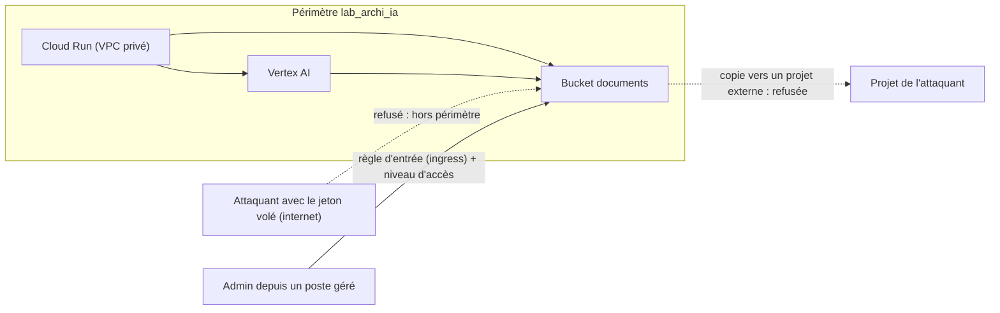

# VPC Service Controls autour de Vertex AI

> [!NOTE]
> Dans cette leçon, vous allez tracer un périmètre de service autour du projet IA pour qu'un identifiant volé ne suffise plus à exfiltrer des données, et le déployer d'abord en mode test (dry run).

## Ce que IAM ne fait pas

IAM répond à « **qui** » ; il ne regarde pas « **d'où** ». Si le jeton du compte de service de l'assistant fuit (journal mal filtré, poste compromis), l'attaquant peut, depuis chez lui, lire le bucket de documents et le copier dans **son** projet : IAM l'y autorise, puisque c'est le bon compte.

**VPC Service Controls** (VPC-SC) ajoute une frontière de contexte : un **périmètre de service** regroupe des projets et des services restreints. Les appels qui traversent la frontière (entrée depuis l'extérieur, sortie vers un projet hors périmètre) sont refusés, même avec un IAM valide.



| Sans VPC-SC | Avec VPC-SC |
| --- | --- |
| jeton volé = accès depuis n'importe où | jeton volé inutilisable hors du périmètre |
| `gsutil cp` vers un bucket externe possible | sortie refusée, journalisée |
| Vertex AI peut lire un bucket d'un autre projet | seulement les ressources du périmètre (ou règles explicites) |

## Prérequis : une organisation

Un périmètre appartient à une **politique d'accès** (Access Context Manager) de l'organisation. Le module le crée seulement si vous fournissez `access_policy_id` :

```bash
gcloud access-context-manager policies list --organization=ORG_ID
```

## Le code : spec ou status

```hcl title="files/perimeter.tf (extrait)"
resource "google_access_context_manager_service_perimeter" "ai" {
  count  = var.access_policy_id == null ? 0 : 1
  parent = "accessPolicies/${var.access_policy_id}"
  name   = "accessPolicies/${var.access_policy_id}/servicePerimeters/${replace(var.prefix, "-", "_")}"
  title  = "${var.prefix} - plateforme IA"

  use_explicit_dry_run_spec = var.vpcsc_dry_run

  dynamic "spec" {                     # configuration de test : journalise, ne bloque pas
    for_each = var.vpcsc_dry_run ? [local.perimeter_config] : []
    content {
      resources           = spec.value.resources   # ["projects/NUMERO"]
      restricted_services = spec.value.restricted_services
      vpc_accessible_services {
        enable_restriction = true
        allowed_services   = ["RESTRICTED-SERVICES"]
      }
    }
  }
  # dynamic "status" { ... }  même contenu, appliqué quand vpcsc_dry_run = false
}
```

- `spec` = configuration **dry run** : les violations sont journalisées (`dryRun: true` dans les journaux d'audit) mais rien n'est bloqué.
- `status` = configuration **appliquée**.
- `vpc_accessible_services` restreint ce que le VPC peut appeler aux services du périmètre : c'est le pendant du point PSC `vpc-sc`.

> [!WARNING]
> Un périmètre appliqué d'emblée casse presque toujours quelque chose : la console d'un admin, un pipeline CI, un connecteur. Démarrez en dry run, laissez tourner une à deux semaines, lisez les violations, écrivez les règles d'entrée et de sortie nécessaires, puis seulement basculez `vpcsc_dry_run = false`.

```quiz
question: "Le compte de service de l'assistant a roles/storage.objectViewer sur le bucket. Un attaquant vole son jeton et tente de lire le bucket depuis internet. Le périmètre est appliqué (status). Que se passe-t-il ?"
options:
  - "La lecture réussit car IAM l'autorise"
  - "La lecture est refusée par VPC Service Controls, car la requête ne vient pas de l'intérieur du périmètre ni d'une règle d'entrée"
  - "La lecture réussit mais le contenu est chiffré par CMEK"
answer: 1
explanation: "VPC-SC s'évalue en plus d'IAM : les deux doivent autoriser. La requête vient d'un réseau hors périmètre, sans niveau d'accès ni règle d'entrée, elle est refusée. CMEK ne protège pas contre un appel autorisé : Google déchiffre pour un appelant légitime."
```

## Trouver les violations en dry run

Dans l'explorateur de journaux, ou en ligne de commande :

```bash
gcloud logging read \
  'protoPayload.metadata.@type="type.googleapis.com/google.cloud.audit.VpcServiceControlAuditMetadata"
   AND protoPayload.metadata.dryRun=true' \
  --project=mon-projet-ia-dev --freshness=7d --limit=20 \
  --format='table(timestamp, protoPayload.methodName, protoPayload.authenticationInfo.principalEmail)'
```

Chaque ligne est un appel qui **serait** bloqué. Pour chacun : soit c'est légitime (règle d'entrée pour le groupe admin depuis les postes gérés, règle de sortie vers le projet KMS central), soit c'est exactement ce que le périmètre doit empêcher.

> [!TIP]
> Si la clé CMEK vit dans un projet KMS central **hors** périmètre, Vertex AI et Cloud Storage doivent l'appeler : il faut soit inclure le projet KMS dans le périmètre, soit écrire une règle de sortie vers `cloudkms.googleapis.com` de ce projet. C'est la violation la plus fréquente au premier dry run.

```quiz
question: "Pourquoi le module place-t-il la configuration dans spec quand vpcsc_dry_run = true ?"
options:
  - "Parce que spec est la configuration de test : les violations sont journalisées sans être bloquées"
  - "Parce que status est réservé aux périmètres de type pont (bridge)"
  - "Parce que spec s'applique plus vite que status"
answer: 0
explanation: "Avec use_explicit_dry_run_spec, spec contient la configuration évaluée en mode test et status celle qui est appliquée. Les ponts (PERIMETER_TYPE_BRIDGE) sont une autre notion."
```

## Exercice

Les administrateurs de la plateforme, membres du groupe `admins-ia@exemple.fr`, doivent pouvoir lire les journaux et les objets du bucket depuis la console, depuis les postes de l'entreprise uniquement. Esquissez la règle d'entrée (ingress) à ajouter dans `spec`.

<details>
<summary>Voir la solution</summary>

D'abord un **niveau d'accès** (access level) qui décrit « poste de l'entreprise » (plage IP de sortie du proxy, ou appareil géré via Endpoint Verification), par exemple `accessPolicies/123/accessLevels/postes_geres`. Puis :

```hcl
ingress_policies {
  title = "admins depuis postes geres"
  ingress_from {
    identities = ["group:admins-ia@exemple.fr"]
    sources {
      access_level = "accessPolicies/${var.access_policy_id}/accessLevels/postes_geres"
    }
  }
  ingress_to {
    resources = ["*"]
    operations {
      service_name = "storage.googleapis.com"
      method_selectors { method = "google.storage.objects.get" }
      method_selectors { method = "google.storage.objects.list" }
    }
  }
}
```

On cible des **méthodes** précises plutôt que `*` : les admins lisent, ils ne copient pas vers l'extérieur.

</details>

## Résultat obtenu

`terraform plan` réel le 2026-10-15 avec un identifiant de politique **factice** (`access_policy_id=123456789012`) : la ressource est planifiée en mode test, rien n'est créé.

```text
  # google_access_context_manager_service_perimeter.ai[0] will be created
      + use_explicit_dry_run_spec = true
          + restricted_services = [
              + "aiplatform.googleapis.com",
              + "cloudkms.googleapis.com",
              + "modelarmor.googleapis.com",
              + "storage.googleapis.com",
            ]
...
Plan: 40 to add, 0 to change, 0 to destroy.
```

Le périmètre lui-même n'a pas été créé : notre projet de test n'est pas rattaché à une organisation.

## Je sais faire

- [ ] Expliquer ce que VPC-SC ajoute à IAM, avec l'exemple du jeton volé
- [ ] Déclarer un périmètre en dry run puis l'appliquer
- [ ] Retrouver les violations dry run dans les journaux
- [ ] Écrire une règle d'entrée ciblée sur des identités, une source et des méthodes
