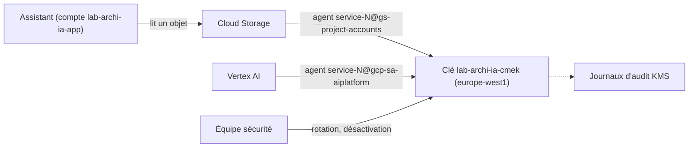

# CMEK avec Cloud KMS et résidence des données

> [!NOTE]
> Dans cette leçon, vous allez créer une clé de chiffrement que **vous** contrôlez, l'autoriser pour les seuls agents de service Google qui en ont besoin, et chiffrer avec elle le bucket de documents de l'assistant, dans l'UE.

## Chiffrement par défaut ou CMEK ?

Google Cloud chiffre **toujours** les données au repos, avec des clés gérées par Google. **CMEK** (Customer-Managed Encryption Keys) remplace ces clés par une clé qui vit dans **votre** Cloud KMS (Key Management Service) :

| | Clés Google (défaut) | CMEK |
| --- | --- | --- |
| Qui crée et fait tourner la clé | Google | vous (rotation planifiée) |
| Révoquer l'accès aux données | impossible côté client | désactiver la version de clé : données illisibles |
| Preuve pour un audit | engagement contractuel | journaux d'audit KMS de chaque utilisation |
| Localisation de la clé | gérée par Google | vous choisissez (`europe-west1`) |
| Coût | inclus | quelques centimes par clé et par mois + opérations (voir la grille KMS) |

> [!IMPORTANT]
> CMEK protège contre la perte de contrôle **au niveau du fournisseur** (et permet le « bouton rouge » de révocation). Il ne protège pas contre un appelant autorisé : si l'assistant lit un document, Google le déchiffre pour lui. Ce sont IAM et VPC-SC qui décident qui est autorisé.

## Qui chiffre vraiment ?

Ce n'est pas votre application qui appelle KMS : ce sont les **agents de service** (comptes gérés par Google, un par service et par projet) de Cloud Storage et de Vertex AI. Ce sont eux qui reçoivent `roles/cloudkms.cryptoKeyEncrypterDecrypter`, sur **la clé**, pas sur le projet.



```hcl title="files/data_protection.tf (extrait)"
resource "google_kms_key_ring" "ai" {
  name     = "${var.prefix}-keyring"
  location = var.region # la clé vit dans la même région que les données
}

resource "google_kms_crypto_key" "ai" {
  name            = "${var.prefix}-cmek"
  key_ring        = google_kms_key_ring.ai.id
  rotation_period = var.kms_rotation_period # 7776000s = 90 jours
}

resource "google_kms_crypto_key_iam_member" "agents" {
  for_each      = toset([local.vertex_agent, local.storage_agent])
  crypto_key_id = google_kms_crypto_key.ai.id
  role          = "roles/cloudkms.cryptoKeyEncrypterDecrypter"
  member        = each.value
}
```

Les noms des agents se déduisent du **numéro** de projet (`data.google_project.this.number`) :

| Service | Agent de service |
| --- | --- |
| Cloud Storage | `service-NUMERO@gs-project-accounts.iam.gserviceaccount.com` |
| Vertex AI | `service-NUMERO@gcp-sa-aiplatform.iam.gserviceaccount.com` |
| IAP | `service-NUMERO@gcp-sa-iap.iam.gserviceaccount.com` |

> [!WARNING]
> Un agent de service n'existe parfois qu'après la première utilisation de l'API. Si `apply` échoue sur la liaison IAM de la clé (« service account does not exist »), forcez sa création avec `gcloud beta services identity create --service=aiplatform.googleapis.com --project=...` puis relancez.

## Le bucket chiffré, dans l'UE

```hcl title="files/data_protection.tf (extrait)"
resource "google_storage_bucket" "kb" {
  name                        = "${var.prefix}-kb-${local.number}"
  location                    = upper(var.region)      # EUROPE-WEST1
  uniform_bucket_level_access = true                   # pas d'ACL objet par objet
  public_access_prevention    = "enforced"             # impossible à rendre public

  encryption {
    default_kms_key_name = google_kms_crypto_key.ai.id
  }
  depends_on = [google_kms_crypto_key_iam_member.agents] # l'agent doit avoir le droit AVANT
}
```

Pour les ressources Vertex AI elles-mêmes (corpus RAG, index, jeux de données, endpoints), on passe la même clé dans `encryption_spec.kms_key_name` : c'est la sortie `cmek_key` du module. Gemini Enterprise a sa propre configuration CMEK, détaillée dans le [socle de sécurité Gemini Enterprise](../../../../04-agents-google-cloud/03-securite-gemini-enterprise/06-gemini-enterprise-security-baseline/README.md).

```quiz
question: "Quel compte doit recevoir roles/cloudkms.cryptoKeyEncrypterDecrypter pour que le bucket chiffré par CMEK fonctionne ?"
options:
  - "Le compte de service de l'application (lab-archi-ia-app)"
  - "L'agent de service Cloud Storage du projet (service-NUMERO@gs-project-accounts.iam.gserviceaccount.com)"
  - "Tous les utilisateurs du projet"
answer: 1
explanation: "C'est Cloud Storage, via son agent de service, qui chiffre et déchiffre les objets. L'application n'a besoin que de roles/storage.objectViewer sur le bucket. Donner le rôle KMS aux utilisateurs violerait le moindre privilège."
```

## Résidence et rotation : ce qu'il faut savoir

- La clé doit être dans une **localisation compatible** avec la ressource : clé `europe-west1` pour un bucket `europe-west1`. Une clé `global` ne chiffre pas un bucket régional.
- La **rotation** crée une nouvelle version primaire ; les anciennes données restent lisibles avec les anciennes versions, qu'il ne faut pas détruire.
- **Détruire** une clé (ou toutes ses versions) rend les données définitivement illisibles. En production, `prevent_destroy = true` et une contrainte d'organisation qui impose un délai de destruction.

```quiz
question: "La sécurité désactive la version primaire de la clé CMEK pendant un incident. Quel est l'effet sur le bucket ?"
options:
  - "Aucun, le bucket garde une copie déchiffrée"
  - "Les objets chiffrés avec cette version deviennent illisibles jusqu'à réactivation"
  - "Les objets sont supprimés"
answer: 1
explanation: "Sans version de clé active, Cloud Storage ne peut plus déchiffrer : lectures en erreur. La réactivation rétablit l'accès. C'est le « bouton rouge » qu'offre CMEK. Rien n'est supprimé."
```

## Exercice

Écrivez la ressource Terraform d'un **jeu de données BigQuery** (`google_bigquery_dataset`) qui stockera les journaux de conversation de l'assistant, en `europe-west1`, chiffré avec la clé du module. Quel agent de service devra recevoir le rôle KMS ?

<details>
<summary>Voir la solution</summary>

```hcl
resource "google_bigquery_dataset" "conversations" {
  dataset_id = "lab_archi_ia_conversations"
  location   = var.region
  default_table_expiration_ms = 90 * 24 * 3600 * 1000 # 90 jours : minimisation

  default_encryption_configuration {
    kms_key_name = google_kms_crypto_key.ai.id
  }
  depends_on = [google_kms_crypto_key_iam_member.agents]
}
```

L'agent BigQuery `bq-NUMERO@bigquery-encryption.iam.gserviceaccount.com` doit être ajouté à la liste `for_each` de `google_kms_crypto_key_iam_member.agents`. L'expiration des tables applique une durée de conservation, exigence RGPD fréquente pour des conversations.

</details>

## Résultat obtenu

`terraform plan` réel le 2026-10-15 (extrait de la couche données ; numéro de projet masqué) :

```text
  # google_kms_crypto_key.ai will be created
  # google_kms_crypto_key_iam_member.agents["serviceAccount:service-NUMERO@gcp-sa-aiplatform.iam.gserviceaccount.com"] will be created
  # google_kms_crypto_key_iam_member.agents["serviceAccount:service-NUMERO@gs-project-accounts.iam.gserviceaccount.com"] will be created
  # google_kms_key_ring.ai will be created
  # google_storage_bucket.kb will be created
  # google_storage_bucket_iam_member.app_reads_kb will be created
```

## Je sais faire

- [ ] Expliquer ce que CMEK apporte, et ce qu'il n'apporte pas
- [ ] Autoriser les bons agents de service sur une clé, et seulement eux
- [ ] Créer un bucket UE, privé, chiffré CMEK
- [ ] Passer la clé aux ressources Vertex AI et BigQuery
