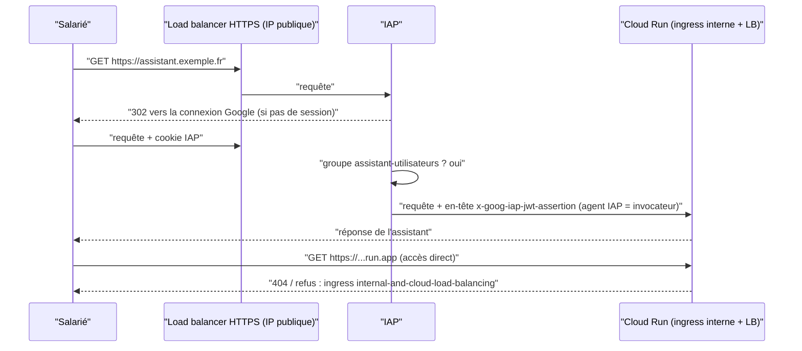

# Cloud Run privé derrière un load balancer et IAP

> [!NOTE]
> Dans cette leçon, vous allez rendre l'assistant injoignable par son URL `run.app`, le publier derrière un load balancer HTTPS et réserver l'accès aux salariés authentifiés grâce à Identity-Aware Proxy (IAP).

## Le chemin d'une requête

**IAP** (Identity-Aware Proxy) est un proxy géré par Google qui vérifie l'identité de l'utilisateur (compte Google Workspace ou Cloud Identity) et son droit `roles/iap.httpsResourceAccessor` **avant** de transmettre la requête. L'application n'a pas à coder d'authentification.



## Trois verrous

| Verrou | Paramètre | Effet |
| --- | --- | --- |
| Entrée réseau | `ingress = "INGRESS_TRAFFIC_INTERNAL_LOAD_BALANCER"` | l'URL `run.app` refuse le trafic internet direct |
| Identité utilisateur | `iap { enabled = true }` sur le backend | connexion Google obligatoire |
| Autorisation | `roles/iap.httpsResourceAccessor` à un **groupe** | seuls les membres passent |
| Appel de Cloud Run | `roles/run.invoker` à l'**agent IAP** | Cloud Run n'accepte que les requêtes relayées par IAP |

```hcl title="files/app.tf (extrait)"
resource "google_cloud_run_v2_service" "app" {
  name     = "${var.prefix}-assistant"
  location = var.region
  ingress  = "INGRESS_TRAFFIC_INTERNAL_LOAD_BALANCER"

  template {
    service_account = google_service_account.app.email
    scaling { max_instance_count = 5 } # plafonne aussi la dépense
    # vpc_access { egress = "ALL_TRAFFIC" ... }  (leçon 2.1)
    containers {
      image = var.app_image
      env {
        name  = "MODEL_ARMOR_TEMPLATE"
        value = google_model_armor_template.assistant.id
      }
    }
  }
}

resource "google_cloud_run_v2_service_iam_member" "iap_invoker" {
  name   = google_cloud_run_v2_service.app.name
  role   = "roles/run.invoker"
  member = local.iap_agent # service-NUMERO@gcp-sa-iap.iam.gserviceaccount.com
}
```

Le load balancer se compose de six ressources, créées seulement si `app_domain` est renseigné :

```hcl title="files/app.tf (le backend avec IAP)"
resource "google_compute_region_network_endpoint_group" "app" {
  network_endpoint_type = "SERVERLESS"     # un NEG sans serveur pointe vers Cloud Run
  cloud_run { service = google_cloud_run_v2_service.app.name }
}

resource "google_compute_backend_service" "app" {
  load_balancing_scheme = "EXTERNAL_MANAGED"
  backend { group = google_compute_region_network_endpoint_group.app[0].id }
  iap { enabled = true }                   # client OAuth géré par Google
  log_config { enable = true }
}
# + url_map -> target_https_proxy (certificat géré) -> forwarding_rule :443 sur une IP globale
```

> [!TIP]
> Avec `iap { enabled = true }` sans `oauth2_client_id`, IAP utilise un client OAuth **géré par Google** : plus besoin de créer un écran de consentement à la main pour un usage interne. Pour personnaliser l'écran (logo, nom), fournissez votre propre client.

```quiz
question: "Vous oubliez de donner roles/run.invoker à l'agent IAP. Que voit le salarié autorisé après s'être connecté ?"
options:
  - "L'assistant fonctionne normalement"
  - "Une erreur 403 : IAP l'a laissé passer, mais Cloud Run refuse l'appel relayé par IAP"
  - "Une page de connexion en boucle"
answer: 1
explanation: "IAP authentifie l'utilisateur puis appelle Cloud Run avec sa propre identité (l'agent de service IAP). Sans le rôle invocateur, Cloud Run répond 403. La boucle de connexion signale plutôt un problème de cookie ou de domaine."
```

## Le certificat et le DNS

Le certificat **géré par Google** (`google_compute_managed_ssl_certificate`) n'est émis qu'une fois que l'enregistrement DNS `A` de `app_domain` pointe vers l'IP du load balancer (sortie `lb_ip`). Comptez de quelques minutes à une heure ; en attendant, le HTTPS échoue, c'est normal.

> [!WARNING]
> IAP protège le **chemin HTTP**. Il ne remplace ni Model Armor (contenu des prompts) ni VPC-SC (exfiltration par API). Un salarié autorisé peut toujours tenter une injection de prompt : c'est l'objet de la leçon suivante.

```quiz
question: "Pourquoi accorder roles/iap.httpsResourceAccessor à un groupe plutôt qu'à des utilisateurs un par un ?"
options:
  - "Parce qu'IAP refuse les membres user:"
  - "Parce que l'arrivée et le départ des salariés se gèrent dans l'annuaire, sans modifier Terraform ni IAM, et que l'audit lit une seule liaison"
  - "Parce que les groupes ont des droits plus étendus"
answer: 1
explanation: "IAP accepte les utilisateurs, mais gérer l'accès par groupe découple les mouvements de personnel de l'infrastructure. Un groupe n'a pas plus de droits qu'un utilisateur."
```

## Exercice

L'application veut connaître l'adresse e-mail de l'utilisateur pour personnaliser les réponses. Comment l'obtenir de façon fiable derrière IAP ?

<details>
<summary>Voir la solution</summary>

IAP ajoute l'en-tête signé `x-goog-iap-jwt-assertion`. L'application **vérifie** ce JWT (signature par les clés publiques d'IAP, audience `/projects/NUMERO/global/backendServices/ID_BACKEND`) puis lit la revendication `email` :

```python
from google.auth.transport import requests
from google.oauth2 import id_token

def utilisateur(request_headers, audience):
    jwt = request_headers["x-goog-iap-jwt-assertion"]
    claims = id_token.verify_token(jwt, requests.Request(), audience=audience,
                                   certs_url="https://www.gstatic.com/iap/verify/public_key")
    return claims["email"]
```

L'en-tête non signé `x-goog-authenticated-user-email` existe aussi, mais il ne faut pas s'y fier seul : la vérification du JWT garantit que la requête vient bien d'IAP.

</details>

## Résultat obtenu

`terraform plan` réel le 2026-10-15 avec `app_domain=assistant.exemple.fr` (domaine fictif ; extrait) :

```text
  # google_cloud_run_v2_service.app will be created
  + resource "google_cloud_run_v2_service" "app" {
      + deletion_protection     = false
      + effective_labels        = {
          + "formation-lab"              = "architecture-ia"
          + "goog-terraform-provisioned" = "true"
        }
      + ingress                 = "INGRESS_TRAFFIC_INTERNAL_LOAD_BALANCER"
  # google_cloud_run_v2_service_iam_member.iap_invoker[0] will be created
  # google_compute_backend_service.app[0] will be created
  # google_compute_global_address.lb[0] will be created
  # google_compute_global_forwarding_rule.https[0] will be created
  # google_compute_managed_ssl_certificate.app[0] will be created
  # google_compute_region_network_endpoint_group.app[0] will be created
  # google_compute_target_https_proxy.app[0] will be created
  # google_compute_url_map.app[0] will be created
  # google_iap_web_backend_service_iam_member.users["group:assistant@exemple.fr"] will be created
```

## Je sais faire

- [ ] Fermer l'accès direct à Cloud Run avec le bon paramètre d'ingress
- [ ] Assembler un load balancer HTTPS avec NEG sans serveur et certificat géré
- [ ] Activer IAP et donner les deux rôles nécessaires (utilisateurs, agent IAP)
- [ ] Vérifier l'identité de l'utilisateur dans l'application avec le JWT IAP
