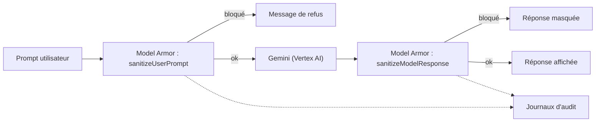

# Model Armor et journaux d'audit

> [!NOTE]
> Dans cette leçon, vous allez déclarer en Terraform un modèle Model Armor qui filtre prompts et réponses, activer les journaux d'accès aux données de Vertex AI et les envoyer vers un bucket de logs régional à rétention longue.

## Model Armor en deux mots

**Model Armor** est un service Google Cloud qui analyse un texte (le prompt de l'utilisateur, ou la réponse du modèle) et signale : injection de prompt et tentative de contournement (*jailbreak*), URL malveillantes, données sensibles (via Sensitive Data Protection), contenus dangereux ou haineux. L'application l'appelle **avant** et **après** Gemini.



## Le modèle (template)

Un **modèle** Model Armor regroupe les filtres et leurs seuils ; il est régional (disponible notamment en `europe-west1`).

```hcl title="files/guardrails.tf (extrait)"
resource "google_model_armor_template" "assistant" {
  location    = var.region
  template_id = "${var.prefix}-assistant"

  filter_config {
    pi_and_jailbreak_filter_settings {
      filter_enforcement = "ENABLED"
      confidence_level   = "MEDIUM_AND_ABOVE"
    }
    malicious_uri_filter_settings { filter_enforcement = "ENABLED" }
    sdp_settings {
      basic_config { filter_enforcement = "ENABLED" } # cartes bancaires, identifiants...
    }
    rai_settings { # DANGEROUS, HARASSMENT, HATE_SPEECH, SEXUALLY_EXPLICIT
      rai_filters {
        filter_type      = "DANGEROUS"
        confidence_level = "MEDIUM_AND_ABOVE"
      }
    }
  }
  template_metadata { log_sanitize_operations = true }
}
```

| Seuil `confidence_level` | Effet | Pour |
| --- | --- | --- |
| `LOW_AND_ABOVE` | bloque au moindre doute, plus de faux positifs | assistant exposé au public |
| `MEDIUM_AND_ABOVE` | compromis | assistant interne (notre choix) |
| `HIGH` | ne bloque que l'évident | outils d'experts, avec revue humaine |

Côté application (identifiant injecté dans Cloud Run par `MODEL_ARMOR_TEMPLATE`), un appel ressemble à :
```python title="appel Model Armor (illustration)"
from google.cloud import modelarmor_v1
client = modelarmor_v1.ModelArmorClient(
    client_options={"api_endpoint": "modelarmor.europe-west1.rep.googleapis.com"})
r = client.sanitize_user_prompt(request=modelarmor_v1.SanitizeUserPromptRequest(
    name=os.environ["MODEL_ARMOR_TEMPLATE"],
    user_prompt_data=modelarmor_v1.DataItem(text=prompt)))
if r.sanitization_result.filter_match_state == modelarmor_v1.FilterMatchState.MATCH_FOUND:
    return "Je ne peux pas traiter cette demande."
```

> [!TIP]
> Pour **Gemini Enterprise**, Model Armor s'active au niveau de l'application, sans code : voyez [Model Armor pour Gemini Enterprise](../../../../04-agents-google-cloud/03-securite-gemini-enterprise/05-gemini-enterprise-model-armor/README.md). Un **floor setting** (plancher) peut en plus imposer un niveau minimal à tous les modèles d'un projet ou d'un dossier.

```quiz
question: "Pourquoi appeler Model Armor aussi sur la réponse du modèle, et pas seulement sur le prompt ?"
options:
  - "Parce que l'API l'exige"
  - "Parce qu'une injection indirecte (dans un document lu par l'assistant) ou une fuite de données sensibles apparaît dans la réponse, pas dans le prompt de l'utilisateur"
  - "Pour réduire la latence"
answer: 1
explanation: "Le prompt de l'utilisateur peut être anodin alors que le document récupéré contient une instruction malveillante, ou que la réponse recopie un numéro de carte. Filtrer la sortie couvre ces cas. Un second appel ajoute de la latence, il ne la réduit pas."
```

## Journaux d'audit : ce qui est actif par défaut, et ce qui ne l'est pas

Les **journaux d'audit Cloud** (Cloud Audit Logs) existent en plusieurs types :

| Type | Contenu | Par défaut |
| --- | --- | --- |
| Admin Activity | création, modification, IAM | toujours actif, non désactivable |
| Data Access : `ADMIN_READ` | lecture de configuration | **désactivé** (sauf BigQuery) |
| Data Access : `DATA_READ` / `DATA_WRITE` | appels aux modèles, lecture de données | **désactivé** |
| Policy Denied | refus VPC-SC, contraintes | toujours actif |

Sans `DATA_READ`/`DATA_WRITE` sur `aiplatform.googleapis.com`, vous ne savez pas **qui** a appelé Gemini, quand, avec quel modèle. C'est le contrôle qui était en `WARN` dans le rapport de posture de la leçon 1.2.

```hcl title="files/data_protection.tf (extrait)"
resource "google_project_iam_audit_config" "ai" {
  for_each = toset(["aiplatform.googleapis.com", "modelarmor.googleapis.com"])
  service  = each.value
  audit_log_config { log_type = "ADMIN_READ" }
  audit_log_config { log_type = "DATA_READ" }
  audit_log_config { log_type = "DATA_WRITE" }
}

resource "google_logging_project_bucket_config" "audit" {
  location       = var.region          # les journaux restent dans l'UE
  bucket_id      = "${var.prefix}-audit"
  retention_days = var.log_retention_days   # 365
}

resource "google_logging_project_sink" "audit" {
  destination = "logging.googleapis.com/${google_logging_project_bucket_config.audit.id}"
  filter      = "logName:\"cloudaudit.googleapis.com\" AND (protoPayload.serviceName=\"aiplatform.googleapis.com\" OR protoPayload.serviceName=\"modelarmor.googleapis.com\")"
}
```

> [!WARNING]
> Les journaux Data Access peuvent devenir **volumineux** (une entrée par appel) et sont facturés à l'ingestion au-delà du quota gratuit. Activez-les sur les services IA, pas sur `allServices`, et suivez le volume la première semaine. Ils ne contiennent pas le texte des prompts : pour cela, c'est la journalisation des requêtes de Vertex AI, à activer consciemment (données personnelles).

```quiz
question: "Un auditeur demande la liste des comptes qui ont appelé Gemini le mois dernier. Le projet n'a que la configuration d'audit par défaut. Que pouvez-vous fournir ?"
options:
  - "La liste complète, car tous les appels sont journalisés par défaut"
  - "Rien de fiable : les journaux Data Access de Vertex AI sont désactivés par défaut, seules les modifications (Admin Activity) sont tracées"
  - "La liste, à partir de la facture"
answer: 1
explanation: "Les appels aux modèles sont des accès aux données (DATA_READ/DATA_WRITE), désactivés par défaut. Il faut les avoir activés avant. La facture agrège la consommation, sans identité."
```

## Exercice

Écrivez la requête de l'explorateur de journaux qui liste, sur les 24 dernières heures, les appels `GenerateContent` à Vertex AI avec l'identité appelante.

<details>
<summary>Voir la solution</summary>

```text
logName:"cloudaudit.googleapis.com%2Fdata_access"
protoPayload.serviceName="aiplatform.googleapis.com"
protoPayload.methodName:"GenerateContent"
timestamp>="2026-10-14T00:00:00Z"
```

En ligne de commande, sur le bucket de logs dédié :

```bash
gcloud logging read 'protoPayload.serviceName="aiplatform.googleapis.com" AND protoPayload.methodName:"GenerateContent"' \
  --bucket=lab-archi-ia-audit --location=europe-west1 --view=_AllLogs \
  --project=mon-projet-ia-dev --freshness=1d \
  --format='table(timestamp, protoPayload.authenticationInfo.principalEmail, protoPayload.resourceName)'
```

</details>

## Résultat obtenu

`terraform plan` réel le 2026-10-15 (extrait garde-fous et audit) :

```text
  # google_logging_project_bucket_config.audit will be created
  # google_logging_project_sink.audit will be created
  # google_model_armor_template.assistant will be created
  # google_project_iam_audit_config.ai["aiplatform.googleapis.com"] will be created
  # google_project_iam_audit_config.ai["modelarmor.googleapis.com"] will be created
```

Et l'état actuel du projet de test, d'après `check_posture.py` (avant tout `apply`) :
```text
[WARN] Audit accès aux données Vertex AI    manque DATA_READ, DATA_WRITE
```

## Je sais faire

- [ ] Déclarer un modèle Model Armor régional avec des seuils adaptés à l'usage
- [ ] Placer Model Armor avant et après l'appel au modèle
- [ ] Activer les journaux Data Access sur les seuls services IA
- [ ] Router les journaux d'audit vers un bucket de logs UE à rétention longue
