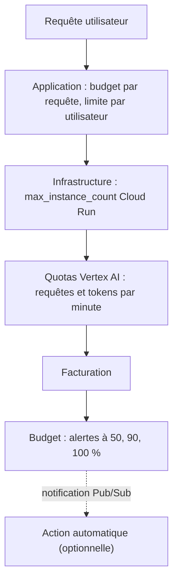

# Quotas, plafonds et budgets

> [!NOTE]
> Dans cette leçon, vous allez borner la dépense d'une plateforme IA à trois niveaux (quotas de l'API, plafonds d'infrastructure, budgets avec alertes) et comprendre pourquoi un budget seul ne protège de rien.

## Trois niveaux de limites



| Niveau | Agit | Délai | Exemple |
| --- | --- | --- | --- |
| Application | bloque | immédiat | « 30 questions par salarié et par heure » |
| Infrastructure | bloque | immédiat | Cloud Run plafonné à 5 instances |
| Quota | bloque (erreur 429) | immédiat | tokens d'entrée par minute et par modèle |
| Budget | **alerte** seulement | heures (données de facturation différées) | e-mail à 90 % de 200 € |

> [!IMPORTANT]
> Un budget Google Cloud **ne coupe rien** : il envoie des alertes, avec un décalage, car les données de coût arrivent avec retard. Une boucle d'agent qui s'emballe la nuit peut dépasser le budget bien avant l'e-mail. Les vrais freins sont les quotas, les plafonds et le code.

## Les quotas Vertex AI

Un **quota** est une limite d'usage d'une API (par minute, par jour), par projet, région et souvent par modèle. Les identifiants se listent en lecture seule :

```bash
gcloud beta quotas info list --service=aiplatform.googleapis.com \
  --project=mon-projet-ia-dev --format='value(quotaId)' | grep GenerateContent
```

Pour beaucoup de modèles Gemini récents, Vertex AI utilise un **quota partagé dynamique** : la capacité est partagée entre clients et une erreur 429 signale une saturation momentanée plutôt qu'une limite fixe de votre projet. Pour une capacité garantie, il existe le **débit provisionné** (Provisioned Throughput), payé d'avance. Dans les deux cas, le code doit **réessayer avec attente exponentielle** (voir [Performance, coût et latence à l'échelle](../../04-performance-cout-latence-a-l-echelle/index.md)).

Pour **abaisser** volontairement un quota (par exemple limiter un projet de dev), l'API Cloud Quotas expose des préférences de quota, gérables en Terraform avec `google_cloud_quotas_quota_preference`.

```quiz
question: "La facture d'un projet IA dépasse son budget de 200 € à 3 h du matin à cause d'un agent qui boucle. Que s'est-il passé côté budget ?"
options:
  - "Le budget a coupé les appels à 200 €"
  - "Le budget a, au mieux, envoyé une alerte avec retard : il ne bloque rien"
  - "Le budget a désactivé la facturation du projet"
answer: 1
explanation: "Un budget ne fait qu'alerter. Couper la facturation exige une action automatique explicite (Pub/Sub + fonction), avec ses propres risques. La protection immédiate vient des quotas, du plafond d'instances et des limites applicatives."
```

## Les plafonds d'infrastructure

Dans le module, Cloud Run est plafonné :

```hcl title="files/app.tf (extrait)"
scaling {
  max_instance_count = 5 # plafonne aussi la dépense
}
```

Cinq instances avec, par exemple, 80 requêtes simultanées chacune (valeur par défaut de Cloud Run) bornent le nombre d'appels en vol vers Gemini, donc la dépense par minute. Au-delà, les requêtes attendent ou reçoivent une erreur 429 de Cloud Run : mieux vaut une file d'attente qu'une facture.

## Le budget en Terraform

```hcl title="files/guardrails.tf (extrait)"
resource "google_billing_budget" "ai" {
  count           = var.billing_account == null ? 0 : 1
  billing_account = var.billing_account
  display_name    = "${var.prefix}-budget"

  budget_filter { projects = ["projects/${local.number}"] }

  amount {
    specified_amount {
      currency_code = "EUR"
      units         = tostring(var.monthly_budget_eur)
    }
  }

  dynamic "threshold_rules" {
    for_each = [0.5, 0.9, 1.0]
    content { threshold_percent = threshold_rules.value }
  }
}
```

> [!WARNING]
> Créer un budget demande `roles/billing.costsManager` (ou administrateur) **sur le compte de facturation**, un droit que l'équipe applicative n'a généralement pas. Dans une landing zone, les budgets sont souvent créés par l'équipe FinOps dans un module séparé, d'où le `count` optionnel.

> [!TIP]
> Les labels posés par `default_labels` (`formation-lab = architecture-ia`) remontent dans l'export de facturation BigQuery : vous pouvez ventiler le coût par application et filtrer un budget par label.

```quiz
question: "Quelle combinaison protège le mieux contre un emballement nocturne de la dépense ?"
options:
  - "Un budget avec alerte à 100 %"
  - "Un plafond d'instances Cloud Run, une limite de requêtes par utilisateur dans l'application, et un budget pour être prévenu"
  - "Aucune limite, mais un modèle moins cher"
answer: 1
explanation: "Les limites qui bloquent immédiatement (plafond, limite applicative) empêchent l'emballement ; le budget sert à détecter les dérives lentes. Un modèle moins cher réduit le coût unitaire, pas le risque d'emballement."
```

## Exercice

Votre projet de dev ne doit jamais dépenser plus de quelques euros par jour en Gemini. Listez trois mécanismes à mettre en place, du plus immédiat au plus lent.

<details>
<summary>Voir la solution</summary>

1. **Dans le code** : un compteur de tokens par jour (dans Firestore ou Memorystore) ; au-delà d'un seuil, l'assistant répond « quota de dev atteint ». Effet immédiat.
2. **Préférence de quota** abaissée sur `GenerateContentInputTokensPerMinutePerRegionPerBaseModel` pour le projet de dev (`google_cloud_quotas_quota_preference`) et `max_instance_count = 1`. Effet immédiat, côté Google.
3. **Budget mensuel** filtré sur le projet, alertes à 50/90/100 %, notification Pub/Sub vers le canal de l'équipe. Effet différé, sert à détecter.

Option drastique : une fonction abonnée au Pub/Sub du budget qui détache le compte de facturation du projet de dev. À réserver à la dev, car elle arrête **tous** les services du projet.

</details>

## Résultat obtenu

Commandes réelles du 2026-10-15, en lecture seule (projet masqué). Les quotas `GenerateContent` du projet de test :

```text
$ gcloud beta quotas info list --service=aiplatform.googleapis.com --project=<projet> \
    --format='value(quotaId)' | grep -E 'GenerateContent(Input|Output|Requests)'
GenerateContentInputTokensPerMinutePerRegionPerBaseModel
GenerateContentOutputTokensPerMinutePerRegionPerBaseModel
GenerateContentRequestsPerMinutePerProjectPerRegionPerBaseModel
```

Le budget, planifié avec un compte de facturation **factice** (`terraform plan`, extrait) :

```text
  # google_billing_budget.ai[0] will be created
      + amount {
          + specified_amount {
              + currency_code = "EUR"
              + units         = "200"
            }
        }
      + threshold_rules {
          + spend_basis       = "CURRENT_SPEND"
          + threshold_percent = 0.5
        }
      ...
```

## Je sais faire

- [ ] Distinguer ce qui bloque (quota, plafond, code) de ce qui alerte (budget)
- [ ] Lister les quotas Vertex AI d'un projet
- [ ] Plafonner Cloud Run pour borner la dépense
- [ ] Déclarer un budget avec seuils en Terraform
