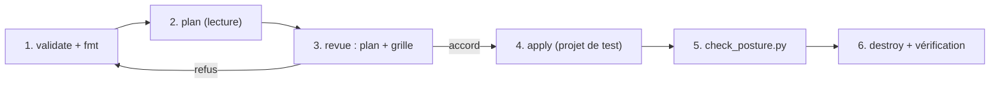

# Projet final : valider, planifier et auditer la plateforme

> [!NOTE]
> Dans cette leçon, vous allez dérouler la chaîne complète d'une livraison d'infrastructure IA : valider le module, le planifier contre votre projet, contrôler la posture, décider de l'appliquer (ou non), puis nettoyer. Vous terminez avec une grille de revue à présenter à votre équipe sécurité.

## Le cahier des charges

L'assistant interne doit être livré dans `assistant-dev` avec :

1. une identité dédiée, quatre rôles projet et un rôle sur un seul bucket ;
2. aucune sortie internet, API Google via PSC restreint ;
3. un bucket de documents UE, privé, chiffré CMEK ;
4. un accès réservé à un groupe via IAP, Cloud Run injoignable en direct ;
5. Model Armor, journaux Data Access, bucket de logs à 365 jours ;
6. si l'organisation le permet : périmètre VPC-SC en dry run, contrainte UE, budget.



## Étape 1 et 2 : valider puis planifier

```bash
cd files/
cp terraform.tfvars.example terraform.tfvars      # à adapter, jamais commité
terraform init -backend=false                     # en équipe : backend "gcs"
terraform validate && terraform fmt -check
terraform plan -out=plan.tfplan                   # ne crée rien
```

`plan` lit votre projet (ici le numéro via `data.google_project`) et affiche ce qui **serait** créé. C'est l'artefact que l'on fait relire.

> [!TIP]
> Ajoutez ces trois commandes à votre CI (intégration continue) sur chaque demande de fusion, et faites tourner un analyseur de politiques (par exemple `gcloud beta terraform vet` ou Checkov) sur le plan exporté en JSON (`terraform show -json plan.tfplan`) : la revue de sécurité devient automatique.

## Étape 3 : la grille de revue

| Contrôle | Où le voir dans le plan | Attendu |
| --- | --- | --- |
| Aucun rôle primitif | `google_project_iam_member.*` | pas de `roles/owner`, `roles/editor` |
| Pas d'accès public | bucket, Cloud Run | `public_access_prevention = "enforced"`, pas d'`allUsers` |
| Ingress Cloud Run | `google_cloud_run_v2_service.app` | `INGRESS_TRAFFIC_INTERNAL_LOAD_BALANCER` |
| Région | toutes les ressources | `europe-west1` / `EUROPE-WEST1` |
| CMEK | `google_storage_bucket.kb` | `default_kms_key_name` renseigné |
| Sortie réseau | `google_compute_firewall.*` | deny `0.0.0.0/0`, allow PSC seulement |
| Audit | `google_project_iam_audit_config.ai` | `DATA_READ`, `DATA_WRITE` |
| VPC-SC | `..._service_perimeter.ai` | `use_explicit_dry_run_spec = true` au premier déploiement |

```quiz
question: "Dans la revue du plan, vous voyez google_project_iam_binding pour roles/aiplatform.user. Pourquoi bloquer la fusion ?"
options:
  - "Parce que ce rôle n'existe pas"
  - "Parce que _binding fait autorité sur tous les membres de ce rôle dans le projet : l'apply retirerait l'accès aux autres équipes qui l'ont"
  - "Parce que les bindings ne fonctionnent pas avec Vertex AI"
answer: 1
explanation: "Une ressource _binding remplace la liste complète des membres d'un rôle. Dans un projet partagé, elle supprime silencieusement des accès. Un module applicatif utilise _member."
```

## Étapes 4 à 6 : appliquer, contrôler, nettoyer

Si et seulement si vous êtes dans un **projet de test** et que la revue est validée :

```bash
terraform apply plan.tfplan
python check_posture.py --project mon-projet-ia-dev
# ... tests fonctionnels : DNS privé, 403 en accès direct à run.app, connexion IAP ...
terraform destroy
gcloud run services list --project=mon-projet-ia-dev --region=europe-west1 --filter="metadata.name~lab-archi-ia"
gcloud compute forwarding-rules list --project=mon-projet-ia-dev --filter="name~labarchiia OR name~lab-archi-ia"
```

> [!WARNING]
> Après `destroy`, deux éléments **restent** volontairement : les **versions de clé KMS** (Cloud KMS ne supprime pas immédiatement : les versions passent en « destruction programmée », 30 jours par défaut, et le trousseau ne peut jamais être supprimé) et les **API activées** (`disable_on_destroy = false`). Le load balancer, lui, est facturé à l'heure tant qu'il existe : ne laissez pas un `apply` de test tourner.

```quiz
question: "Après terraform destroy, la commande gcloud kms keys list montre encore la clé lab-archi-ia-cmek. Est-ce un échec du nettoyage ?"
options:
  - "Oui, il faut supprimer la clé à la main"
  - "Non : Cloud KMS ne supprime ni trousseaux ni clés ; Terraform programme la destruction des versions, la clé reste listée sans version active"
  - "Oui, c'est le signe que prevent_destroy était à true"
answer: 1
explanation: "C'est le comportement de Cloud KMS, conçu pour éviter les pertes de données irréversibles. Avec prevent_destroy = true, le destroy aurait échoué avec une erreur, pas réussi."
```

## Exercice final

Transformez le module en deux instances, `dev` et `prod`, avec un backend GCS distinct par environnement, des domaines différents, et le périmètre VPC-SC **appliqué** en prod seulement. Décrivez l'arborescence et les fichiers de variables.

<details>
<summary>Voir la solution</summary>

```text
plateforme-ia/
├── module/              ← le contenu de files/*.tf, sans bloc backend
├── envs/
│   ├── dev/
│   │   ├── main.tf      module "plateforme" { source = "../../module" ... }
│   │   ├── backend.tf   backend "gcs" { bucket = "tfstate-ia", prefix = "dev" }
│   │   └── dev.tfvars   project_id = "assistant-dev", app_domain = "assistant-dev.exemple.fr", vpcsc_dry_run = true
│   └── prod/
│       ├── main.tf
│       ├── backend.tf   prefix = "prod"
│       └── prod.tfvars  project_id = "assistant-prod", app_domain = "assistant.exemple.fr", vpcsc_dry_run = false
```

Points d'attention :

- le bloc `provider` passe dans `envs/*/main.tf` (un module réutilisable ne configure pas son provider) ;
- en prod, `prevent_destroy = true` sur la clé KMS, et la clé dans le projet KMS central : ajoutez une variable `kms_key_id` qui, si elle est fournie, remplace la clé créée par le module ;
- le passage dry run → appliqué se fait par un simple changement de `vpcsc_dry_run`, après lecture des violations (leçon 2.2).

</details>

## Résultat obtenu

Chaîne réelle du 2026-10-15 (Terraform 1.16.0, provider 6.50.0 ; projet masqué ; **pas d'apply**) :

```text
$ terraform validate
Success! The configuration is valid.
$ terraform fmt -check && echo FMT_OK
FMT_OK
$ terraform plan -var project_id=<projet> -var app_domain=assistant.exemple.fr \
    -var 'iap_members=["group:assistant@exemple.fr"]'
...
Plan: 46 to add, 0 to change, 0 to destroy.
$ terraform plan -var project_id=<projet> -var access_policy_id=123456789012 \
    -var billing_account=000000-AAAAAA-BBBBBB -var enforce_eu_location_policy=true
...
Plan: 40 to add, 0 to change, 0 to destroy.
$ pytest -q
4 passed in 0.01s
$ python check_posture.py --project <projet>
...
7 contrôles : 1 FAIL, 2 WARN
```

Le second plan n'a pas de load balancer (pas de domaine) mais ajoute le périmètre, la contrainte UE et le budget. Aucune ressource n'a été créée dans le projet : il n'y a donc rien à nettoyer, ce que confirme `gcloud run services list --filter="metadata.name~lab-archi-ia"` (« Listed 0 items »).

## Je sais faire

- [ ] Dérouler validate, fmt, plan et faire relire un plan avec une grille
- [ ] Appliquer dans un projet de test puis détruire et vérifier
- [ ] Expliquer ce qui subsiste après destroy (KMS, API) et pourquoi
- [ ] Découper le module en environnements dev et prod
