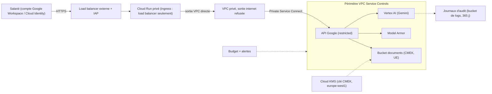

Un prototype d'assistant IA tient en 50 lignes. Le mettre devant 5 000 collaborateurs, avec des documents internes, sans qu'un auditeur ou un RSSI (responsable de la sécurité des systèmes d'information) ne bloque le projet, demande autre chose : une **landing zone**, c'est-à-dire un socle cloud préparé à l'avance (projets, identités, réseau, chiffrement, journaux, budgets) dans lequel les équipes IA déploient sans réinventer la sécurité.

Cette formation construit ce socle **en code**, avec un module Terraform complet, et fournit un script Python qui contrôle la posture d'un projet existant en lecture seule.

Fil rouge : un **assistant interne** (questions RH, procédures, documentation) qui appelle Gemini sur Vertex AI, lit un bucket de documents et s'ouvre aux seuls salariés authentifiés.

## Pour qui ?

- Architectes cloud, ingénieurs plateforme, équipes sécurité qui doivent dire « oui, mais proprement » à un projet IA.
- Vous connaissez les bases de Google Cloud (projet, IAM, console) et vous avez déjà lu du Terraform.
- Pour la sécurité spécifique de Gemini Enterprise (connecteurs, Model Armor appliqué à l'application), voyez aussi [Sécuriser Gemini Enterprise](../../../04-agents-google-cloud/03-securite-gemini-enterprise/index.md) : cette formation en est le socle d'infrastructure.

## Ce que l'on construit

## Prérequis techniques

- Terraform 1.6 ou plus récent (testé avec 1.16) et le provider `hashicorp/google` 6.x (testé avec 6.50.0).
- Python 3.10+ et `gcloud` (pour les identifiants : `gcloud auth application-default login`).
- Pour aller jusqu'au bout (VPC Service Controls, contrainte de localisation, budget) : un projet **dans une organisation** et un compte de facturation. Sans organisation, le module se déploie quand même : ces trois blocs sont désactivés par variable.

## Programme

| Module | Contenu | Durée indicative |
| --- | --- | --- |
| 1. Le socle | Organisation des projets, résidence UE, IAM au moindre privilège, comptes de service, contrôle de posture | 1h30 |
| 2. Réseau et données | VPC privé, Private Service Connect, VPC Service Controls, CMEK avec Cloud KMS | 1h45 |
| 3. Exposer, protéger, surveiller | Cloud Run privé derrière load balancer + IAP, Model Armor, journaux d'audit, quotas et budgets | 1h45 |
| 4. Projet final | Assembler, valider, planifier, contrôler la posture, nettoyer | 1h |

## Le lab

Tout le code est dans [`files/`](./files/) : le module Terraform (`versions.tf`, `variables.tf`, un fichier par couche, `outputs.tf`, `terraform.tfvars.example`), le script de posture [`check_posture.py`](./files/check_posture.py) et ses tests.

| | En local (sans GCP) | Sur GCP |
| --- | --- | --- |
| Terraform | `terraform init -backend=false`, `validate`, `fmt -check` | `terraform plan` sur votre projet, puis `apply` si vous le décidez |
| Posture | `pytest` (tests sans réseau) | `python check_posture.py --project <id>` en lecture seule |
| Coût | nul | nul pour `plan` et le script ; un `apply` crée des ressources facturées (load balancer, KMS, Cloud Run) |

> [!WARNING]
> Ce module a été **validé et planifié**, pas appliqué : le `terraform apply` est votre décision, dans un projet de test, et se termine par `terraform destroy`.
