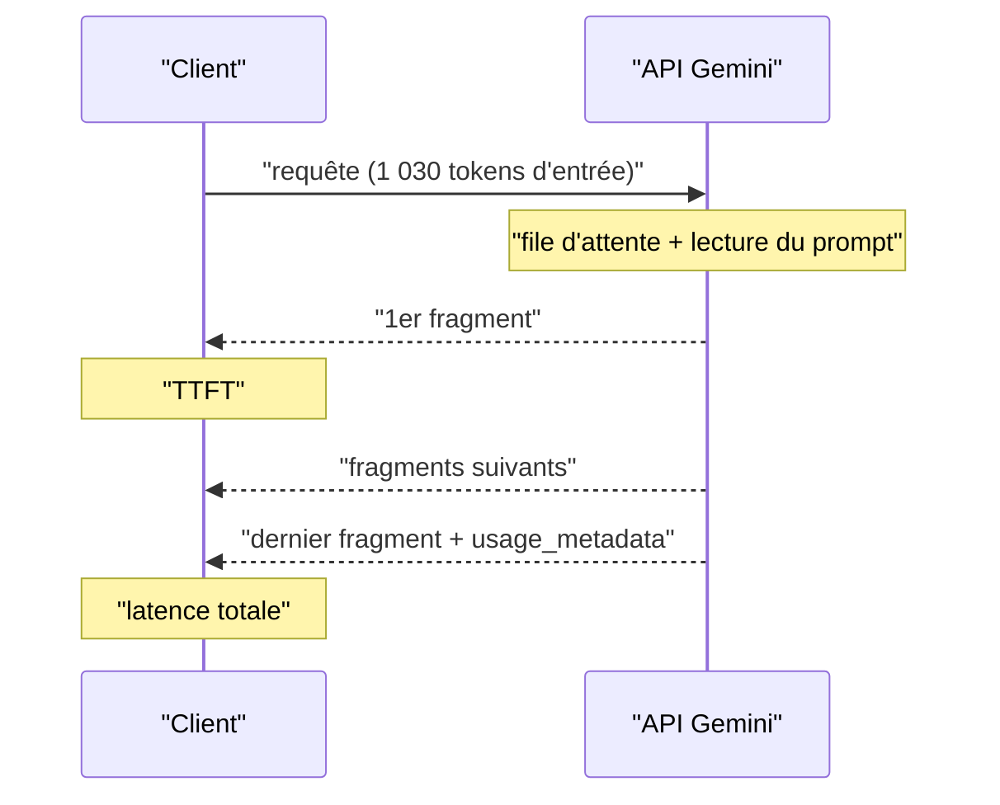

# TTFT, débit et percentiles : les bonnes mesures

> [!NOTE]
> Dans cette leçon, vous allez définir les cinq mesures qui décrivent une application LLM en production, les instrumenter dans une fonction Python, et apprendre à lire un p95 sans vous tromper.

## Les cinq mesures

| Mesure | Définition | Ce qu'elle dit | Ressenti utilisateur |
| --- | --- | --- | --- |
| **TTFT** (*time to first token*) | temps entre l'envoi et le premier fragment de réponse | file d'attente + lecture du prompt + début de génération | « ça répond » |
| **Latence totale** | temps jusqu'au dernier fragment | TTFT + génération de tous les tokens de sortie | « c'est fini » |
| **Débit** (*throughput*) | requêtes (ou tokens) traitées par seconde | capacité du système sous charge | nombre de clients servis |
| **Tokens** entrée / en cache / sortie / réflexion | décompte renvoyé par l'API (`usage_metadata`) | la base du coût | invisible, mais c'est la facture |
| **Qualité** | part des réponses justes, sur un jeu de référence | ce qu'on risque en optimisant | « c'est faux » |

Un **token** est un morceau de mot (en français, environ 4 caractères en moyenne, ordre de grandeur) : c'est l'unité que les modèles lisent, produisent et que l'on paie.



> [!TIP]
> Les **tokens de réflexion** (*thinking*) des modèles Gemini récents sont facturés comme des tokens de sortie et allongent le TTFT : le modèle « pense » avant d'écrire. Le lab règle `thinking_level="low"` pour une tâche de FAQ ; mesurez avant de l'augmenter.

## Instrumenter un appel

Tout le banc repose sur une seule fonction, [`ask`](../files/router.py), qui chronomètre et récupère les compteurs :

```python title="files/router.py (extrait)"
async def call():
    c, parts, t0 = Call(model), [], time.perf_counter()
    async for chunk in await client.aio.models.generate_content_stream(
            model=model, contents=question, config=config):
        if not c.ttft and chunk.text:
            c.ttft = time.perf_counter() - t0          # premier fragment non vide
        parts.append(chunk.text or "")
        if chunk.usage_metadata:
            u = chunk.usage_metadata
            c.prompt_tokens = u.prompt_token_count or 0
            c.cached_tokens = u.cached_content_token_count or 0
            c.output_tokens = (u.candidates_token_count or 0) + (u.thoughts_token_count or 0)
    c.latency = time.perf_counter() - t0
```

Le coût découle des compteurs et d'une grille de prix (USD par million de tokens, relevée le 2026-10-15 sur la page officielle, à revérifier) :

```python title="files/router.py (extrait)"
PRICES = {  # (entrée, entrée en cache, sortie)
    "gemini-3.5-flash-lite": (0.30, 0.03, 2.50),
    "gemini-3.8-flash": (0.75, 0.075, 3.75),
}

def cost_usd(model, prompt, cached, output):
    p_in, p_cached, p_out = PRICES.get(model, (0.0, 0.0, 0.0))
    return ((prompt - cached) * p_in + cached * p_cached + output * p_out) / 1e6
```

> [!WARNING]
> Utilisez `time.perf_counter()` (horloge monotone, haute résolution) et non `time.time()`, qui peut sauter si l'horloge système est ajustée. Et chronométrez **côté client** : c'est ce que vit l'utilisateur, réseau compris.

```quiz
question: "Une réponse a un TTFT de 0,7 s et une latence totale de 0,8 s. Où passe l'essentiel du temps ?"
options:
  - "Dans la génération des tokens de sortie"
  - "Avant le premier token : file d'attente, lecture du prompt, éventuelle réflexion"
  - "Dans le réseau après la réponse"
answer: 1
explanation: "Seuls 0,1 s séparent le premier du dernier fragment : la réponse est courte. Le gros du temps est avant le premier token. Pour l'améliorer : prompt plus court, cache, modèle plus petit, réflexion plus faible."
```

## Pourquoi des percentiles et pas une moyenne

La **moyenne** est tirée par quelques valeurs extrêmes et cache la dispersion. Le **p50** (médiane) est la valeur sous laquelle se trouvent 50 % des mesures ; le **p95**, celle sous laquelle se trouvent 95 % : 1 utilisateur sur 20 attend plus que le p95.

```python title="files/bench.py (extrait)"
def pct(values, p):
    """Percentile p (inclusif). Avec 16 mesures, le p95 est presque le max : restez prudent."""
    if len(values) == 1:
        return values[0]
    return statistics.quantiles(values, n=100, method="inclusive")[p - 1]
```

| Nombre de mesures | Fiabilité du p95 |
| --- | --- |
| 16 (notre banc) | indicatif : il dépend d'une ou deux mesures |
| 100 | utilisable pour comparer deux réglages |
| 1 000 et plus | fiable, et permet le p99 |

```quiz
question: "Sur 16 requêtes, la latence p95 passe de 1,35 s à 1,76 s entre deux réglages. Que conclure ?"
options:
  - "Le second réglage est 30 % plus lent pour 5 % des utilisateurs, c'est certain"
  - "Avec 16 mesures, le p95 dépend presque d'une seule requête : il faut regarder laquelle, puis confirmer sur un échantillon plus grand"
  - "Rien, les percentiles ne servent pas pour les LLM"
answer: 1
explanation: "À 16 mesures, le p95 interpole entre les deux plus grandes valeurs. Une seule requête lente (par exemple une escalade vers le grand modèle) suffit à le déplacer. C'est un signal à investiguer, pas une preuve."
```

## Exercice

À partir de ces 8 latences en secondes : `0.71, 0.78, 0.69, 0.79, 1.33, 0.86, 0.92, 3.10`, calculez la moyenne, le p50 et le p95 avec `statistics.quantiles(..., method="inclusive")`. Laquelle des trois décrit le mieux « l'expérience typique » ? Laquelle signale le problème ?

<details>
<summary>Voir la solution</summary>

```python
import statistics
v = [0.71, 0.78, 0.69, 0.79, 1.33, 0.86, 0.92, 3.10]
q = statistics.quantiles(v, n=100, method="inclusive")
print(round(statistics.mean(v), 2), round(q[49], 2), round(q[94], 2))
# 1.15 0.82 2.48
```

- la **moyenne** (1,15 s) ne correspond à aucune requête réelle : elle est tirée par la valeur de 3,10 s ;
- le **p50** (0,82 s) décrit l'expérience typique ;
- le **p95** (2,48 s) révèle la longue traîne : il faut aller voir la requête à 3,10 s (escalade ? 429 suivi d'un réessai ?).

</details>

## Résultat obtenu

Mesures réelles du 2026-10-15 (API Gemini, 16 questions, 4 en parallèle), extrait de `python bench.py` :

```text
stratégie                        TTFT p50    p95  lat p50    p95  req/s  qualité    coût $ appels
big (gemini-3.8-flash)               1.57   2.02     1.81   2.57   1.97     100%   0.01560     16
small (gemini-3.5-flash-lite)        0.76   1.23     0.86   1.35   3.89      94%   0.00683     16
big (gemini-3.8-flash)           tokens entrée=16503 dont en cache=0 sortie+réflexion=860
small (gemini-3.5-flash-lite)    tokens entrée=16503 dont en cache=0 sortie+réflexion=753
```

Lecture : environ 1 030 tokens d'entrée par question pour une cinquantaine en sortie. C'est **l'entrée** qui domine la facture : 16 503 × 0,30 $ ≈ 5 millièmes de dollar d'entrée pour flash-lite, contre 753 × 2,50 $ ≈ 2 millièmes en sortie (prix par million).

## Je sais faire

- [ ] Définir TTFT, latence totale, débit et percentiles, et dire ce que chacun révèle
- [ ] Instrumenter un appel en streaming avec `perf_counter` et `usage_metadata`
- [ ] Calculer le coût d'un appel, tokens en cache et de réflexion compris
- [ ] Interpréter un p95 en fonction du nombre de mesures
