# Le streaming : réduire la latence perçue

> [!NOTE]
> Dans cette leçon, vous allez comprendre ce que le streaming change (et ne change pas) à la latence, l'utiliser avec le SDK `google-genai` en asynchrone, et savoir quand il ne sert à rien.

## Perçu contre réel

Le **streaming** renvoie la réponse par fragments (*chunks*) au fil de la génération, au lieu d'attendre la fin. Il ne rend pas le modèle plus rapide : la latence totale est quasi identique. Il réduit la latence **perçue**, parce que l'utilisateur lit dès le TTFT.

```mermaid
gantt
  dateFormat X
  axisFormat %Ls
  title "Une réponse de 400 tokens (ordre de grandeur)"
  section Sans streaming
  Attente (rien à l'écran) :a1, 0, 4000
  Affichage d'un bloc       :a2, 4000, 4100
  section Avec streaming
  Attente jusqu'au TTFT     :b1, 0, 800
  Texte qui s'écrit         :b2, 800, 4000
```



| Situation | Gain du streaming |
| --- | --- |
| Chat, réponse longue (explication, rédaction) | fort : l'utilisateur lit pendant la génération |
| Réponse courte (1 à 3 phrases, notre FAQ) | faible : TTFT et fin sont proches |
| Sortie JSON consommée par du code | nul pour l'affichage ; utile seulement pour mesurer le TTFT ou couper tôt |
| Appel d'outil, agent | le texte final arrive après les outils : streamer les étapes (« je cherche… ») aide davantage |

## Le code

Avec le SDK `google-genai`, la version asynchrone `client.aio` renvoie un itérateur asynchrone. Attention à la syntaxe : on **attend** l'appel, puis on itère.

```python title="files/router.py (extrait)"
async for chunk in await client.aio.models.generate_content_stream(
        model=model, contents=question, config=config):
    if not c.ttft and chunk.text:
        c.ttft = time.perf_counter() - t0
    parts.append(chunk.text or "")
```

Pour une interface web, on relaie les fragments tels quels, par exemple en *Server-Sent Events* (SSE, un flux HTTP texte que le navigateur lit au fil de l'eau) avec FastAPI :

```python title="streaming vers le navigateur (illustration)"
from fastapi import FastAPI
from fastapi.responses import StreamingResponse
from google import genai

app, client = FastAPI(), genai.Client()

@app.get("/ask")
async def ask(q: str):
    async def events():
        async for chunk in await client.aio.models.generate_content_stream(
                model="gemini-3.5-flash-lite", contents=q):
            if chunk.text:
                yield f"data: {chunk.text}\n\n"
    return StreamingResponse(events(), media_type="text/event-stream")
```

> [!WARNING]
> Derrière un proxy ou un load balancer, vérifiez que la réponse n'est pas **mise en tampon** : sinon le client reçoit tout d'un coup à la fin et vous perdez le bénéfice. Sur Cloud Run, le streaming HTTP fonctionne nativement ; certains proxys d'entreprise demandent l'en-tête `X-Accel-Buffering: no` ou équivalent.

```quiz
question: "Vous passez une réponse de FAQ de 50 tokens en streaming. Le TTFT est de 0,76 s et la latence totale de 0,86 s. Qu'avez-vous gagné ?"
options:
  - "Environ 0,1 s de latence perçue : le streaming apporte peu sur des réponses aussi courtes"
  - "Un facteur 2 sur la latence totale"
  - "Une réduction du coût de 50 %"
answer: 0
explanation: "Le gain perçu est au plus l'écart entre TTFT et fin. Le streaming ne change ni la latence totale ni le coût : les mêmes tokens sont produits et facturés."
```

## Couper tôt : le streaming comme garde-fou

Le streaming permet aussi d'**arrêter** une génération dès qu'on en sait assez : un filtre détecte un contenu interdit au troisième fragment, l'utilisateur clique sur « Stop », ou la sortie dépasse une longueur. On sort simplement de la boucle `async for` : la connexion est fermée.

> [!TIP]
> Pour plafonner la sortie de façon sûre, préférez `max_output_tokens` dans la configuration (le modèle s'arrête côté serveur) au comptage côté client. Le lab fixe `max_output_tokens=1024`, très au-dessus des ~50 tokens utiles, comme filet de sécurité.

```quiz
question: "Pourquoi le TTFT d'une requête escaladée vers le grand modèle est-il beaucoup plus élevé que celui d'une requête traitée par le petit modèle ?"
options:
  - "Parce que le grand modèle ne sait pas streamer"
  - "Parce que l'utilisateur attend la réponse complète du petit modèle (pour lire sa confiance) avant que le grand ne commence"
  - "Parce que l'escalade désactive le cache"
answer: 1
explanation: "Dans une cascade, la décision d'escalader se prend sur la sortie complète du petit modèle. Le TTFT perçu = latence du petit + TTFT du grand. C'est le coût caché du routage, visible dans le p95."
```

## Exercice

Modifiez `ask` pour qu'elle s'arrête dès que la réponse accumulée dépasse 600 caractères, et renvoie ce qui a été reçu avec une confiance de 0 (réponse tronquée = à ne pas croire).

<details>
<summary>Voir la solution</summary>

```python
async for chunk in await client.aio.models.generate_content_stream(
        model=model, contents=question, config=config):
    if not c.ttft and chunk.text:
        c.ttft = time.perf_counter() - t0
    parts.append(chunk.text or "")
    if sum(map(len, parts)) > 600:
        c.latency = time.perf_counter() - t0
        c.answer, c.confidence = "".join(parts), 0.0
        return c   # sortir de la boucle ferme le flux
```

Limite : les tokens déjà générés côté serveur peuvent être facturés, et `usage_metadata` (qui arrive avec le dernier fragment) manque ; le coût est alors à estimer. C'est pourquoi `max_output_tokens` reste la première ligne de défense.

</details>

## Résultat obtenu

Mesures réelles du 2026-10-15, premières questions du banc (secondes, `resultats_big_small.json`) :

```text
modèle                  question  TTFT   fin   tokens sortie
gemini-3.5-flash-lite   q01       0.61   0.71  38
gemini-3.5-flash-lite   q02       1.18   1.33  58
gemini-3.8-flash        q01       2.20   2.52  63
gemini-3.8-flash        q02       1.17   1.57  73
router (escalade q12)   q12       2.70   3.19  —
```

Sur des réponses de 40 à 70 tokens, la fin arrive 0,1 à 0,4 s après le premier fragment : le levier principal ici est le **TTFT**, donc le choix du modèle et la taille du prompt, pas le streaming.

## Je sais faire

- [ ] Expliquer la différence entre latence perçue et latence totale
- [ ] Streamer une réponse avec `client.aio.models.generate_content_stream`
- [ ] Relayer un flux vers un navigateur sans mise en tampon
- [ ] Reconnaître les cas où le streaming n'apporte rien
