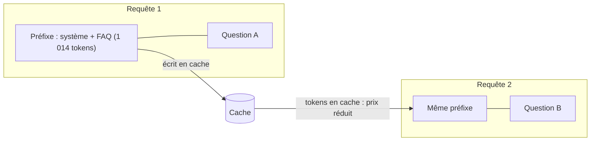

# Mise en cache du contexte

> [!NOTE]
> Dans cette leçon, vous allez distinguer le cache de contexte implicite et explicite de Gemini, calculer quand il est rentable, et voir sur des mesures réelles pourquoi notre base de connaissances de 1 000 tokens n'en profitait pas.

## Le principe

À chaque question, le banc renvoie le même préfixe : consigne système + FAQ, soit environ 1 014 tokens, suivis de quelques tokens de question. La **mise en cache du contexte** (*context caching*) évite de refacturer plein tarif ce préfixe identique : les tokens servis depuis le cache sont facturés à prix réduit, et le TTFT peut baisser car le modèle n'a pas à relire tout le préfixe.



| | Cache **implicite** | Cache **explicite** |
| --- | --- | --- |
| Activation | automatique sur les modèles compatibles | `client.caches.create(...)` |
| Garantie de réutilisation | aucune (au mieux) | oui, tant que le cache vit (TTL) |
| Prix des tokens en cache | réduit | réduit |
| Stockage | gratuit | facturé **à l'heure**, par million de tokens |
| Taille minimale | oui (dépend du modèle) | oui (1 024 tokens pour flash-lite, mesuré ci-dessous) |
| Signal | `usage_metadata.cached_content_token_count` | idem |

> [!IMPORTANT]
> Le cache porte sur un **préfixe** : placez tout ce qui est stable (consignes, documents, exemples) **au début**, et ce qui varie (la question, l'historique récent) à la fin. Un horodatage au début du prompt suffit à casser tout le cache.

## Créer un cache explicite

```python title="files/extras.py (extrait)"
c = client.caches.create(model=R.SMALL_MODEL, config=types.CreateCachedContentConfig(
    system_instruction=long_context, ttl="300s", display_name="lab-perf-faq"))
try:
    r = client.models.generate_content(
        model=R.SMALL_MODEL, contents="Combien coûte la livraison express ?",
        config=types.GenerateContentConfig(cached_content=c.name))
    print(r.usage_metadata.prompt_token_count, r.usage_metadata.cached_content_token_count)
finally:
    client.caches.delete(name=c.name)   # le stockage est facturé à l'heure
```

## Quand est-ce rentable ?

Avec les prix flash-lite relevés le 2026-10-15 (entrée 0,30 $, entrée en cache 0,03 $, stockage 1,00 $ par million de tokens et par heure), pour un contexte de $T$ tokens et $N$ requêtes par heure :

$$\text{économie par heure} = N \cdot T \cdot (0{,}30 - 0{,}03) / 10^6 \quad ; \quad \text{stockage} = T \cdot 1{,}00 / 10^6$$

Le cache explicite est rentable dès que $N \cdot 0{,}27 > 1{,}00$, soit **à partir de 4 requêtes par heure** environ sur ce contexte, quelle que soit sa taille. En dessous, l'implicite (gratuit) suffit.

```quiz
question: "Un assistant interne reçoit 2 questions par heure la nuit et 600 par heure le jour, sur un contexte de 50 000 tokens. Quelle stratégie de cache explicite ?"
options:
  - "Un cache permanent, 24 h sur 24"
  - "Un cache créé le matin avec un TTL couvrant la journée, laissé expirer la nuit (l'implicite prend le relais)"
  - "Jamais de cache explicite, trop cher"
answer: 1
explanation: "Le jour, 600 requêtes par heure dépassent très largement le seuil de rentabilité (environ 4 par heure). La nuit, 2 par heure ne paient pas le stockage. Le TTL permet d'adapter la durée de vie au trafic."
```

> [!WARNING]
> Le cache explicite est lié à **un modèle** précis. Si votre routeur escalade vers un autre modèle, celui-ci ne profite pas du cache du premier : il faut un cache par modèle, ou accepter que les escalades paient plein tarif.

```quiz
question: "Le banc n'a observé aucun token en cache implicite (dont en cache = 0) sur plus de 60 requêtes au même préfixe. Quelle est l'explication la plus probable ?"
options:
  - "Le cache implicite est désactivé dans l'API"
  - "Le préfixe commun (environ 1 014 tokens) est sous ou au ras de la taille minimale de cache du modèle"
  - "Les requêtes étaient trop espacées dans le temps"
answer: 1
explanation: "La création d'un cache explicite avec ce même contexte a été refusée avec « Cached content is too small. total_token_count=1014, min_total_token_count=1024 ». Le préfixe est sous le minimum : aucun cache, implicite ou explicite, ne peut s'appliquer."
```

## Exercice

Votre base de connaissances fait 1 014 tokens, juste sous le minimum. Proposez deux façons **utiles** (pas du remplissage) de rendre le préfixe cachable, et dites si cela vaut la peine.

<details>
<summary>Voir la solution</summary>

1. Déplacer dans le préfixe des éléments stables qui étaient ailleurs : **exemples de réponses** (*few-shot*) qui améliorent la qualité, schéma JSON détaillé, règles de ton.
2. Fusionner la FAQ avec d'autres documents réellement utiles au support (conditions générales, fiches produits) : plus de questions trouvent leur réponse.

Est-ce rentable ? Avec 1 024 tokens à 0,30 $/M, l'économie maximale est d'environ 0,28 millième de dollar par requête. Sur 50 000 requêtes par mois, environ 14 $. Le levier devient vraiment intéressant sur des contextes de dizaines de milliers de tokens (documents longs, historique d'agent) : c'est là qu'il faut le chercher.

</details>

## Résultat obtenu

Exécutions réelles du 2026-10-15 (`python extras.py cache`) :

```text
# 1er essai, contexte = consigne + FAQ
Création du cache refusée : 400 INVALID_ARGUMENT. {'error': {'code': 400, 'message': 'Cached content
is too small. total_token_count=1014, min_total_token_count=1024', 'status': 'INVALID_ARGUMENT'}}

# 2e essai, contexte répété deux fois pour la démonstration
cache=2pyg6h... prompt=2035 dont en cache=2027
-> La livraison express coûte 9,90 € pour toute commande passée avant 13 h, du lundi au vendredi.
cache supprimé
```

Et sur le banc complet : `tokens entrée=16503 dont en cache=0` pour chaque stratégie. 2 027 tokens sur 2 035 servis depuis le cache, c'est 99,6 % du prompt facturé au tarif réduit ; sous 1 024 tokens, rien.

## Je sais faire

- [ ] Distinguer cache implicite et explicite, et lire `cached_content_token_count`
- [ ] Ordonner un prompt pour maximiser le préfixe stable
- [ ] Calculer le seuil de rentabilité d'un cache explicite
- [ ] Créer, utiliser et supprimer un cache explicite
