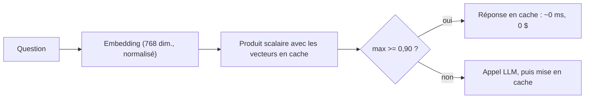

# Le cache sémantique des réponses

> [!NOTE]
> Dans cette leçon, vous allez construire un cache qui reconnaît une question **reformulée** grâce aux embeddings, choisir son seuil de similarité à partir de mesures réelles, et lister les cas où il ne faut surtout pas l'utiliser.

## Du cache exact au cache sémantique

Un cache classique (clé = texte exact) ne sert presque jamais : « Combien de temps pour retourner un article ? » et « Je peux retourner un article pendant combien de temps ? » sont deux clés différentes. Un **cache sémantique** compare le **sens** :

1. on calcule l'**embedding** de la question (un vecteur de nombres qui représente son sens ; deux phrases proches donnent des vecteurs proches) ;
2. on cherche la question déjà vue dont le vecteur est le plus proche, par **similarité cosinus** (1 = même direction, 0 = sans rapport) ;
3. au-dessus d'un **seuil**, on renvoie la réponse en cache : zéro appel au LLM.



## Le code

```python title="files/router.py (extrait)"
class SemanticCache:
    def __init__(self, threshold=CACHE_SIM):
        self.threshold, self.vecs, self.values = threshold, [], []

    def get(self, vec):
        if not self.vecs:
            return None, 0.0
        sims = np.array(self.vecs) @ vec          # vecteurs normalisés : produit scalaire = cosinus
        i = int(sims.argmax())
        return (self.values[i] if sims[i] >= self.threshold else None), float(sims[i])

    def put(self, vec, value):
        self.vecs.append(vec)
        self.values.append(value)
```

Les embeddings du lot sont calculés **en un seul appel**. Piège rencontré pendant l'écriture du lab : passer une liste de chaînes à `embed_content` produit **un seul** vecteur pour l'ensemble ; il faut un `Content` par texte.

```python title="files/router.py (extrait)"
r = await client.aio.models.embed_content(
    model=EMBED_MODEL,
    contents=[types.Content(parts=[types.Part(text=t)]) for t in texts],
    config=types.EmbedContentConfig(output_dimensionality=768))
assert len(r.embeddings) == len(texts), "un embedding attendu par texte"
```

> [!TIP]
> `gemini-embedding-2` produit 3 072 dimensions ; `output_dimensionality=768` divise par 4 la mémoire et le temps de recherche. Après réduction, **normalisez** les vecteurs (`v / np.linalg.norm(v)`) pour que le produit scalaire soit bien un cosinus.

## Choisir le seuil sur des mesures

Voici les similarités réellement mesurées dans le banc (meilleure correspondance trouvée dans le cache) :

| Question entrante | Plus proche en cache | Similarité | Même réponse attendue ? |
| --- | --- | --- | --- |
| r01 « Quel est le prix de la livraison standard… » | q01 | **0,966** | oui |
| r02 « Combien de temps ai-je pour retourner… » | q02 | **0,958** | oui |
| r03 « Est-il possible de régler en plusieurs fois ? » | q05 | **0,879** | oui |
| r04 « Le ruban LED Fil se coupe tous les combien ? » | q08 | **0,830** | oui |
| q07 « Sous quel délai signaler un produit cassé ? » | autre question | 0,761 | **non** |
| q10 calcul remise pro | autre question | 0,691 | **non** |

Au seuil de **0,90** : 2 reformulations sur 4 servies par le cache, aucun faux positif. À **0,82**, les 4 l'auraient été, mais la marge avec la question sans rapport la plus proche (0,761) n'est plus que de 0,06.

```quiz
question: "Vous baissez le seuil de 0,90 à 0,75. Quel risque prenez-vous, d'après les mesures ?"
options:
  - "Aucun, le taux de cache augmente"
  - "Servir à « Sous quel délai signaler un produit cassé ? » la réponse d'une autre question : 0,761 dépasse 0,75"
  - "Les embeddings deviennent plus coûteux"
answer: 1
explanation: "Un faux positif de cache, c'est une réponse fausse donnée avec assurance et sans aucun appel au modèle pour la rattraper. Le coût des embeddings ne dépend pas du seuil."
```

> [!WARNING]
> N'utilisez pas de cache sémantique partagé pour des réponses **personnelles** (« où en est **ma** commande ? ») ou **datées** (stock, prix promotionnel du jour). Clé de cache = sens de la question **et** contexte (client, langue, version de la FAQ). Videz le cache quand la base de connaissances change.

## Ce que coûte et rapporte le cache

- **Coût** : un embedding par question (0,20 $ par million de tokens, soit quelques millionièmes de dollar pour une question), plus la recherche (négligeable en mémoire jusqu'à quelques milliers d'entrées ; au-delà, un index vectoriel).
- **Gain** : la requête en cache coûte 0 en LLM et répond en quelques microsecondes. Sur notre banc, 2 requêtes sur 16 servies par le cache.

Le gain réel dépend de la **répétition** de votre trafic : en support client, une poignée de questions (livraison, retours, mot de passe) représente souvent une grosse part du volume. Mesurez-la sur vos journaux avant de promettre un chiffre.

```quiz
question: "Où placer le cache sémantique dans un routeur à deux modèles ?"
options:
  - "Après le petit modèle, pour ne cacher que les réponses validées"
  - "Avant tout appel LLM, et ne mettre en cache que la réponse finale (après escalade éventuelle)"
  - "Après le grand modèle uniquement"
answer: 1
explanation: "Le cache évite tout appel s'il est consulté en premier. On stocke la réponse finale, celle que l'utilisateur a reçue, pour ne pas mettre en cache une réponse du petit modèle jugée insuffisante."
```

## Exercice

Ajoutez au cache une **expiration** : chaque entrée vit 24 h. Écrivez la modification de `put` et `get`.

<details>
<summary>Voir la solution</summary>

```python
import time

class SemanticCache:
    def __init__(self, threshold=0.90, ttl=24 * 3600):
        self.threshold, self.ttl, self.vecs, self.values, self.t = threshold, ttl, [], [], []

    def put(self, vec, value):
        self.vecs.append(vec); self.values.append(value); self.t.append(time.time())

    def get(self, vec):
        now = time.time()
        keep = [i for i, t in enumerate(self.t) if now - t < self.ttl]   # purge paresseuse
        self.vecs = [self.vecs[i] for i in keep]
        self.values = [self.values[i] for i in keep]
        self.t = [self.t[i] for i in keep]
        if not self.vecs:
            return None, 0.0
        sims = np.array(self.vecs) @ vec
        i = int(sims.argmax())
        return (self.values[i] if sims[i] >= self.threshold else None), float(sims[i])
```

En production, on délègue cela à un magasin qui gère le TTL nativement (Memorystore pour Redis avec recherche vectorielle, par exemple).

</details>

## Résultat obtenu

Exécution réelle du routeur le 2026-10-15 (`CONF_MIN=0.95 python bench.py --strategies router`), lignes des reformulations :

```text
r01 cache [] 0.966 True 0.0 0.0 La livraison standard en France métropolitaine coûte 4,90 € et elle est offerte dès 60 € d'achat.
r02 cache [] 0.958 True 0.0 0.0 Vous disposez d'un délai de rétractation de 30 jours après réception pour retourner un article…
r03 small [1.0] 0.879 True 0.56 0.64 Oui, il est possible de régler en 3 fois sans frais par carte bancaire à partir de 150 € d'achat.
r04 small [1.0] 0.83 True 0.7 0.78 Les rubans LED « Fil » se coupent tous les 5 cm, au niveau des repères ciseaux.
```

Colonnes : identifiant, route, confiance(s), similarité max dans le cache, qualité, TTFT, latence (s), réponse.

## Je sais faire

- [ ] Expliquer la différence entre cache exact et cache sémantique
- [ ] Calculer des embeddings par lot (un `Content` par texte) et les normaliser
- [ ] Choisir un seuil de similarité à partir de mesures, pas au hasard
- [ ] Dire quand un cache sémantique est dangereux
