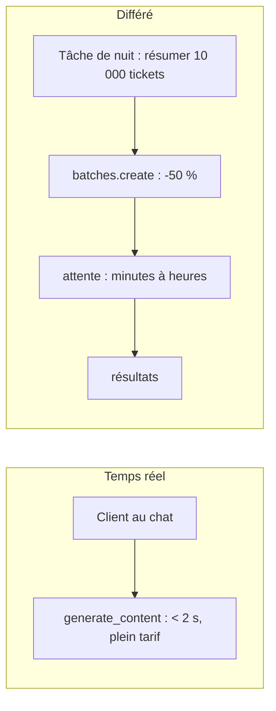

# Batch, compression de prompts et budget par requête

> [!NOTE]
> Dans cette leçon, vous allez basculer le travail non urgent sur l'API Batch (moitié prix), mesurer ce que rapporte vraiment la compression d'un prompt, et poser un budget par requête qui empêche une escalade coûteuse.

## L'API Batch : moitié prix, mais pas tout de suite

L'**API Batch** de Gemini traite un lot de requêtes de façon **asynchrone** : vous soumettez, vous revenez chercher le résultat plus tard (l'objectif annoncé est 24 h, souvent beaucoup moins). En échange, le prix est divisé par deux (flash-lite : 0,15 $ au lieu de 0,30 $ par million de tokens d'entrée, relevé le 2026-10-15).



| Charge | Temps réel | Batch |
| --- | --- | --- |
| Réponse au client dans le chat | oui | non |
| Classer les tickets de la veille | possible | **oui** |
| Générer des réponses types pour la FAQ | possible | **oui** |
| Évaluer un nouveau prompt sur 500 questions | possible | **oui** |
| Pré-remplir un cache sémantique | possible | **oui** |

```python title="files/extras.py (extrait)"
job = client.batches.create(model=R.SMALL_MODEL, src=reqs, config={"display_name": "lab-perf-batch"})
while job.state.name not in ("JOB_STATE_SUCCEEDED", "JOB_STATE_FAILED", "JOB_STATE_CANCELLED",
                             "JOB_STATE_EXPIRED") and time.time() - t0 < 900:
    time.sleep(20)
    job = client.batches.get(name=job.name)
for r in job.dest.inlined_responses:
    print(r.response.text)
```

> [!TIP]
> Les requêtes « en ligne » (`src=[...]`) conviennent à de petits lots. Pour des milliers de requêtes, déposez un fichier JSONL avec `client.files.upload` et passez son nom en `src`. Sur Vertex AI, l'équivalent est la prédiction par lot, avec entrée et sortie dans Cloud Storage ou BigQuery.

## La compression de prompt : mesurer avant de couper

Chaque token d'entrée est payé à chaque requête. Deux familles de compression :

| Technique | Exemple | Risque |
| --- | --- | --- |
| **Compaction** sans perte | retirer puces, titres, espaces | quasi nul |
| **Sélection de contexte** | n'envoyer que la section utile de la FAQ (via embeddings, c'est du RAG) | rater la section qui contenait la réponse |
| **Compression apprise** (LLMLingua et apparentés) | un petit modèle supprime les tokens peu informatifs | perte de sens, à évaluer |

```python title="files/extras.py (extrait)"
variants = {
    "FAQ complète (markdown)": R.SYSTEM,
    "FAQ complète compactée": base + "\n" + compact(R.KB),
    "Section « Livraison » seule": base + "\n" + sections(R.KB)["Livraison"],
}
for name, text in variants.items():
    n = client.models.count_tokens(model=R.SMALL_MODEL, contents=text).total_tokens
```

```quiz
question: "La compaction de la FAQ fait gagner 4 % de tokens, la sélection de la seule section utile 74 %. Pourquoi ne pas toujours sélectionner ?"
options:
  - "Parce que count_tokens est payant"
  - "Parce que certaines questions ont besoin de plusieurs sections (q10 mélange produits, professionnels et livraison) : une sélection trop étroite fait perdre en qualité, et le préfixe variable empêche le cache de contexte"
  - "Parce que la sélection augmente le TTFT"
answer: 1
explanation: "La sélection est un compromis qualité/coût : il faut l'évaluer sur le jeu de questions. Et un contexte qui change à chaque requête ne forme plus un préfixe stable, ce qui annule le cache de contexte. Elle réduit plutôt le TTFT."
```

## Un budget par requête

Un **budget par requête** borne ce qu'une seule question peut coûter : `max_output_tokens`, nombre d'étapes d'un agent, et dans notre routeur, le droit d'escalader.

```python title="files/router.py (extrait)"
# Coût estimé du grand modèle : mêmes tokens, sortie doublée par prudence.
big_estimate = cost_usd(BIG_MODEL, small.prompt_tokens, small.cached_tokens, 2 * small.output_tokens)
if small.confidence < self.conf_min and small.cost + big_estimate <= self.max_cost:
    big = await ask(self.client, BIG_MODEL, question)
```

Avec `MAX_COST_USD=0.01`, une question de FAQ (environ 0,0004 $ en flash-lite et 0,001 $ en flash) passe largement. Le budget mord sur les cas anormaux : un prompt gonflé par un document de 200 000 tokens collé par l'utilisateur ne déclenchera pas, en plus, un appel au grand modèle.

> [!WARNING]
> Un budget par requête ne remplace pas un budget **par utilisateur** ou par jour : 10 000 requêtes « dans le budget » font une grosse facture. Combinez-le avec une limite de débit par utilisateur et les quotas (voir [Quotas, plafonds et budgets](../../03-architecture-ia-entreprise-gcp/03-exposer-proteger-surveiller/03-quotas-et-budgets.md)).

```quiz
question: "Pourquoi le routeur estime-t-il le coût du grand modèle AVANT de l'appeler, au lieu de le mesurer après ?"
options:
  - "Parce que l'API ne renvoie pas le nombre de tokens du grand modèle"
  - "Parce qu'un budget sert à décider : une fois l'appel fait, la dépense est engagée"
  - "Parce que le grand modèle est gratuit"
answer: 1
explanation: "La mesure après coup sert à la comptabilité et au suivi ; seule une estimation préalable permet de refuser une dépense. L'API renvoie bien l'usage du grand modèle, mais trop tard pour décider."
```

## Exercice

Les 16 questions du banc coûtent 0,00683 $ en flash-lite temps réel. Estimez le coût du même lot en Batch, puis dites pour quelles questions de Lumen & Co le Batch serait acceptable.

<details>
<summary>Voir la solution</summary>

Le Batch divise par deux les prix d'entrée et de sortie : environ **0,0034 $** pour le lot (16 503 × 0,15 + 753 × 1,25, divisé par un million).

Acceptable : aucune des questions du chat (un client attend). En revanche, on peut utiliser le Batch pour **pré-calculer** les réponses aux 50 questions les plus fréquentes chaque nuit, à moitié prix, et les charger dans le cache sémantique : le jour, ces questions coûtent 0 en LLM. C'est le même modèle, moins cher, et plus rapide pour l'utilisateur.

</details>

## Résultat obtenu

Exécutions réelles du 2026-10-15 :

```text
$ python extras.py tokens
FAQ complète (markdown)          1014 tokens
FAQ complète compactée            972 tokens
Section « Livraison » seule       266 tokens

$ python extras.py batch
état=JOB_STATE_SUCCEEDED après 143 s
-> Oui, nous livrons en Belgique pour un montant de 12,00 €, avec un délai de 5 à 8 jours ouvrés (cette livraison n'est jam
-> Les ampoules LED sont garanties 3 ans, sur présentation de la facture.
```

Le lot de 2 requêtes a été traité en 2 min 23 s : acceptable pour une tâche de nuit, rédhibitoire pour un chat.

## Je sais faire

- [ ] Choisir entre temps réel et Batch selon l'urgence
- [ ] Soumettre un lot et récupérer ses résultats
- [ ] Mesurer un gain de compression avec `count_tokens` avant de couper
- [ ] Borner le coût d'une requête avant d'engager la dépense
