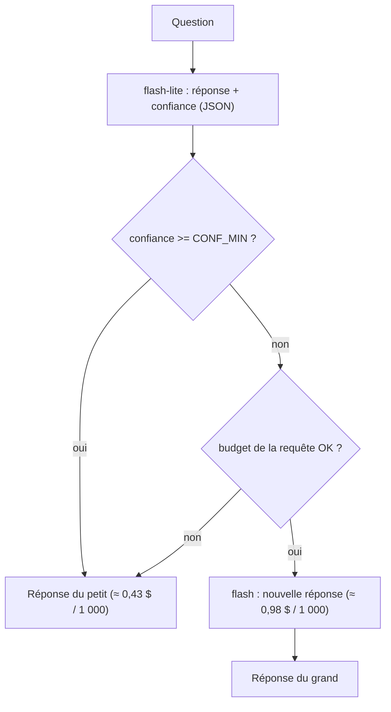

# Le routage de modèles : petit d'abord, grand si besoin

> [!NOTE]
> Dans cette leçon, vous allez construire une cascade flash-lite → flash pilotée par la confiance, découvrir sur des mesures réelles que la confiance auto-déclarée d'un modèle est mal calibrée, et choisir un seuil en connaissance de cause.

## L'idée de la cascade

La plupart des questions de support sont simples ; un petit modèle y répond bien, plus vite et moins cher. Une **cascade** (popularisée par FrugalGPT, voir les références) essaie d'abord le petit modèle et n'**escalade** vers le grand que si un signal indique que la réponse est douteuse.



| Signal pour escalader | Coût | Fiabilité |
| --- | --- | --- |
| Confiance auto-déclarée par le modèle (notre lab) | nul (même appel) | **faible**, voir les mesures |
| Règles sur la question (calcul, date, plusieurs sujets) | nul | bonne sur les cas prévus |
| Validateur : un 2ᵉ appel juge la réponse | un appel | moyenne à bonne |
| Classifieur entraîné sur vos données | entraînement | la meilleure, une fois calibrée |
| Vérification déterministe (JSON valide, montant recalculé) | nul | excellente, mais spécifique |

## Le code

Le petit modèle répond en **JSON structuré** (schéma imposé par `response_schema`) avec sa confiance :

```python title="files/router.py (extrait)"
SCHEMA = {
    "type": "object",
    "properties": {"answer": {"type": "string"}, "confidence": {"type": "number"}},
    "required": ["answer", "confidence"],
}

small = await ask(self.client, SMALL_MODEL, question)
res = Result(small.answer, "small", [small], ttft=small.ttft)
big_estimate = cost_usd(BIG_MODEL, small.prompt_tokens, small.cached_tokens, 2 * small.output_tokens)
if small.confidence < self.conf_min and small.cost + big_estimate <= self.max_cost:
    big = await ask(self.client, BIG_MODEL, question)
    res = Result(big.answer, "escalated", [small, big], ttft=small.latency + big.ttft)
```

Une sortie illisible (JSON cassé) reçoit une confiance de 0 : elle escalade automatiquement.

## Ce que disent les mesures

Sur les 16 questions, le petit modèle a déclaré une confiance de **1,0 sur 15 questions**, et de **0,9 à 0,95** sur la seule question qu'il a ratée (q12 : « Je commande en express un vendredi à 15 h, quand est-ce que je reçois mon colis ? » ; il répond « le prochain jour ouvré » sans conclure « mardi »).

| Seuil `CONF_MIN` | q12 (confiance 0,9) | Escalades | Qualité | Coût du lot |
| --- | --- | --- | --- | --- |
| 0,8 | reste au petit, **fausse** | 0 | 94 % | 0,00612 $ |
| 0,95 | escalade, **juste** | 1 | 100 % | 0,00716 $ |

> [!WARNING]
> La confiance auto-déclarée n'est **pas une probabilité calibrée** : ici, le modèle se dit sûr à 90 % d'une réponse incomplète. Le seuil 0,95 a fonctionné parce que les bonnes réponses étaient à 1,0 : c'est fragile. Preuve dans nos propres mesures : lors de l'exécution « small », le même modèle a donné **0,95** à la même question q12 ; avec le test `confidence < 0.95`, elle n'aurait **pas** été escaladée. Sur un autre jeu de questions, ou après une mise à jour du modèle, la distribution peut changer. Mesurez-la sur au moins quelques centaines de questions annotées avant de vous y fier.

```quiz
question: "Avec CONF_MIN = 0,95, le routeur a atteint 100 % de qualité pour un coût proche du petit modèle seul. Que faut-il en conclure ?"
options:
  - "Que la confiance auto-déclarée est un signal fiable, on peut déployer"
  - "Que ce réglage marche sur ces 16 questions, avec une seule escalade décisive : il faut le valider sur un jeu plus grand et le surveiller en production"
  - "Que le grand modèle est inutile"
answer: 1
explanation: "Un seul cas a fait la différence. C'est un indice encourageant, pas une preuve. Le grand modèle a justement corrigé ce cas : il reste utile pour la traîne difficile."
```

## Améliorer le signal sans appel supplémentaire

Les questions ratées ont un profil : **calcul** ou **raisonnement sur une date**. Une règle simple, combinée à la confiance, attrape ce profil sans aucun appel :

```python title="règle d'escalade (illustration)"
import re

RISKY = re.compile(r"\b(combien je paie|total|remise|quand|quel jour|si je commande)\b", re.I)

def must_escalate(question: str, confidence: float, conf_min: float = 0.8) -> bool:
    return confidence < conf_min or bool(RISKY.search(question))
```

> [!TIP]
> Une autre option : demander au petit modèle de **classer** la question (`"type": "faq" | "calcul" | "hors_sujet"`) dans le même JSON. Les catégories sont plus faciles à fiabiliser qu'un nombre entre 0 et 1, et elles servent aussi aux tableaux de bord.

```quiz
question: "Dans une cascade, quel est le coût caché d'une escalade pour l'utilisateur ?"
options:
  - "Aucun, l'escalade est transparente"
  - "La latence : il attend la réponse complète du petit modèle, puis le grand ; sur le banc, TTFT de 2,70 s pour q12 contre environ 0,8 s sans escalade"
  - "Il doit se reconnecter"
answer: 1
explanation: "Les deux appels sont séquentiels. C'est pourquoi le p95 du routeur au seuil 0,95 (1,76 s) dépasse celui du petit modèle seul (1,35 s). Pour un chat, on peut afficher la réponse du petit tout en vérifiant en arrière-plan, au prix d'une complexité accrue."
```

## Exercice

Intégrez `must_escalate` dans `Router.answer` et écrivez un test sans clé qui vérifie que q10 (calcul de remise) est escaladée même avec une confiance de 1,0.

<details>
<summary>Voir la solution</summary>

Dans `router.py` :

```python
if must_escalate(question, small.confidence, self.conf_min) and small.cost + big_estimate <= self.max_cost:
```

Dans `test_router.py`, en réutilisant le faux client :

```python
def test_calcul_toujours_escalade():
    cl = client({R.SMALL_MODEL: 1.0, R.BIG_MODEL: 0.9})
    q = "Je suis pro : 2 suspensions à 80 € avec la remise, combien je paie au total ?"
    assert run(R.Router(cl).answer(q)).route == "escalated"
```

Attention à l'effet sur le coût : si 20 % de votre trafic contient « quand », vous escaladez 20 % des requêtes. Mesurez la part réelle sur vos journaux.

</details>

## Résultat obtenu

Deux exécutions réelles du routeur le 2026-10-15 (16 questions, 4 en parallèle), extrait de `bench.py --strategies router` :

```text
# CONF_MIN=0.8
router    TTFT p50 0.88  p95 1.16   lat p50 0.97  p95 1.32   qualité 94%   coût 0.00612 $   appels 14  cache 2  escal. 0
q12 small [0.9] False 1.32 La livraison express est en 24 h ouvrées pour toute commande passée avant 13 h, du lundi a…

# CONF_MIN=0.95
router    TTFT p50 0.85  p95 1.56   lat p50 0.95  p95 1.76   qualité 100%  coût 0.00716 $   appels 15  cache 2  escal. 1
q12 escalated [0.9, 0.95] 0.731 True 2.7 3.19 La livraison express en 24 h ouvrées s'applique uniquement aux commandes passées avant 13 h…
```

## Je sais faire

- [ ] Construire une cascade petit → grand modèle avec un signal d'escalade
- [ ] Expliquer pourquoi la confiance auto-déclarée est mal calibrée
- [ ] Choisir un seuil à partir des confiances observées sur les réussites et les échecs
- [ ] Combiner confiance et règles déterministes pour escalader
