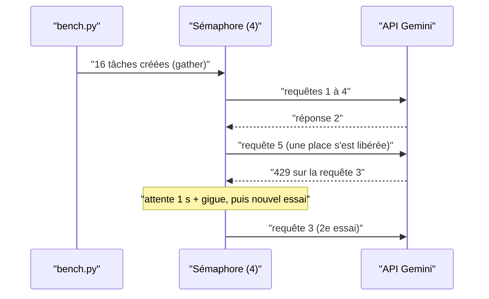

# Le test de charge avec asyncio

> [!NOTE]
> Dans cette leçon, vous allez écrire un banc de charge en `asyncio` qui envoie des requêtes en parallèle avec une concurrence bornée, gérer proprement les erreurs 429 et 503, et lire le débit obtenu.

## Pourquoi asyncio

Un appel LLM passe presque tout son temps à **attendre** le réseau. `asyncio` permet de lancer des dizaines d'appels qui attendent en même temps dans un seul processus, sans threads. Un **sémaphore** borne le nombre de requêtes « en vol » : c'est la **concurrence** du test.



## Le code

```python title="files/bench.py (extrait)"
async def run_fixed(client, model, questions, concurrency):
    sem = asyncio.Semaphore(concurrency)  # limite le nombre de requêtes en vol

    async def one(q):
        async with sem:
            c = await R.ask(client, model, q["question"])
            ...
            return row(q, res)
    return await asyncio.gather(*(one(q) for q in questions))
```

Le **débit** est le nombre de requêtes divisé par la durée murale (*wall time*) du lot :

```python title="files/bench.py (extrait)"
"debit_rps": len(rows) / wall,
```

## Réessayer correctement

Sous charge, l'API renvoie **429** (quota ou limite de débit atteinte) ou **503** (surcharge momentanée). La règle : réessayer avec une attente **exponentielle** (1 s, 2 s, 4 s…) et une **gigue** aléatoire, pour que des centaines de clients ne réessaient pas tous à la même milliseconde.

```python title="files/router.py (extrait)"
async def with_retry(fn, tries=5):
    for i in range(tries):
        try:
            return await fn()
        except Exception as e:  # google.genai.errors.APIError porte .code
            code = getattr(e, "code", None)
            if code not in (429, 500, 503, 504) or i == tries - 1:
                raise
            await asyncio.sleep(2 ** i + random.random())
```

| Code | Signification | Réessayer ? |
| --- | --- | --- |
| 400 | requête invalide (schéma, taille) | **non** : corriger |
| 403 | droits, API non activée | **non** |
| 429 | limite de débit ou quota | oui, avec attente |
| 500, 503, 504 | erreur ou surcharge côté serveur | oui, avec attente |

> [!WARNING]
> Un réessai **en streaming** recommence toute la génération : le client ne doit pas afficher deux fois le début de la réponse. Dans le lab, `with_retry` enveloppe l'appel streaming **complet** ; une interface réelle doit effacer ce qui a été affiché avant de rejouer.

```quiz
question: "Vous doublez la concurrence de 4 à 8 et le débit ne bouge pas, mais le p95 double. Que se passe-t-il le plus probablement ?"
options:
  - "Le code asyncio est bloquant"
  - "Vous avez atteint la limite de débit côté API : les requêtes supplémentaires attendent (429 + réessais), ce qui allonge la traîne sans servir plus de monde"
  - "Le modèle est devenu plus lent par nature"
answer: 1
explanation: "Quand le débit plafonne et que la latence monte, c'est le signe d'un goulot d'étranglement : quota, limite par minute ou capacité partagée. Au-delà, augmenter la concurrence ne fait que remplir une file d'attente."
```

## Lire le débit du banc

Sur notre banc, à concurrence 4, flash-lite a traité **3,89 requêtes par seconde** contre **1,97** pour flash : avec des requêtes deux fois plus courtes, on en sert deux fois plus avec la même concurrence (loi de Little : concurrence ≈ débit × latence, soit 4 ≈ 3,89 × 0,9 s environ).

| | Concurrence | Latence p50 | Débit mesuré | Concurrence ÷ latence |
| --- | --- | --- | --- | --- |
| flash | 4 | 1,81 s | 1,97 req/s | 2,2 |
| flash-lite | 4 | 0,86 s | 3,89 req/s | 4,7 |

Les écarts entre les deux dernières colonnes viennent de la dispersion des latences et de la fin du lot (les dernières requêtes tournent avec moins de 4 en vol).

> [!TIP]
> Pour dimensionner : nombre d'utilisateurs simultanés × questions par minute ÷ 60 = débit cible. Multipliez par la latence p95 : vous obtenez la concurrence à prévoir, donc les quotas et le `max_instance_count` de Cloud Run.

```quiz
question: "Le support attend un pic de 10 questions par seconde, avec une latence p95 de 1,3 s. Quelle concurrence prévoir au minimum ?"
options:
  - "Environ 13 requêtes en vol"
  - "Environ 1,3 requête en vol"
  - "Environ 130 requêtes en vol"
answer: 0
explanation: "Loi de Little : concurrence = débit × temps de séjour = 10 × 1,3 ≈ 13. Avec une marge, on prévoit 20 à 30, et des quotas de requêtes et de tokens par minute en conséquence (10 req/s = 600 req/min, environ 600 000 tokens d'entrée par minute avec notre prompt de 1 000 tokens)."
```

## Exercice

Ajoutez au banc une option `--rps` qui envoie les requêtes à **cadence fixe** (par exemple 5 par seconde), au lieu de « dès qu'une place se libère ». Pourquoi est-ce un test plus réaliste ?

<details>
<summary>Voir la solution</summary>

```python
async def run_open_loop(client, model, questions, rps):
    async def one(q, delay):
        await asyncio.sleep(delay)                 # départ planifié, indépendant des réponses
        c = await R.ask(client, model, q["question"])
        return c
    return await asyncio.gather(*(one(q, i / rps) for i, q in enumerate(questions)))
```

Le banc à sémaphore est un test « en boucle fermée » : si le serveur ralentit, il envoie moins, ce qui **masque** la saturation. Les vrais clients arrivent sans attendre les autres (« boucle ouverte ») : si le système ralentit, la file grossit et la latence explose. C'est ce que montre le test à cadence fixe.

</details>

## Résultat obtenu

Exécution réelle du 2026-10-15, `python bench.py --concurrency 4` (les éventuels réessais sont inclus dans les latences ; extrait) :

```text
stratégie                        TTFT p50    p95  lat p50    p95  req/s  qualité    coût $ appels
big (gemini-3.8-flash)               1.57   2.02     1.81   2.57   1.97     100%   0.01560     16
small (gemini-3.5-flash-lite)        0.76   1.23     0.86   1.35   3.89      94%   0.00683     16
```

Avec 16 requêtes à concurrence 4, c'est un test de **fumée**, pas de capacité : il valide la mécanique et donne des ordres de grandeur. Un vrai test de charge se fait sur des centaines de requêtes, avec un quota dédié, pas sur une clé partagée.

## Je sais faire

- [ ] Écrire un banc asyncio à concurrence bornée par un sémaphore
- [ ] Réessayer 429 et 5xx avec attente exponentielle et gigue, et pas les 4xx
- [ ] Relier concurrence, débit et latence par la loi de Little
- [ ] Distinguer test en boucle fermée et test à cadence fixe
