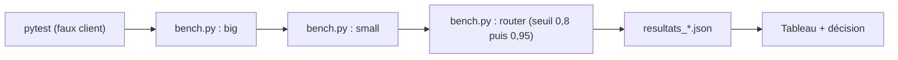
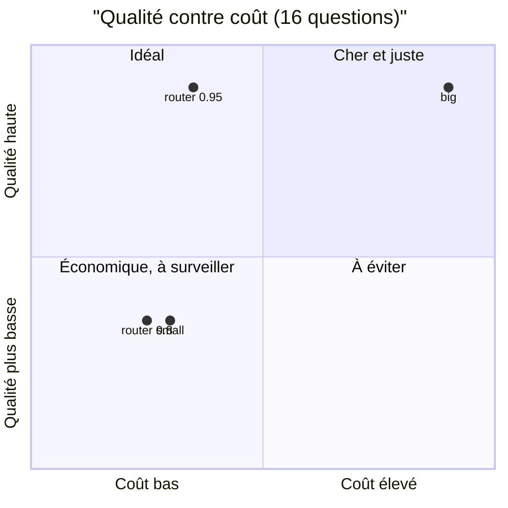

# Projet final : le banc complet et les arbitrages chiffrés

> [!NOTE]
> Dans cette leçon, vous allez lancer le banc complet (trois stratégies, environ 50 appels), lire le tableau de résultats et rédiger une recommandation chiffrée pour le support de Lumen & Co, avec ses limites.

## Lancer le banc

```bash
cd files/
pip install -r requirements.txt
pytest -q                                   # 8 tests, sans clé ni réseau
cp .env.example .env                        # mettez votre clé dans GOOGLE_API_KEY
python bench.py --concurrency 4             # big, small, router : ~16 + 16 + 15 appels
CONF_MIN=0.95 python bench.py --strategies router --out resultats_router_095.json
```

Chaque exécution écrit un fichier JSON avec le résumé et le détail par question (route, confiances, similarité, réponse), pour l'audit.



## Le tableau de résultats

Mesures réelles du 2026-10-15, API Gemini, 16 questions (12 originales + 4 reformulations), concurrence 4. Coût estimé avec la grille publique relevée le même jour (USD).

| Stratégie | TTFT p50 | TTFT p95 | Lat. p50 | Lat. p95 | Débit | Qualité | Coût du lot | Coût / 1 000 q. | Appels LLM | Cache | Escalades |
| --- | --- | --- | --- | --- | --- | --- | --- | --- | --- | --- | --- |
| big (`gemini-3.8-flash`) | 1,57 s | 2,02 s | 1,81 s | 2,57 s | 1,97 req/s | 16/16 | 0,01560 $ | 0,98 $ | 16 | 0 | — |
| small (`gemini-3.5-flash-lite`) | 0,76 s | 1,23 s | 0,86 s | 1,35 s | 3,89 req/s | 15/16 | 0,00683 $ | 0,43 $ | 16 | 0 | — |
| router, `CONF_MIN=0.8` | 0,88 s | 1,16 s | 0,97 s | 1,32 s | 3,17 req/s | 15/16 | 0,00612 $ | 0,38 $ | 14 | 2 | 0 |
| router, `CONF_MIN=0.95` | 0,85 s | 1,56 s | 0,95 s | 1,76 s | 2,41 req/s | 16/16 | 0,00716 $ | 0,45 $ | 15 | 2 | 1 |



Comment lire :

- **big** est la référence de qualité, mais coûte 2,3 fois plus que small et répond deux fois plus lentement ;
- **small** rate une seule question (q12, raisonnement sur une date) ;
- **router 0,8** économise 10 % sur small grâce au cache (2 appels évités), sans corriger q12 ;
- **router 0,95** obtient la qualité de big pour **46 % de son coût**, au prix d'un p95 plus élevé (l'escalade de q12 a pris 3,19 s).

> [!WARNING]
> **Limites de ces chiffres.** 16 questions, une seule exécution par réglage, une clé partagée : chaque différence de qualité repose sur **une** question, et les p95 sur une ou deux requêtes. Les deux exécutions du routeur et celle de big/small ont eu lieu à quelques minutes d'intervalle, pas simultanément. Pour décider en production : au moins quelques centaines de questions réelles annotées, plusieurs exécutions, et les intervalles de confiance.

```quiz
question: "La direction veut « la qualité du grand modèle au prix du petit ». Que lui répondre avec ces mesures ?"
options:
  - "C'est atteint : router 0,95 a 100 % de qualité pour 0,45 $ les 1 000 questions"
  - "C'est prometteur sur 16 questions (qualité de big pour environ la moitié de son coût), mais le signal d'escalade est fragile : à valider sur un jeu plus grand avant de s'engager"
  - "C'est impossible, il faut choisir"
answer: 1
explanation: "Le résultat repose sur une seule escalade décisive, et la confiance auto-déclarée a varié d'une exécution à l'autre (0,9 puis 0,95 pour la même question). L'honnêteté chiffrée consiste à donner le résultat ET sa marge d'incertitude."
```

## Une observation de qualité inattendue

Dans une exécution, flash-lite a renvoyé une réponse contenant des entités HTML (`d&#233;lai`, `&#224;`) au lieu des caractères accentués. Le correcteur automatique, qui ne cherchait que « 12 », l'a comptée juste. Un client, lui, aurait vu un texte abîmé.

> [!TIP]
> Ajoutez à vos contrôles de qualité des vérifications de **forme** (pas d'entités HTML, pas de Markdown cassé, longueur maximale) en plus du fond. Ce sont des tests déterministes, gratuits, qui attrapent ce que les mesures de coût ne voient pas.

```quiz
question: "Sur 1 million de questions par mois, quelle économie représente router 0,95 par rapport à big, d'après les coûts mesurés ?"
options:
  - "Environ 530 $ par mois (0,98 $ − 0,45 $ par 1 000 questions)"
  - "Environ 53 $ par mois"
  - "Environ 5 300 $ par mois"
answer: 0
explanation: "(0,98 − 0,45) × 1 000 000 / 1 000 ≈ 530 $. Avec un trafic plus répétitif que notre banc, le cache sémantique augmenterait l'écart ; avec plus de questions difficiles, les escalades le réduiraient."
```

## Exercice final

Rédigez la recommandation (5 à 8 lignes) pour le support de Lumen & Co : stratégie, réglages, conditions de mise en production et indicateurs à surveiller.

<details>
<summary>Voir la solution</summary>

**Recommandation (exemple).**

1. Stratégie : routeur flash-lite → flash avec cache sémantique, `CONF_MIN=0.95`, `CACHE_SIM=0.90`, plus une règle d'escalade systématique pour les questions de calcul et de date.
2. Gain attendu, d'après le banc : qualité équivalente au grand modèle pour environ la moitié de son coût, TTFT médian divisé par près de 2.
3. Condition préalable : rejouer le banc sur 300 questions réelles annotées (journaux anonymisés), en deux exécutions ; seuil d'acceptation : qualité ≥ celle de big moins 2 points.
4. Production : budget par requête 0,01 $, plafond d'instances, réessais exponentiels, cache purgé à chaque mise à jour de la FAQ.
5. Tableau de bord : taux de cache, taux d'escalade, p95 de latence, coût par 1 000 questions, taux de réponses signalées par les clients. Alerte si le taux d'escalade dépasse 20 % (signal de dérive du modèle ou des questions).

</details>

## Résultat obtenu

Sorties brutes réelles du 2026-10-15 (extraits ; fichiers complets dans `files/resultats_*.json`) :

```text
$ pytest -q
........                                                                 [100%]
8 passed in 0.33s

$ python bench.py --concurrency 4
stratégie                        TTFT p50    p95  lat p50    p95  req/s  qualité    coût $ appels cache escal.
big (gemini-3.8-flash)               1.57   2.02     1.81   2.57   1.97     100%   0.01560     16     0      0
small (gemini-3.5-flash-lite)        0.76   1.23     0.86   1.35   3.89      94%   0.00683     16     0      0

$ python bench.py --strategies router --out resultats_router.json
router                               0.88   1.16     0.97   1.32   3.17      94%   0.00612     14     2      0

$ CONF_MIN=0.95 python bench.py --strategies router --out resultats_router_095.json
router                               0.85   1.56     0.95   1.76   2.41     100%   0.00716     15     2      1
router                           tokens entrée=15479 dont en cache=0 sortie+réflexion=761
```

La ligne `router` de la première commande est omise : elle était faussée par le bogue d'embeddings décrit en leçon 2.2 (un seul vecteur pour tout le lot), corrigé avant les deux exécutions suivantes. Au total, la préparation et les mesures de cette formation ont consommé moins de 80 appels au modèle.

## Je sais faire

- [ ] Lancer un banc reproductible et conserver les résultats bruts
- [ ] Lire un tableau qualité / coût / latence et en tirer un arbitrage
- [ ] Énoncer les limites statistiques d'un petit banc
- [ ] Rédiger une recommandation chiffrée avec ses conditions de validation
