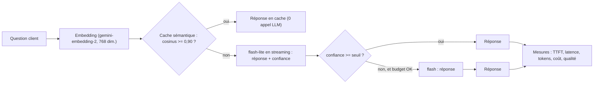

Un prototype qui répond en 2 secondes pour un centime ne dit rien de la production : à 50 000 questions par jour, chaque dixième de seconde et chaque millième de dollar se multiplient. Cette formation apprend à **mesurer** une application LLM comme un système (latence au premier token, percentiles, débit, tokens, coût), puis à appliquer les leviers qui comptent, **chiffres réels à l'appui**.

Fil rouge : le **support client** d'une boutique fictive de luminaires, Lumen & Co. Une base de connaissances d'environ 1 000 tokens, 16 questions dont 4 reformulations, et trois stratégies comparées sur le même banc :

- **big** : toujours le grand modèle (`gemini-3.8-flash`) ;
- **small** : toujours le petit (`gemini-3.5-flash-lite`) ;
- **router** : cache sémantique, puis petit modèle, escalade vers le grand si la confiance est basse.

## Pour qui ?

- Développeurs et architectes qui ont déjà une application Gemini en Python et doivent la passer à l'échelle.
- Vous connaissez `asyncio` dans les grandes lignes, les embeddings et le JSON structuré.
- Pour le socle d'infrastructure (quotas, budgets, IAM), voyez [Architecture IA d'entreprise sur Google Cloud](../03-architecture-ia-entreprise-gcp/index.md).

## Ce que l'on construit

## Résultats mesurés (2026-10-15, 16 questions, 4 requêtes en parallèle)

| Stratégie | TTFT p50 | Latence p95 | Qualité | Coût pour 1 000 questions |
| --- | --- | --- | --- | --- |
| big (`gemini-3.8-flash`) | 1,57 s | 2,57 s | 100 % | ~0,98 $ |
| small (`gemini-3.5-flash-lite`) | 0,76 s | 1,35 s | 94 % | ~0,43 $ |
| router, seuil 0,8 | 0,88 s | 1,32 s | 94 % | ~0,38 $ |
| router, seuil 0,95 | 0,85 s | 1,76 s | 100 % | ~0,45 $ |

Le détail, la méthode et les limites de ces chiffres (16 questions, c'est peu) sont dans le module 4.

## Prérequis techniques

- Python 3.10+, `pip install -r requirements.txt` (google-genai, numpy, python-dotenv, pytest).
- Une clé de l'API Gemini (Google AI Studio) dans `GOOGLE_API_KEY`, ou Vertex AI avec `GOOGLE_GENAI_USE_VERTEXAI=TRUE` et vos identifiants ADC.

## Programme

| Module | Contenu | Durée indicative |
| --- | --- | --- |
| 1. Mesurer | TTFT, latence totale, débit, percentiles p50/p95, tokens et coût par requête ; streaming | 1h15 |
| 2. Réduire les coûts | cache de contexte implicite et explicite, cache sémantique, batch, compression de prompt, budget par requête | 1h45 |
| 3. Router et tenir la charge | cascade flash-lite → flash, signal de confiance, banc de charge asyncio, 429 et réessais | 1h15 |
| 4. Projet final | exécuter le banc, lire le tableau, choisir et justifier un réglage | 45 min |

## Le lab

Le code est dans [`files/`](./files/) : [router.py](./files/router.py) (routeur, cache, mesures), [bench.py](./files/bench.py) (banc de charge), [extras.py](./files/extras.py) (compression, cache explicite, batch), la base [faq.md](./files/faq.md), les questions [questions.json](./files/questions.json), les tests sans clé [test_router.py](./files/test_router.py) et les résultats JSON bruts des exécutions.

| | En local | Avec GCP (Vertex AI) |
| --- | --- | --- |
| Tests | `pytest -q` (faux client, aucune clé) | idem |
| Banc | `python bench.py` avec `GOOGLE_API_KEY` | `GOOGLE_GENAI_USE_VERTEXAI=TRUE GOOGLE_CLOUD_PROJECT=... GOOGLE_CLOUD_LOCATION=europe-west1 python bench.py`, avec `SMALL_MODEL`/`BIG_MODEL` disponibles dans la région et `THINKING_LEVEL=` (vide) pour les modèles 2.5. Vérifié le 2026-10-15 avec un appel `gemini-2.5-flash` en `europe-west1` (TTFT 1,58 s) ; le banc complet a tourné sur l'API Gemini. Ajoutez les prix Vertex à `PRICES` |
| Appels | environ 50 pour les trois stratégies | idem |
