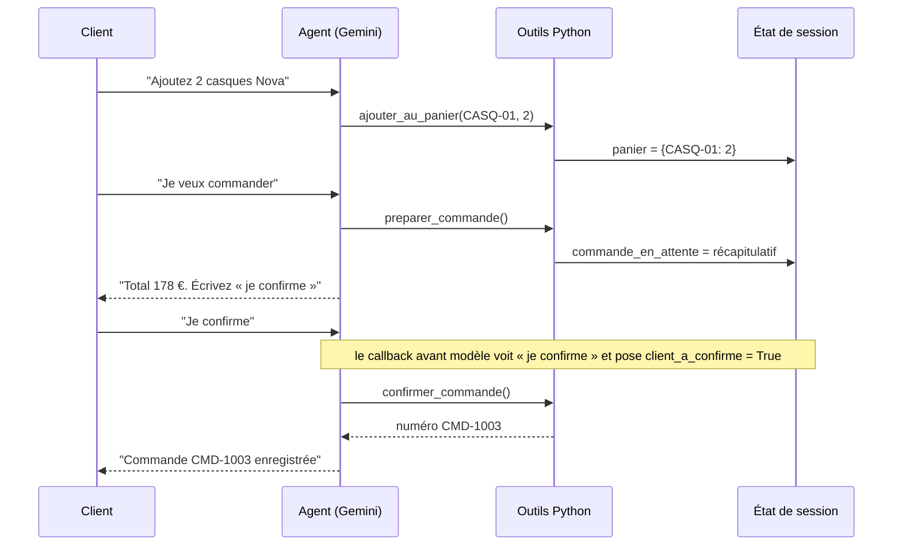

# Le cas d'usage et l'architecture

> [!NOTE]
> Dans cette leçon, vous allez délimiter ce que l'assistant de la boutique a le droit de faire, repérer les briques de Google ADK dont il a besoin et dessiner le chemin d'une commande, du premier message à l'enregistrement.

## Le besoin

La boutique fictive « Atelier Son » vend des casques, des enceintes et des accessoires. Le service client reçoit toujours les mêmes demandes : « vous avez ce produit ? », « il est en stock ? », « je veux commander », « où est mon colis ? », et parfois « je veux être remboursé ! ».

Un **agent** convient ici parce que les demandes sont ouvertes et que l'ordre des étapes dépend du client. Mais un agent qui **enregistre des commandes** touche à de l'argent : on va donc encadrer chaque action sensible par du code, pas par une simple consigne dans le prompt.

## Ce que l'agent a le droit de faire

| Action | Autorisée ? | Comment c'est garanti |
| --- | --- | --- |
| Chercher un produit, donner un prix | oui | outil `chercher_produits` : le prix vient du catalogue, jamais du modèle |
| Vérifier le stock | oui | outil `verifier_stock` |
| Ajouter au panier (1 à 5 unités) | oui | outil `ajouter_au_panier`, plafond codé en Python |
| Enregistrer une commande | **seulement après « je confirme »** | commande en deux temps + callback avant outil |
| Suivre une livraison | oui | outil `statut_livraison` |
| Rembourser, gérer un litige | **non** | outil `escalader_vers_humain` |
| Recevoir un numéro de carte | **non** | callback avant modèle qui bloque le message |

> [!TIP]
> Écrivez ce tableau **avant** le code. Chaque ligne « non » ou « seulement si » deviendra un test automatique (module 3).

## Les briques ADK utilisées

Rappel : le **function calling** (appel de fonction) permet au modèle de répondre « appelle `verifier_stock` avec `sku="CASQ-01"` » au lieu de répondre du texte. Votre code exécute la fonction et renvoie le résultat au modèle.

| Brique ADK | Rôle dans ce lab |
| --- | --- |
| `Agent` | le modèle + ses consignes (`instruction`) + ses outils |
| Outil fonction | une fonction Python ordinaire ; ADK lit son nom, sa docstring et ses types pour la décrire au modèle |
| `Runner` (ici `InMemoryRunner`) | la boucle : envoie le message, exécute les outils demandés, renvoie les résultats, jusqu'à la réponse finale |
| Session et `state` | la mémoire d'une conversation ; `state` est un dictionnaire (le panier y vit) |
| Callbacks | des fonctions appelées par ADK **avant** le modèle ou **avant** un outil, qui peuvent court-circuiter l'étape |

## Le chemin d'une commande



```quiz
question: "Pourquoi le prix d'un produit doit-il venir d'un outil plutôt que de la mémoire du modèle ?"
options:
  - "Parce que le modèle ne sait pas compter"
  - "Parce que le modèle ne connaît pas le catalogue de cette boutique et peut inventer un prix plausible"
  - "Parce qu'ADK interdit au modèle d'écrire des nombres"
answer: 1
explanation: "Le modèle n'a jamais vu le catalogue fictif d'Atelier Son. Sans outil, il produirait un prix vraisemblable mais faux. L'outil est la seule source de vérité."
```

## Pourquoi une commande en deux temps ?

Si l'agent avait un seul outil `passer_commande`, il pourrait l'appeler dès que le client dit « je veux commander », sans montrer le total. On sépare donc :

1. `preparer_commande` : calcule le récapitulatif et le range dans l'état, **sans rien enregistrer** ;
2. `confirmer_commande` : enregistre, mais un callback refuse de l'exécuter tant que le client n'a pas écrit « je confirme ».

La consigne du prompt dit la même chose, mais c'est le **code** qui garantit la règle : un modèle peut oublier une consigne, un `if` ne l'oublie pas.

> [!WARNING]
> Un garde-fou écrit uniquement dans le prompt (« ne commande jamais sans accord ») n'est pas un garde-fou. C'est un souhait. Les actions irréversibles doivent être protégées par du code.

```quiz
question: "Quels éléments sont garantis par du code Python dans cet agent, et pas seulement par le prompt ? (plusieurs réponses)"
options:
  - "Le plafond de 5 unités par produit"
  - "Le ton poli des réponses"
  - "L'interdiction d'enregistrer une commande sans « je confirme »"
  - "Le blocage des numéros de carte bancaire"
answer: [0, 2, 3]
explanation: "Le plafond est dans ajouter_au_panier, la confirmation dans le callback avant outil, le blocage de carte dans le callback avant modèle. Le ton, lui, ne dépend que de l'instruction : c'est acceptable car une erreur de ton n'a pas de conséquence irréversible."
```

## Exercice : délimiter un autre agent

Une pharmacie en ligne veut le même type d'assistant. Remplissez le tableau « Action / Autorisée ? / Comment c'est garanti » pour : conseiller un produit, vérifier le stock, commander un médicament sur ordonnance, donner une posologie, suivre un colis.

<details>
<summary>Voir la solution</summary>

| Action | Autorisée ? | Garantie |
| --- | --- | --- |
| Conseiller un produit sans ordonnance | oui, avec mention « demandez conseil à votre pharmacien » | consigne + outil catalogue |
| Vérifier le stock | oui | outil |
| Commander sur ordonnance | **non** pour l'agent | l'outil de commande refuse les produits marqués « ordonnance » (champ dans le catalogue) et escalade |
| Donner une posologie | **non** | escalade vers un pharmacien ; un callback peut détecter les questions de dosage |
| Suivre un colis | oui | outil |

Le principe ne change pas : tout ce qui est risqué est refusé **par une fonction**, pas par une phrase du prompt.

</details>

## Résultat obtenu

Premier échange du scénario réel `python run.py` (gemini-3.5-flash, 2026-10-15) : l'agent appelle l'outil avant de répondre et ne cite que les prix du catalogue.

```text
CLIENT > Bonjour, vous avez des casques audio ?
   [outil] chercher_produits({'requete': 'casque'})
   AGENT > Bonjour ! Nous proposons actuellement deux modèles de casques audio : le Casque audio
   sans fil Nova à 89 € (ref: CASQ-01) et le Casque audio filaire Studio à 49 € (ref: CASQ-02).
   Souhaitez-vous en savoir plus sur l'un d'eux ou en ajouter un à votre panier ?
```

## Je sais faire

- [ ] Lister les actions d'un agent et dire lesquelles sont interdites ou conditionnelles
- [ ] Expliquer le rôle d'`Agent`, d'un outil fonction, du `Runner`, de la session et des callbacks
- [ ] Justifier une commande en deux temps
- [ ] Distinguer un garde-fou dans le prompt d'un garde-fou dans le code
