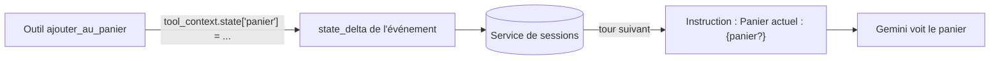

# Outils et état de session

> [!NOTE]
> Dans cette leçon, vous allez installer le projet, écrire les outils de l'agent sous forme de fonctions Python et stocker le panier dans l'**état de session** d'ADK, pour qu'il survive d'un message à l'autre.

## Installer et configurer

```bash
python -m venv .venv && source .venv/bin/activate
pip install -r requirements.txt       # google-adk==2.10.0, python-dotenv, pytest
cp .env.example .env                  # puis collez votre clé d'API Gemini dans .env
```

Le fichier `.env` contient trois variables : `GOOGLE_API_KEY` (la clé créée dans Google AI Studio), `GOOGLE_GENAI_USE_VERTEXAI=FALSE` (mode « clé d'API », sans projet Google Cloud) et `MODEL` (par défaut `gemini-3.5-flash`). `agent.py` les charge avec `load_dotenv()`.

> [!WARNING]
> Ne commitez jamais `.env`. Ajoutez-le à `.gitignore` dès la création du dépôt. Seul `.env.example`, avec une valeur factice, est versionné.

## Un outil = une fonction bien décrite

ADK transforme chaque fonction en **déclaration d'outil** envoyée au modèle : le nom de la fonction, la docstring (la description) et les annotations de type (les paramètres). Le modèle ne voit **que** cela : une docstring vague donne un outil mal utilisé.

```python title="files/agent.py"
def verifier_stock(sku: str) -> dict:
    """Donne le stock disponible d'un produit.

    Args:
        sku: identifiant produit, par exemple "CASQ-01".
    """
    p = CATALOGUE.get(sku.upper())
    if not p:
        return {"erreur": f"Produit {sku} inconnu."}
    return {"sku": sku.upper(), "stock": p["stock"], "disponible": p["stock"] > 0}
```

Trois règles appliquées partout dans [agent.py](../files/agent.py) :

| Règle | Pourquoi |
| --- | --- |
| Renvoyer un `dict` | le modèle reçoit une structure claire (`stock`, `disponible`) plutôt qu'une phrase |
| Renvoyer `{"erreur": ...}` au lieu de lever une exception | le modèle lit l'erreur et peut corriger ou expliquer au client |
| Donner un exemple de valeur dans `Args` | le modèle comprend le format attendu (`"CASQ-01"`, pas `"casque nova"`) |

```quiz
question: "Le modèle appelle verifier_stock(sku=\"XYZ\") et le produit n'existe pas. Quelle est la meilleure réaction de l'outil ?"
options:
  - "Lever une KeyError pour arrêter l'agent"
  - "Renvoyer {\"erreur\": \"Produit XYZ inconnu.\"}"
  - "Renvoyer un stock de 0"
answer: 1
explanation: "Une erreur explicite permet au modèle de proposer une recherche au client. Un stock de 0 serait un mensonge (le produit n'existe pas) et une exception interromprait la conversation."
```

## Le panier dans l'état de session

Une **session** ADK regroupe les échanges d'une conversation. Elle porte un dictionnaire `state` que vos outils lisent et modifient via le paramètre spécial `tool_context` : ADK le remplit automatiquement et ne le montre pas au modèle.

```python title="files/agent.py"
def ajouter_au_panier(sku: str, quantite: int, tool_context: ToolContext) -> dict:
    """Ajoute un produit au panier du client (stocké dans l'état de session).

    Args:
        sku: identifiant produit.
        quantite: nombre d'unités (1 à 5).
    """
    sku = sku.upper()
    p = CATALOGUE.get(sku)
    if not p:
        return {"erreur": f"Produit {sku} inconnu."}
    panier = dict(tool_context.state.get("panier", {}))
    total = panier.get(sku, 0) + quantite
    if quantite < 1 or total > MAX_QUANTITE:
        return {"erreur": f"Quantité refusée : 1 à {MAX_QUANTITE} unités par produit."}
    if total > p["stock"]:
        return {"erreur": f"Stock insuffisant : {p['stock']} disponible(s)."}
    panier[sku] = total
    tool_context.state["panier"] = panier  # on réaffecte : ADK enregistre le changement
    return {"panier": panier}
```



> [!TIP]
> On copie le dictionnaire (`dict(...)`) puis on **réaffecte** la clé. ADK détecte les changements par affectation (`state["panier"] = ...`) et les enregistre dans le `state_delta` de l'événement. Modifier le dictionnaire en place peut passer inaperçu.

L'instruction de l'agent contient `{panier?}` : ADK y injecte la valeur de `state["panier"]` à chaque appel du modèle. Le `?` rend la variable optionnelle (pas d'erreur tant que le panier n'existe pas).

## Assembler l'agent

```python title="files/agent.py"
root_agent = Agent(
    name="service_client",
    model=MODEL,
    description="Assistant de commandes et de suivi de livraison.",
    instruction=INSTRUCTION,
    tools=[chercher_produits, verifier_stock, ajouter_au_panier, voir_panier,
           preparer_commande, confirmer_commande, statut_livraison, escalader_vers_humain],
    before_model_callback=garde_fou_entree,
    before_tool_callback=garde_fou_outils,
)
```

Le nom `root_agent` n'est pas anodin : c'est celui que cherchent les commandes `adk web` et `adk run`. Les deux callbacks sont expliqués dans la leçon suivante.

```quiz
question: "Où vit le panier entre deux messages du client ?"
options:
  - "Dans une variable globale Python"
  - "Dans l'état de la session (session.state), géré par le service de sessions d'ADK"
  - "Dans l'historique du modèle uniquement"
answer: 1
explanation: "Le panier est écrit dans tool_context.state, enregistré par le service de sessions et réinjecté dans l'instruction via {panier?}. Une variable globale serait partagée entre tous les clients."
```

## Exercice : un outil `retirer_du_panier`

Écrivez `retirer_du_panier(sku, tool_context)` qui retire complètement un produit du panier, et renvoie une erreur s'il n'y est pas. Ajoutez-le à la liste `tools`.

<details>
<summary>Voir la solution</summary>

```python
def retirer_du_panier(sku: str, tool_context: ToolContext) -> dict:
    """Retire complètement un produit du panier.

    Args:
        sku: identifiant produit, par exemple "CASQ-01".
    """
    panier = dict(tool_context.state.get("panier", {}))
    if sku.upper() not in panier:
        return {"erreur": f"{sku} n'est pas dans le panier."}
    del panier[sku.upper()]
    tool_context.state["panier"] = panier
    return {"panier": panier}
```

Pensez aussi à invalider une éventuelle commande en attente (`state["commande_en_attente"] = None`) : sinon le client pourrait confirmer un récapitulatif devenu faux.

</details>

## Résultat obtenu

Extrait du scénario réel (gemini-3.5-flash, 2026-10-15) : le modèle enchaîne deux outils dans le même tour, et le panier est bien dans l'état.

```text
CLIENT > Le sans fil est en stock ? Ajoutez-en 2 à mon panier.
   [outil] verifier_stock({'sku': 'CASQ-01'})
   [outil] ajouter_au_panier({'quantite': 2, 'sku': 'CASQ-01'})
   AGENT > Le Casque audio sans fil Nova est bien en stock avec 12 unités disponibles.
   J'ai ajouté 2 exemplaires à votre panier. Souhaitez-vous passer à la préparation de la
   commande ou voir votre panier ?
```

Et le test sans clé `test_panier_dans_etat_de_session` vérifie `etat["panier"] == {"CASQ-01": 2}` : `PASSED`.

## Je sais faire

- [ ] Configurer ADK en mode clé d'API avec un `.env`
- [ ] Écrire un outil avec une docstring et des types que le modèle comprend
- [ ] Renvoyer des erreurs exploitables plutôt que lever des exceptions
- [ ] Lire et écrire l'état de session avec `tool_context.state`
- [ ] Injecter une valeur de l'état dans l'instruction avec `{cle?}`
