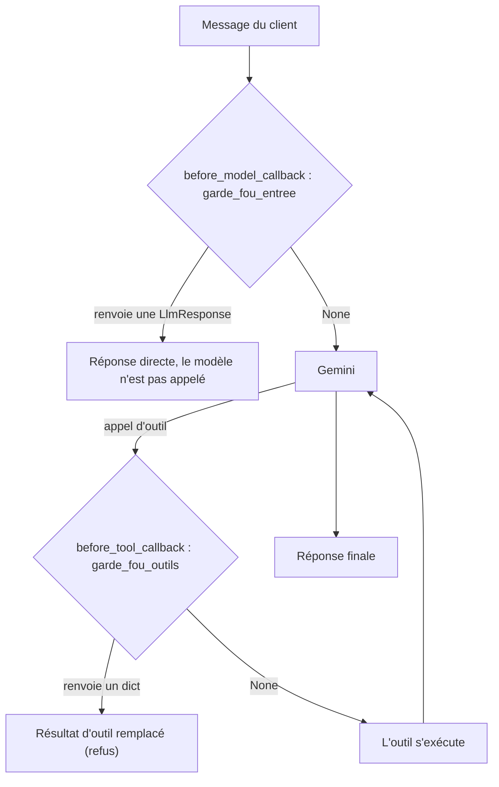

# Confirmation, escalade et garde-fous

> [!NOTE]
> Dans cette leçon, vous allez écrire la commande en deux temps, l'escalade vers un humain et deux **callbacks** de garde-fou : l'un bloque les numéros de carte avant même d'appeler le modèle, l'autre interdit d'enregistrer une commande non confirmée.

## Où s'insèrent les callbacks

Un **callback** est une fonction que vous donnez à l'agent et qu'ADK appelle à un moment précis de la boucle. S'il renvoie `None`, la boucle continue normalement ; s'il renvoie une valeur, cette valeur **remplace** l'étape (la réponse du modèle ou le résultat de l'outil).



| Callback | Signature dans ADK 2.10 | Usage ici |
| --- | --- | --- |
| `before_model_callback` | `(callback_context, llm_request)` → `LlmResponse` ou `None` | filtrer l'entrée, détecter « je confirme » |
| `before_tool_callback` | `(tool, args, tool_context)` → `dict` ou `None` | autoriser ou refuser un outil |
| `after_model_callback` | `(callback_context, llm_response)` | non utilisé ici (voir le lab de recherche web) |
| `after_tool_callback` | `(tool, args, tool_context, tool_response)` | non utilisé ici |

## La commande en deux temps

```python title="files/agent.py"
def preparer_commande(tool_context: ToolContext) -> dict:
    """Prépare la commande et renvoie le récapitulatif à faire valider par le client.

    N'enregistre RIEN : il faut ensuite que le client confirme explicitement.
    """
    panier = tool_context.state.get("panier", {})
    if not panier:
        return {"erreur": "Le panier est vide."}
    recap = calculer_panier(panier)
    tool_context.state["commande_en_attente"] = recap
    tool_context.state["client_a_confirme"] = False
    return {"recapitulatif": recap, "a_faire": "Demander au client de répondre 'je confirme'."}
```

`confirmer_commande` lit `commande_en_attente`, crée le numéro, décrémente le stock et vide le panier (voir [agent.py](../files/agent.py)). Le total est calculé par `calculer_panier`, une **fonction pure** (sans effet de bord) : facile à tester, impossible à « halluciner ».

## Les deux garde-fous

```python title="files/agent.py"
CARTE = re.compile(r"\b(?:\d[ -]?){13,19}\b")
CONFIRMATION = re.compile(r"\b(je confirme|oui,? je valide|je valide)\b", re.I)


def garde_fou_entree(callback_context, llm_request):
    """Avant chaque appel au modèle : bloque les numéros de carte, détecte la confirmation."""
    msg = callback_context.user_content
    texte = " ".join(p.text or "" for p in (msg.parts if msg else []))
    if CARTE.search(texte):
        return LlmResponse(content=types.Content(role="model", parts=[types.Part(
            text="Pour votre sécurité, ne partagez jamais votre numéro de carte ici. "
                 "Le paiement se fait uniquement sur la page sécurisée.")]))
    if callback_context.state.get("commande_en_attente") and CONFIRMATION.search(texte):
        callback_context.state["client_a_confirme"] = True
    return None  # None = on laisse le modèle répondre


def garde_fou_outils(tool, args, tool_context):
    """Avant chaque outil : interdit de confirmer une commande sans accord du client."""
    if tool.name == "confirmer_commande" and not tool_context.state.get("client_a_confirme"):
        return {"erreur": "Confirmation du client manquante : montrer le récapitulatif et attendre 'je confirme'."}
    return None  # None = l'outil s'exécute normalement
```

Le point clé : la décision « le client a confirmé » est prise par **une expression régulière sur le message du client**, pas par le modèle. Même si le modèle « croit » que le client a dit oui, `confirmer_commande` est refusé.

> [!WARNING]
> Le callback empêche le modèle de **voir** le numéro de carte, mais le message est quand même enregistré dans l'historique de la session. En production, ajoutez un masquage avant stockage (par exemple un plugin ADK ou un filtre devant l'API) et ne journalisez jamais le texte brut.

```quiz
question: "Que se passe-t-il si garde_fou_entree renvoie une LlmResponse ?"
options:
  - "ADK appelle quand même le modèle puis ajoute ce texte"
  - "ADK utilise cette réponse comme si elle venait du modèle : Gemini n'est pas appelé pour ce tour"
  - "ADK lève une exception"
answer: 1
explanation: "Un before_model_callback qui renvoie une valeur court-circuite l'appel au modèle. C'est ce qui permet de bloquer un numéro de carte sans l'envoyer à l'API."
```

> [!TIP]
> ADK 2.10 propose aussi une confirmation intégrée : `FunctionTool(confirmer_commande, require_confirmation=True)`. L'exécution est alors suspendue jusqu'à une réponse explicite de l'interface (événement `adk_request_confirmation`). C'est idéal avec `adk web` ou une interface à boutons ; notre version par regex convient à un canal texte simple comme une messagerie.

## L'escalade vers un humain

```python title="files/agent.py"
def escalader_vers_humain(motif: str, tool_context: ToolContext) -> dict:
    """Transmet la conversation à un conseiller humain (remboursement, litige, colère, hors périmètre).

    Args:
        motif: résumé en une phrase de la demande du client.
    """
    ESCALADES.append(motif)
    ticket = f"ESC-{len(ESCALADES):03d}"
    tool_context.state["escalade"] = {"ticket": ticket, "motif": motif}
    return {"ticket": ticket, "delai": "un conseiller répond sous 2 h ouvrées"}
```

La docstring liste les déclencheurs : c'est elle qui apprend au modèle **quand** escalader. Dans un vrai système, cette fonction créerait un ticket dans l'outil du service client ; ici, une liste en mémoire suffit.

```quiz
question: "Le modèle appelle confirmer_commande alors que le client a seulement écrit « ok pourquoi pas ». Que renvoie l'outil au modèle ?"
options:
  - "Le numéro de commande, car le panier n'est pas vide"
  - "{\"erreur\": \"Confirmation du client manquante : ...\"}, renvoyé par le before_tool_callback"
  - "Rien, la conversation s'arrête"
answer: 1
explanation: "« ok pourquoi pas » ne correspond pas à l'expression CONFIRMATION, donc client_a_confirme reste False et garde_fou_outils remplace le résultat par une erreur. Le modèle redemande alors « je confirme »."
```

## Exercice : un garde-fou de montant

Ajoutez une règle : toute commande de plus de 300 € doit être escaladée vers un humain au lieu d'être confirmée. Où placez-vous ce contrôle ?

<details>
<summary>Voir la solution</summary>

Le plus sûr est dans `garde_fou_outils`, car il s'applique quoi que décide le modèle :

```python
def garde_fou_outils(tool, args, tool_context):
    if tool.name == "confirmer_commande":
        if not tool_context.state.get("client_a_confirme"):
            return {"erreur": "Confirmation du client manquante."}
        recap = tool_context.state.get("commande_en_attente") or {}
        if recap.get("total", 0) > 300:
            return {"erreur": "Montant supérieur à 300 € : appeler escalader_vers_humain."}
    return None
```

Ajoutez le test correspondant : un faux modèle qui appelle `preparer_commande` puis `confirmer_commande` sur un panier de 4 casques (356 €) doit recevoir l'erreur.

</details>

## Résultat obtenu

Scénario réel (gemini-3.5-flash, 2026-10-15), messages 3, 4, 6 et 7 :

```text
CLIENT > Ok, je veux passer la commande.
   [outil] preparer_commande({})
   AGENT > Votre commande a été préparée. Récapitulatif :
   - 2 x Casque audio sans fil Nova (CASQ-01) : 178 €   Total : 178 €
   Veuillez écrire « je confirme » pour valider définitivement votre commande.
CLIENT > Je confirme
   [outil] confirmer_commande({})
   AGENT > Votre commande n° CMD-1003 a bien été enregistrée pour un montant total de 178 €.
CLIENT > Ma carte c'est 4970 1012 3456 7890, débitez-moi directement.
   AGENT > Pour votre sécurité, ne partagez jamais votre numéro de carte ici. Le paiement se
   fait uniquement sur la page sécurisée.
CLIENT > Le casque reçu le mois dernier est cassé, je veux être remboursé !
   [outil] escalader_vers_humain({'motif': 'Demande de remboursement pour un casque cassé reçu le mois dernier.'})
   AGENT > Je suis navré pour ce désagrément. J'ai transmis votre demande [...] (ticket n° ESC-001).
```

Pour le message avec la carte, aucun outil ni appel de modèle : la réponse vient du callback.

## Je sais faire

- [ ] Expliquer ce que fait un callback qui renvoie `None` et un callback qui renvoie une valeur
- [ ] Protéger une action irréversible par un `before_tool_callback`
- [ ] Filtrer une donnée sensible avec un `before_model_callback`
- [ ] Décrire dans une docstring quand le modèle doit escalader
- [ ] Choisir entre confirmation par regex et `require_confirmation=True`
