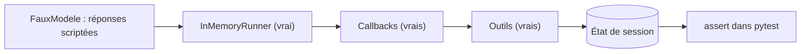

# Tester sans clé, puis en réel, et exploiter

> [!NOTE]
> Dans cette leçon, vous allez tester l'agent **sans clé d'API** grâce à un faux modèle qui pilote le vrai `Runner` ADK, lancer le scénario réel avec Gemini, ouvrir l'interface `adk web`, puis voir ce qui change pour passer en production.

## Deux niveaux de tests

| | Tests sans clé (`pytest`) | Scénario réel (`python run.py`) |
| --- | --- | --- |
| Modèle | `FauxModele` : réponses écrites d'avance | Gemini (`gemini-3.5-flash`) |
| Ce qu'on vérifie | les outils, l'état, **les garde-fous** | que le modèle choisit les bons outils et répond bien |
| Coût, durée | gratuit, environ 1 s | quelques appels de modèle, quelques dizaines de secondes |
| Déterministe ? | oui, à lancer à chaque modification | non : à relire, à lancer avant une mise en production |

## Le faux modèle

Dans ADK, un modèle est un objet `BaseLlm` qui transforme une requête en réponse. On en écrit un qui rejoue une liste de réponses : appels d'outils ou texte.

```python title="files/test_agent.py"
class FauxModele(BaseLlm):
    """Rejoue une liste de réponses écrites d'avance, une par appel au modèle."""
    reponses: list

    async def generate_content_async(self, llm_request, stream=False):
        yield self.reponses.pop(0)


def appel(nom, **args):
    return LlmResponse(content=types.Content(role="model", parts=[
        types.Part(function_call=types.FunctionCall(name=nom, args=args))]))
```

Le vrai `InMemoryRunner` exécute ensuite les vrais outils et les vrais callbacks. On peut donc simuler un modèle **qui se trompe** et vérifier que le garde-fou tient :

```python title="files/test_agent.py"
def test_garde_fou_bloque_confirmation_sans_accord():
    # Le modèle « oublie » de demander l'accord et confirme tout de suite : le callback l'en empêche.
    sorties, etat = discuter(
        [appel("preparer_commande"), appel("confirmer_commande"), texte("...")],
        ["Commande mon panier"], etat={"panier": {"ENC-01": 1}})
    assert sorties[1][0] == "confirmer_commande" and "Confirmation du client manquante" in sorties[1][1]["erreur"]
    assert etat["panier"] == {"ENC-01": 1}  # rien n'a été commandé
```



> [!TIP]
> Le test `test_numero_de_carte_bloque_sans_appeler_le_modele` passe une liste de réponses **vide** : si le modèle était appelé, `pop(0)` lèverait une erreur. C'est une façon simple de prouver qu'un callback a court-circuité le modèle.

```quiz
question: "Que prouve test_garde_fou_bloque_confirmation_sans_accord que le scénario réel ne peut pas prouver ?"
options:
  - "Que Gemini répond en français"
  - "Que même un modèle qui appelle confirmer_commande trop tôt ne peut pas enregistrer de commande"
  - "Que la clé d'API est valide"
answer: 1
explanation: "Avec le vrai modèle, on espère qu'il demande l'accord ; mais on ne peut pas le forcer à se tromper pour tester le filet de sécurité. Le faux modèle, lui, simule exactement l'erreur à rattraper."
```

## Lancer les tests et le scénario

```bash
cd files
pytest -q                 # 7 tests, aucune clé nécessaire
python run.py             # scénario de 7 messages avec le vrai modèle
```

`run.py` réessaie automatiquement sur les erreurs 429 (quota) et 503 (surcharge), avec une attente croissante.

## L'interface de développement `adk web`

ADK fournit une interface web pour discuter avec l'agent et inspecter chaque événement (appels d'outils, `state`, callbacks). Elle attend un dossier **parent** qui contient un sous-dossier par agent, chacun avec un `agent.py` définissant `root_agent` :

```bash
mkdir -p mes_agents && cp -r files mes_agents/boutique
cd mes_agents && adk web          # puis ouvrez http://localhost:8000 et choisissez « boutique »
```

## Passer en production

| Sujet | Dans ce lab | En production |
| --- | --- | --- |
| Sessions | `InMemoryRunner`, perdues à l'arrêt | `DatabaseSessionService` (SQL, extra `pip install "google-adk[db]"`) ou sessions Vertex AI |
| Catalogue et commandes | dictionnaires Python | appels à votre API ou base de données (mêmes signatures d'outils) |
| Numéro de commande | compteur en mémoire | généré par la base, avec une clé d'idempotence |
| Modèle | clé d'API Gemini | Vertex AI : `GOOGLE_GENAI_USE_VERTEXAI=TRUE`, `GOOGLE_CLOUD_PROJECT`, `GOOGLE_CLOUD_LOCATION` |
| Hébergement | votre poste | `adk deploy cloud_run --project <projet> --region <région> mes_agents/boutique` |
| Surveillance | `print` | traces OpenTelemetry d'ADK, taux d'escalade, commandes refusées par le garde-fou |

> [!WARNING]
> `COMMANDES`, `CATALOGUE` et `ESCALADES` sont des variables globales : partagées par toutes les sessions d'un même processus et perdues au redémarrage. C'est voulu pour un lab, inacceptable en production.

```quiz
question: "Vous passez de la clé d'API à Vertex AI. Que devez-vous modifier dans agent.py ?"
options:
  - "Tout réécrire avec le SDK Vertex AI"
  - "Rien : seules les variables d'environnement changent"
  - "Remplacer Agent par VertexAgent"
answer: 1
explanation: "ADK passe par le SDK google-genai, qui choisit l'API Gemini ou Vertex AI selon GOOGLE_GENAI_USE_VERTEXAI. Vérifiez seulement que le modèle choisi est disponible dans votre région Vertex AI."
```

## Exercice : un test pour le stock insuffisant

Écrivez un test sans clé qui vérifie qu'on ne peut pas ajouter 3 chargeurs `CHG-01` alors que le stock est de 5 et que le panier en contient déjà 3.

<details>
<summary>Voir la solution</summary>

```python
def test_stock_insuffisant():
    sorties, etat = discuter(
        [appel("ajouter_au_panier", sku="CHG-01", quantite=3), texte("Désolé.")],
        ["Ajoute 3 chargeurs"], etat={"panier": {"CHG-01": 3}})
    assert sorties[0][1]["erreur"].startswith("Quantité refusée")
    assert etat["panier"] == {"CHG-01": 3}
```

Le total demandé (6) dépasse d'abord le plafond de 5 unités, donc c'est ce message qui sort, avant même le contrôle du stock. Pour tester le message « Stock insuffisant », partez d'un panier vide et d'un produit dont le stock est inférieur à 5 (modifiez `CATALOGUE` dans le test).

</details>

## Résultat obtenu

Tests sans clé, 2026-10-15 :

```text
test_agent.py::test_fonctions_pures PASSED
test_agent.py::test_panier_dans_etat_de_session PASSED
test_agent.py::test_quantite_plafonnee PASSED
test_agent.py::test_garde_fou_bloque_confirmation_sans_accord PASSED
test_agent.py::test_commande_apres_je_confirme PASSED
test_agent.py::test_numero_de_carte_bloque_sans_appeler_le_modele PASSED
test_agent.py::test_escalade PASSED
============================== 7 passed in 1.40s ===============================
```

Fin du scénario réel `python run.py` (gemini-3.5-flash, 2026-10-15) :

```text
CLIENT > Et ma commande CMD-1001, elle arrive quand ?
   [outil] statut_livraison({'numero_commande': 'CMD-1001'})
   AGENT > Votre commande CMD-1001 a été expédiée via Colis Express. La livraison est prévue
   pour le 17 octobre 2026.
[...]
ÉTAT FINAL : {'panier': {}, 'derniere_commande': 'CMD-1003', 'escalade': {'ticket': 'ESC-001',
'motif': 'Demande de remboursement pour un casque cassé reçu le mois dernier.'}}
```

## Je sais faire

- [ ] Écrire un faux modèle `BaseLlm` et piloter le vrai `Runner` avec
- [ ] Tester qu'un garde-fou tient même quand le modèle se trompe
- [ ] Lancer un scénario réel avec reprise sur 429/503
- [ ] Ouvrir l'agent dans `adk web`
- [ ] Lister ce qui doit changer pour la production (sessions, données, hébergement)
