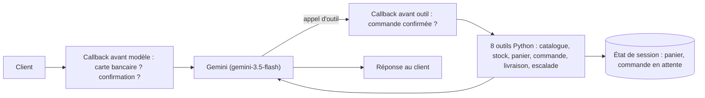

Un client écrit : « Vous avez des casques ? Mettez-m'en deux. » Derrière cette phrase, il faut chercher dans le catalogue, vérifier le stock, remplir un panier, faire valider un total, enregistrer la commande et, si le client se fâche, prévenir un humain. Dans ce lab, vous construisez cet agent avec **Google ADK** (Agent Development Kit, le framework open source de Google pour écrire des agents en Python) et **une simple clé d'API Gemini**.

La boutique, « Atelier Son », est fictive, tout comme ses produits et ses commandes.

## Pour qui ?

- Développeurs Python à l'aise avec les fonctions, les dictionnaires et `pip`.
- Vous savez ce qu'est un appel d'outil (function calling) ; sinon, la leçon 1 le rappelle en deux phrases.
- Aucun projet Google Cloud nécessaire.

## Ce que vous construisez

## Prérequis

- Python 3.10 ou plus récent.
- Une clé d'API Gemini créée dans Google AI Studio (gratuite pour démarrer).
- 15 minutes pour installer : `pip install -r files/requirements.txt`.

## Programme

| Module | Leçon | Ce que vous faites | Durée |
| --- | --- | --- | --- |
| 1. Cas d'usage | [Le cas d'usage et l'architecture](./01-cas-d-usage/01-cas-d-usage-et-architecture.md) | Délimiter ce que l'agent a le droit de faire, dessiner le flux | 30 min |
| 2. Construire | [Outils et état de session](./02-construire/01-outils-et-etat-de-session.md) | Écrire les outils, le panier dans `state` | 40 min |
| 2. Construire | [Confirmation, escalade, garde-fous](./02-construire/02-confirmation-escalade-et-garde-fous.md) | Commande en deux temps, callbacks | 40 min |
| 3. Tester et exploiter | [Tester sans clé, puis en réel](./03-tester-et-exploiter/01-tester-et-exploiter.md) | Faux modèle, scénario réel, `adk web`, pistes de production | 40 min |

## Le code

Tout est dans [files/](./files/) : [agent.py](./files/agent.py) (l'agent), [run.py](./files/run.py) (scénario réel), [test_agent.py](./files/test_agent.py) (7 tests sans clé), [requirements.txt](./files/requirements.txt) et `.env.example` (modèle de configuration à copier en `.env`).

## En local ou sur Google Cloud ?

| | En local (ce lab) | Sur Google Cloud (piste) |
| --- | --- | --- |
| Modèle | API Gemini avec une clé (`GOOGLE_API_KEY`) | Vertex AI (`GOOGLE_GENAI_USE_VERTEXAI=TRUE`, projet et région) |
| Sessions | `InMemoryRunner` : tout disparaît à l'arrêt | service de sessions persistant (base de données ou Vertex AI) |
| Exposition | `python run.py` ou `adk web` | `adk deploy cloud_run` |
| Coût | quelques appels de modèle | Cloud Run + modèle |

Le code de l'agent est **identique** dans les deux cas : seules les variables d'environnement et le service de sessions changent. Ce lab a été testé de bout en bout en local le 2026-10-15 ; la partie Google Cloud est décrite mais n'a pas été déployée ici.
