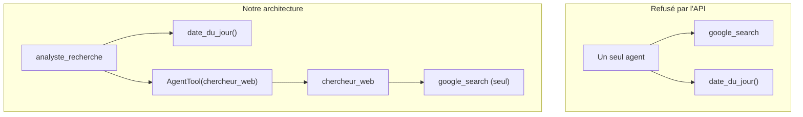

# Le cas d'usage et l'architecture

> [!NOTE]
> Dans cette leçon, vous allez comprendre ce qu'est l'**ancrage** (grounding) avec Google Search, pourquoi un rapport de veille doit citer des sources vérifiables et comment s'organise un agent qui combine recherche web et outils maison.

## Le besoin

Une équipe produit veut chaque semaine une note courte : « Qu'est-ce qui a changé sur tel sujet ? ». Elle exige trois choses :

1. des faits **récents** (le modèle seul s'arrête à sa date d'entraînement) ;
2. des **sources** cliquables pour vérifier chaque point ;
3. un format **stable** : synthèse, points clés, incertitudes.

## L'ancrage avec Google Search

L'**ancrage** consiste à appuyer la réponse du modèle sur des documents extérieurs. Avec l'outil intégré `google_search`, c'est Gemini qui décide de lancer des requêtes Google, lit les résultats et rédige sa réponse. Votre code ne fait aucune requête web : il reçoit la réponse **et** des métadonnées :

| Champ de `grounding_metadata` | Contenu |
| --- | --- |
| `web_search_queries` | les requêtes réellement lancées |
| `grounding_chunks` | les pages utilisées (`web.title`, `web.uri`) |
| `grounding_supports` | quels passages de la réponse s'appuient sur quelles pages |
| `search_entry_point` | un bloc HTML de suggestions de recherche à afficher (règles d'usage de Google) |

```quiz
question: "Avec l'outil intégré google_search, qui exécute la recherche Google ?"
options:
  - "Votre code Python, via une bibliothèque HTTP"
  - "Le service Gemini lui-même, côté Google, pendant la génération"
  - "ADK, qui télécharge les pages puis les envoie au modèle"
answer: 1
explanation: "C'est un outil « intégré » (built-in) : il s'exécute côté serveur, dans l'appel au modèle. Vous recevez le texte final et les métadonnées d'ancrage, sans écrire de code de recherche."
```

## La contrainte : un outil intégré ne se mélange pas librement

Notre agent a besoin de `google_search` **et** d'une fonction maison (`date_du_jour`). Or la documentation d'ADK (page « Tool limitations ») indique que certains outils intégrés, dont Google Search et l'exécution de code, ne peuvent pas être combinés avec d'autres outils dans un même agent. Nous l'avons vérifié avec ADK 2.10 et gemini-3.5-flash : l'API refuse la requête (leçon suivante, erreur 400 réelle).

La solution recommandée : **plusieurs agents**.



`AgentTool` emballe un agent pour qu'il apparaisse comme **un outil fonction** aux yeux de l'agent principal. L'agent principal ne voit donc que des fonctions : la contrainte est respectée.

```quiz
question: "Pourquoi AgentTool résout-il la contrainte ?"
options:
  - "Parce qu'il désactive google_search"
  - "Parce que chaque agent fait son propre appel au modèle : le chercheur n'a que google_search, l'agent principal n'a que des outils fonction"
  - "Parce qu'il passe par une autre API que Gemini"
answer: 1
explanation: "La contrainte porte sur une requête au modèle. Avec AgentTool, il y a deux requêtes distinctes, chacune avec un type d'outils homogène."
```

## Le parcours d'une question

1. L'agent principal appelle `date_du_jour` pour situer « dernières nouveautés ».
2. Il découpe la question en 2 ou 3 sous-questions et appelle `chercheur_web` pour chacune.
3. Un **callback** sur le chercheur relève les pages réellement utilisées, les numérote et les ajoute au texte renvoyé.
4. L'agent principal rédige le rapport en citant les numéros `[n]`.
5. `run.py` ajoute la liste des sources depuis l'état de session : **ce n'est pas le modèle qui écrit les URL**.

> [!WARNING]
> Ne demandez jamais au modèle d'écrire lui-même les URL de ses sources : il peut en inventer de parfaitement plausibles. Prenez-les dans `grounding_metadata`.

## Exercice : choisir l'architecture

Pour chacun de ces besoins, dites si un seul agent suffit ou s'il faut un sous-agent : (a) recherche web seule, réponse en texte ; (b) recherche web + enregistrement du rapport dans un fichier via une fonction ; (c) exécution de code seule sur des données fournies.

<details>
<summary>Voir la solution</summary>

- (a) **Un seul agent** avec `tools=[google_search]`.
- (b) **Sous-agent** : la fonction d'enregistrement est un outil maison, elle ne peut pas cohabiter avec `google_search`. Agent principal avec `[enregistrer_rapport, AgentTool(chercheur)]`. Variante : enregistrer le fichier dans `run.py`, après l'agent, sans outil du tout.
- (c) **Un seul agent** avec `code_executor=BuiltInCodeExecutor()` (voir le lab « Analyste de données CSV »).

</details>

## Résultat obtenu

Premiers événements du run réel `python run.py` (gemini-3.5-flash, 2026-10-15) : l'agent principal appelle la fonction puis trois fois le sous-agent.

```text
[outil] date_du_jour({})
[outil] chercheur_web({'request': 'Google Agent Development Kit ADK dernieres nouveautes annonces fonctionnalités'})
[outil] chercheur_web({'request': 'Google Agent Developer Kit ADK features updates Vertex AI Firebase'})
[outil] chercheur_web({'request': 'Google ADK Agent Development Kit documentation framework release notes'})
```

## Je sais faire

- [ ] Expliquer ce qu'est l'ancrage et ce que contiennent les métadonnées d'ancrage
- [ ] Citer la contrainte des outils intégrés dans ADK
- [ ] Dessiner une architecture agent principal + `AgentTool` + sous-agent de recherche
- [ ] Expliquer pourquoi les URL viennent des métadonnées et pas du modèle
